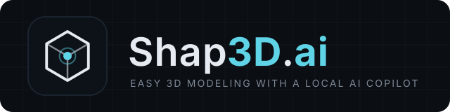
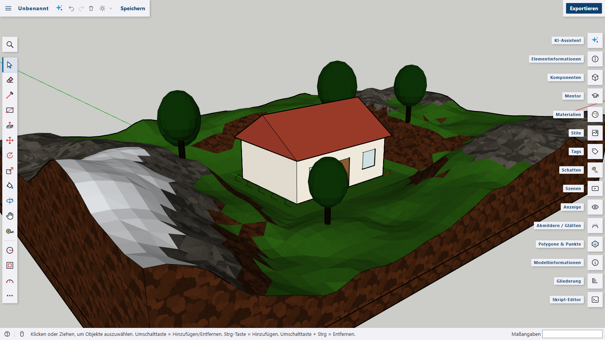

<p align="center">
  
</p>

<p align="center">
  <b>Easy 3D modeling in the browser or as a native desktop app – with a local AI copilot.</b><br>
  Sketch, push/pull, script and sculpt terrain – everything runs on your own machine.
</p>

<p align="center">
  pronounced <b>“shaped AI”</b> &nbsp;/ʃeɪpt eɪ aɪ/</sub>
</p>

<p align="center">
  
  
  
  
  
  
  
  <a href="LICENSE"></a>
</p>



> **Inspired by SketchUp – not affiliated with it.** Shap3D.ai is an independent project written from scratch.
> Its push/pull workflow and the look of its interface are inspired by SketchUp, but it contains no SketchUp code
> or assets. See [Legal notice](docs/wiki/credits-and-legal.md#legal-notice).

## Highlights

- **Push/pull modeling** in the browser or as a [native desktop app](docs/wiki/getting-started.md#desktop-app-tauri) – faces, edges, groups, components, inference snapping and solid tools. [More features](docs/wiki/features.md)
- **AI that runs on your machine** – Ollama, LM Studio or LiteLLM write modeling scripts or generate meshes. No cloud, no API keys. [Local AI copilot](docs/wiki/ai.md)
- **Scriptable** – the `s3d` JavaScript API with 44 commands, 52 materials, code completion and an in-app reference. [Scripting](docs/wiki/scripting.md)
- **Terrain sculpting, polygon inspector and measuring aids** – brushes for landscapes, segment counts for round shapes, zoom-dependent rulers and grid. [Features](docs/wiki/features.md)
- **Command palette** – <kbd>Ctrl</kbd>+<kbd>Shift</kbd>+<kbd>P</kbd> finds every tool, command, material, scene and object. [Command palette](docs/wiki/features.md#command-palette)
- **Import from SketchUp, Blender, 3ds Max and more** – SKP, BLEND, FBX, DAE, OBJ, STL, glTF, 3MF, USD … and IFC with a plugin. [Importing](docs/wiki/import.md)
- **Plugins** – commands, tools, panels, script commands, file formats and whole workspaces, plus packages for OpenSCAD, IFC, LayOut sheets, a room planner and shader materials. [Writing plugins](docs/wiki/plugins.md) · [Plugin packages](docs/wiki/plugin-packages.md)
- **Remote control** – REST API, Swagger UI and an MCP server for AI agents such as Claude Code. [Remote API](docs/wiki/remote-api.md)
- **Dark mode with a night scene** and the interface in English, German, French, Spanish or Arabic. [Languages](docs/wiki/languages.md)

## Quick start

Requirements: **Node.js 20.19+ or 22.12+** and a current Chromium, Firefox or Safari.

```bash
npm ci
npm run dev
```

Open <http://localhost:5173>. On the first start the welcome tour opens.

```bash
npm run build     # production build in dist/
npm run preview   # serve the build locally
```

Docker, the desktop app and more: [Getting started](docs/wiki/getting-started.md).

## Documentation

The details live in the [wiki](docs/wiki/README.md):

|                                                            |                                                                                      |
| ---------------------------------------------------------- | ------------------------------------------------------------------------------------ |
| [Getting started](docs/wiki/getting-started.md)            | install, Docker, desktop app (Tauri)                                                 |
| [Features](docs/wiki/features.md)                          | modeling, terrain, polygon inspector, command palette, measuring, keyboard shortcuts |
| [Local AI copilot](docs/wiki/ai.md)                        | code and mesh models, connecting a local AI server                                   |
| [Scripting](docs/wiki/scripting.md)                        | script editor and the `s3d` API                                                      |
| [Importing](docs/wiki/import.md)                           | SketchUp, Blender, 3ds Max, BIM and other formats                                    |
| [Languages and translations](docs/wiki/languages.md)       | language switch, translation editor, language files                                  |
| [Remote control](docs/wiki/remote-api.md)                  | REST API, Swagger UI and MCP                                                         |
| [Writing plugins](docs/wiki/plugins.md)                    | plugin modules, the `context` API, built-in plugins                                  |
| [Plugin packages](docs/wiki/plugin-packages.md)            | OpenSCAD, IFC, LayOut, room planner, shader materials                                |
| [Contributing](CONTRIBUTING.md)                            | where changes belong, code style, texts, versions, checks                            |
| [Development](docs/wiki/development.md)                    | linting, releases, project structure, screenshots                                    |
| [Credits and legal notice](docs/wiki/credits-and-legal.md) | third-party code and assets, trademarks                                              |

Changes are listed in the [CHANGELOG](CHANGELOG.md).

## License

Shap3D.ai is licensed under the **Apache License 2.0** – see [LICENSE](LICENSE) and [NOTICE](NOTICE).

Bundled third-party assets keep their own licenses (fonts: MgOpen license, reference people: CC0), as listed in [NOTICE](NOTICE) and under [Credits](docs/wiki/credits-and-legal.md#credits).
