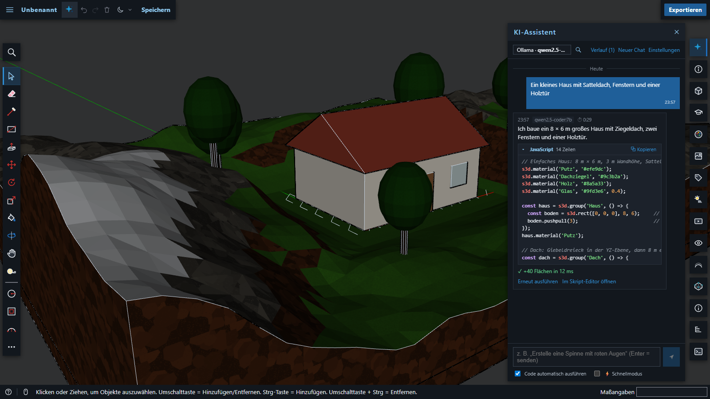
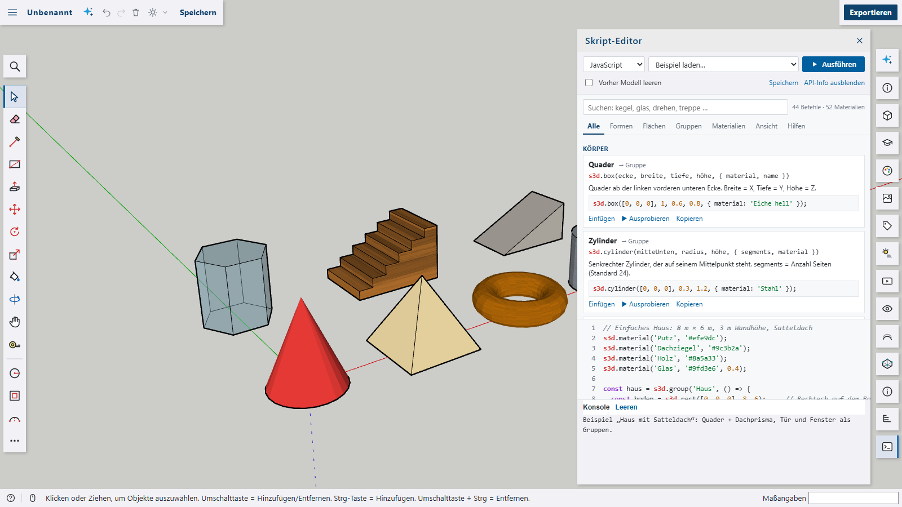
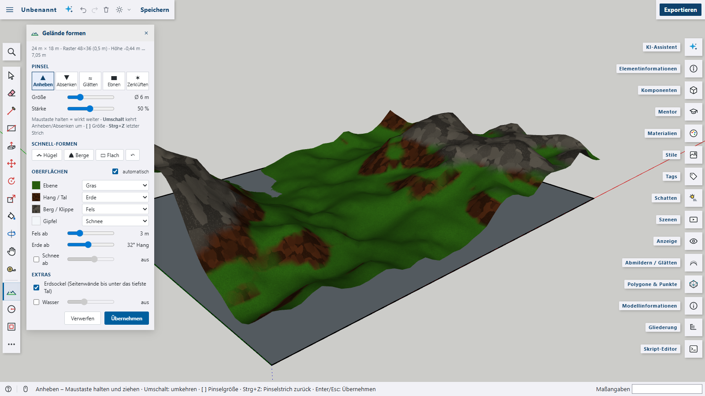
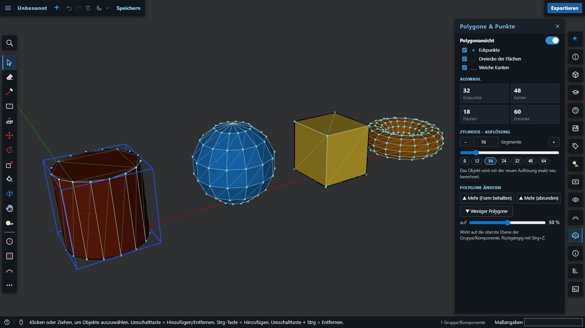
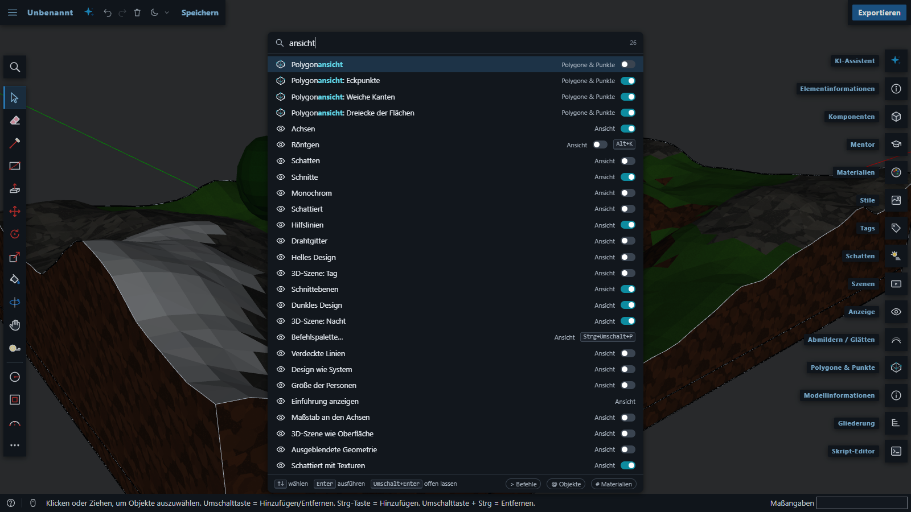
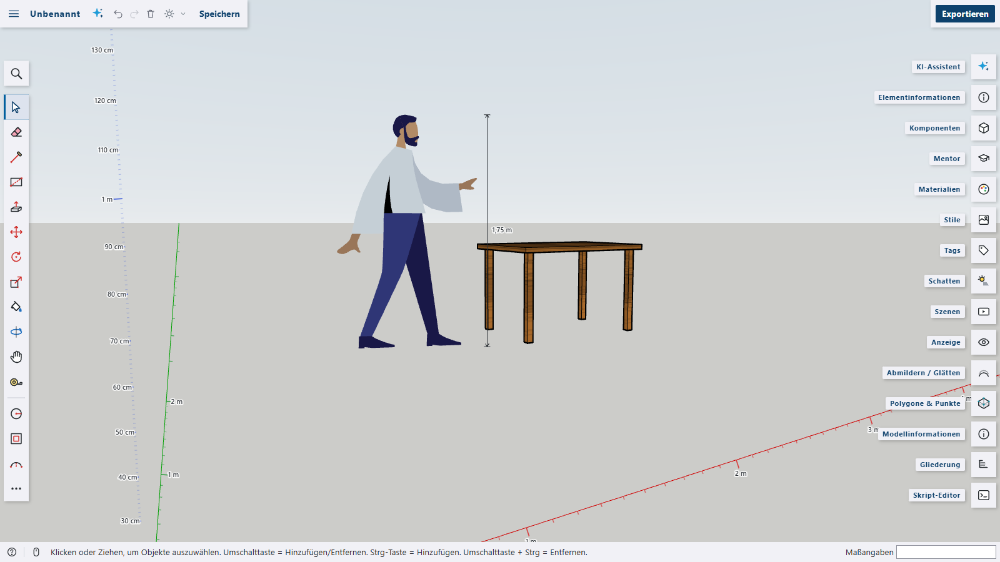
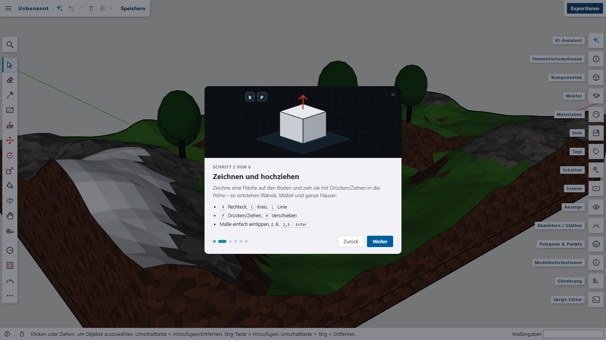
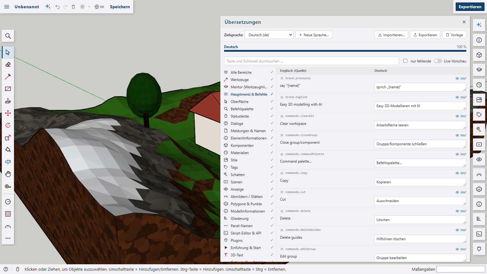

<p align="center">
  
</p>

<p align="center">
  <b>Easy 3D modeling in the browser – with a local AI copilot.</b><br>
  Sketch, push/pull, script and sculpt terrain – everything runs on your own machine.
</p>

<p align="center">
  pronounced <b>“shaped AI”</b> &nbsp;/ʃeɪpt eɪ aɪ/</sub>
</p>

<p align="center">
  
  
  
  
  
  
  <a href="LICENSE"></a>
</p>


> **Inspired by SketchUp – not affiliated with it.** Shap3D.ai is an independent project written from scratch.
> Its push/pull workflow and the look of its interface are inspired by SketchUp, but it contains no SketchUp code
> or assets. See [Legal notice](#legal-notice).

---

## Contents

- [Contents](#contents)
- [Highlights](#highlights)
- [Features](#features)
  - [Direct modeling](#direct-modeling)
  - [Local AI copilot](#local-ai-copilot)
  - [Script editor and the `s3d` API](#script-editor-and-the-s3d-api)
  - [Terrain editor](#terrain-editor)
  - [Polygon inspector](#polygon-inspector)
  - [Command palette](#command-palette)
  - [Measuring: rulers on the axes and people with their height](#measuring-rulers-on-the-axes-and-people-with-their-height)
  - [Welcome tour](#welcome-tour)
  - [Dark mode and night scene](#dark-mode-and-night-scene)
  - [Languages and translations](#languages-and-translations)
- [Getting started](#getting-started)
- [Keyboard shortcuts](#keyboard-shortcuts)
- [Importing from SketchUp, Blender, 3ds Max and others](#importing-from-sketchup-blender-3ds-max-and-others)
- [Connecting a local AI model](#connecting-a-local-ai-model)
- [Scripting example](#scripting-example)
- [Writing plugins](#writing-plugins)
  - [The `context` API](#the-context-api)
  - [Texts and languages in plugins](#texts-and-languages-in-plugins)
  - [Built-in plugins](#built-in-plugins)
  - [Plugin packages](#plugin-packages)
- [Multilingual: language files for developers](#multilingual-language-files-for-developers)
  - [The OpenSCAD plugin](#the-openscad-plugin)
- [Project structure](#project-structure)
- [Regenerating the screenshots](#regenerating-the-screenshots)
- [Credits](#credits)
- [Legal notice](#legal-notice)
- [License](#license)

## Highlights

- **Push/pull modeling in the browser** – a real boundary-representation kernel with faces, edges, groups and components, inference snapping and solid tools.
- **AI that runs on your machine** – talk to Ollama, LM Studio or LiteLLM. The assistant writes modeling scripts, or a mesh model such as LLaMA-Mesh generates geometry directly. No cloud, no API keys.
- **Scriptable** – a small JavaScript API (`s3d.box(…)`, `s3d.terrain(…)`, …) with 44 documented commands, 52 ready-made materials and a searchable in-app reference.
- **Terrain sculpting** – raise, lower, smooth and flatten landscapes with a brush. Grass, earth, rock and snow are painted automatically.
- **Polygon inspector** – see every vertex and triangle, change the segment count of round shapes, subdivide or simplify any mesh.
- **Command palette like in VS Code or IntelliJ** – <kbd>Ctrl</kbd>+<kbd>Shift</kbd>+<kbd>P</kbd>, <kbd>F1</kbd> or <kbd>Shift</kbd> twice finds every tool, command, panel, switch, material, scene and object in one fuzzy search.
- **Measuring aids** – rulers on the axes that switch from metres to centimetres to millimetres as you zoom in, an infinite ground grid whose spacing follows the zoom, and reference people that show their height.
- **Plugin system** – extend the app with plain JavaScript modules or whole plugin packages: commands, tools, panels, script commands and languages, file importers and exporters, overlay drawings. Three examples are included, plus an **OpenSCAD plugin** that runs the real OpenSCAD in the browser.
- **Welcome tour** – six short animated steps on the first start, available again any time from the menu.
- **Dark mode with a real night scene**, a split button for every combination, and an English or German user interface.

## Features

### Direct modeling

The toolset follows the familiar push/pull workflow: draw a shape, pull it into 3D, refine it.

| Area | What you get |
| --- | --- |
| Drawing | Line, freehand, rectangle, rotated rectangle, circle, polygon, three arc tools, pie, 3D text in 16 fonts (plus your own) |
| Modifying | Push/pull, offset, move/copy, rotate, scale, follow me, flip, eraser, paint bucket |
| Precision | Inference engine (endpoints, midpoints, edges, faces, axis and parallel locks), measurement box for typed values, tape measure, protractor, dimensions, guides |
| Structure | Groups, reusable components with live instances, tags, outliner, entity info |
| Solids | Union, subtract, intersect, outer shell, trim and split (CSG via `three-bvh-csg`) |
| Presentation | Styles (shaded, textured, monochrome, hidden line, wireframe, X-ray), section planes, scenes, sun shadows, reference people with a height dimension, zoom-dependent rulers on the axes |
| Files | Native `.shap3d.json` files, import from SketchUp, Blender, 3ds Max and more – **SKP, BLEND, FBX, 3DS, DAE, KMZ, OBJ, STL, glTF/GLB, PLY, 3MF, AMF, VRML, USD/USDZ** – with materials, groups and unit detection (menu or drag & drop), export to GLB, glTF, STL, OBJ and PNG, autosave in the browser |

### Local AI copilot



Describe what you want ("a small house with a gable roof, windows and a wooden door") and the assistant builds it in your model as one undoable step.

- **Code models** (Qwen2.5-Coder, Qwen3, Llama 3.1 …) write `s3d` scripts. The system prompt contains the full API reference, typical real-world dimensions and worked examples, and a failed script is sent back to the model automatically so it can fix itself.
- **Mesh models** (LLaMA-Mesh) return raw OBJ geometry, which is imported as a component.
- **Fast mode** uses a compact prompt and short answers for computers without a graphics card. qwen2.5-coder:3b answers in about 25 s on a laptop CPU.
- **Setup wizard and model search**: connect a local server, then browse Hugging Face for GGUF models with size and speed hints and download them through Ollama with live progress, speed and time remaining.
- **Searchable chat history** with timestamps, a live "thinking" timer, syntax-highlighted code with a copy button, and models are unloaded from memory when you switch.

### Script editor and the `s3d` API



Write JavaScript or declarative JSON and run it with <kbd>Ctrl</kbd>+<kbd>Enter</kbd>. Every run is a single undo step.

- **Code completion**: suggestions as you type, like in VS Code – after `s3d.` all API calls (including those added by plugins), the methods of returned groups and faces (also through variables such as `const kiste = s3d.box(…); kiste.`), the option keys of a call inside `{ … }`, and values: all materials with a colour swatch (ready-made and those in the model), textures, fonts, axes, views and units like `'50cm'`. In JSON it suggests `"type"` values and the keys that fit the type; plugin languages such as OpenSCAD bring their own keywords. Opens after `.`, quotes, `{`, `,` and while typing, or with <kbd>Ctrl</kbd>+<kbd>Space</kbd>; arrows choose, <kbd>Enter</kbd>/<kbd>Tab</kbd> insert, <kbd>Esc</kbd> closes.
- **API info**: a searchable reference of all 44 commands with signatures, descriptions and runnable examples. Insert an example at the cursor, or try it right away next to your model.
- **Shapes**: box, cylinder, cone, pyramid, prism, sphere, dome, ellipsoid, tube, torus, wedge, stairs, terrain, 3D text and OBJ meshes, plus faces, push/pull, offset and follow me.
- **Materials**: 52 ready-made materials (woods, stone, metals, glass, nature, fabrics, colours) usable by name, e.g. `{ material: 'Glas' }`, and 12 procedural textures.
- **OBJ mode**: paste raw mesh output (e.g. from LLaMA-Mesh) and it is scaled, oriented and placed for you.
- **Objects as code**: right-click an object (or empty space for the whole model) › *Als Code öffnen ▸* JavaScript, JSON, OBJ or – with the OpenSCAD plugin – OpenSCAD. The geometry is written exactly (`s3d.polyhedron(points, faces)` with holes, materials and nested groups). *Umwandeln in…* in the script editor translates code between these formats without touching the model; *Umwandeln rückgängig* brings the previous code back. OBJ keeps no materials or loose edges, OpenSCAD keeps no loose edges and no group structure, and only closed solids survive an OpenSCAD round trip.

### Terrain editor



Turn a rectangle into a landscape, or start a new terrain from scratch, then sculpt it directly in the 3D view.

- Brushes for **raise, lower, smooth, flatten and roughen**. Hold the mouse to keep working, <kbd>Shift</kbd> inverts, <kbd>[</kbd> <kbd>]</kbd> resize the brush.
- **Automatic surfaces**: grass on flat ground, earth on slopes and in hollows, rock on peaks and cliffs, optional snow. Every layer can use any material.
- Quick hills/mountains, an **earth base** with side walls, and an optional **water level**.
- When you apply, the terrain becomes a normal group. It stays editable later because the height grid is saved with the model.
- The terrain editor is a [built-in plugin](#built-in-plugins) – it can be switched off in the plugin manager.

### Polygon inspector



- Show **vertices, face triangulation and softened edges** for every object, with live counts for the selection or the whole model.
- **Exact resolution** for round shapes: rebuild a cylinder, sphere, cone, torus, tube or dome with more or fewer segments, including circles you have drawn before pushing them up.
- **More polygons** for any object (keep the shape, or round it with Loop subdivision) and **fewer polygons** via edge-collapse simplification.

### Command palette



Press <kbd>Ctrl</kbd>+<kbd>Shift</kbd>+<kbd>P</kbd>, <kbd>F1</kbd>, <kbd>Ctrl</kbd>+<kbd>K</kbd> or <kbd>Shift</kbd> twice (as in IntelliJ) to reach everything in the app from the keyboard.

- **One search for everything**: tools, menu commands, panels, display switches, AI settings, components and reference people, materials (in the model and the whole library), scenes, tags and the objects in your model.
- **Fuzzy matching** with highlighted letters, word starts and German as well as English search words ("dark" finds *Dunkles Design*).
- **Switches show their state**. <kbd>Enter</kbd> runs an entry and closes the palette, <kbd>Shift</kbd>+<kbd>Enter</kbd> runs or toggles it and keeps the palette open.
- **Prefixes** narrow the search: `>` commands, `@` objects in the model (select and zoom to them), `#` materials (pick one and start painting). Recently used entries come first.

### Measuring: rulers on the axes and people with their height



- **Rulers on the axes**: tick marks along the red, green and blue axes. Zoomed out you see whole metres; the closer you get, the finer the scale becomes – 10 cm, centimetres and finally millimetres, with labels wherever there is room.
- **Height of reference people**: every person shows a dimension line with its height, in metres, or in centimetres and millimetres when you are close.
- **Ground grid**: an infinite grid on the XY plane, like in Blender or KiCad. It reaches to the horizon and fades out there, and its spacing follows the zoom – millimetres, centimetres, decimetres, metres, 10 m and beyond, with stronger major lines every tenth line (1/16″, inches and feet for imperial models). The lines through the origin are tinted red and green, the lines along the X and Y axes are labelled when the rulers are off, and a small legend in the lower left shows the current spacing. Faces on the ground always stay in front of it, and geometry always wins: ruler ticks, grid labels and height dimensions behind a model stay hidden.
- All three can be switched on and off in **Anzeige** (Display), in **Menu › Ansicht** or in the command palette.

### Welcome tour



On the very first start a short tour with small animations explains the essentials: drawing and push/pull, navigating, the AI assistant, terrain, scripts and import, and the light/dark look. It can be closed at any step – including the first – with *Überspringen*, ✕ or <kbd>Esc</kbd>, and opened again any time via **Menu › Einführung** or the command palette.

### Dark mode and night scene

The sun/moon split button switches dark mode on and off. Its menu lets you set the interface (light, dark, follow the system) and the 3D scene (day, night, same as the interface) separately. You can have dark menus with a bright model, or turn the whole viewport into a night scene with a night sky, moonlight and light edges.

### Languages and translations

The interface speaks **English** (the source language, always there), **German**, **French**, **Spanish** and **Arabic** (right to left); more languages can be added without touching the code. The 🌐 button next to the light/dark switch (with the current language code) picks the language, as do *Language: …* in **Menu › View** and the command palette. The choice is kept in the browser; on the very first start the browser language is used if there is a language pack for it, otherwise English. Everything switches live, without reloading.



**Translation editor** (🌐 › *Übersetzungen bearbeiten…*, or *Übersetzungen…* in the palette) – all texts grouped by area with the app's icons (tools, main menu, every panel, dialogs, status bar, script editor, …; every plugin is an area of its own), English (the source), German and the target language side by side, search over texts and keys, a *missing only* filter, a progress bar per language and a warning when a translation lacks a `{placeholder}`.

- **Live preview** – while the editor is open the app shows the target language; every keystroke is visible right away. Missing texts fall back to English.
- **Where is this text?** – the 👁 button outlines every element that currently shows the text.
- **New language…** creates an empty language (code, name, writing direction ltr/rtl); **Import…** loads a language file, **Export** saves the target language as JSON, **Template** downloads `template.json`. Languages and changes made in the editor are kept in the browser.

**Numbers and units follow the language** – the decimal separator (`2.5 m` in English and Arabic, `2,5 m` in German, French and Spanish), the unit symbols (Arabic `مم`, `سم`, `م`, `كم`), thousands separators in counts and the plural forms (Arabic has six). The *Measurements* box accepts every form: `2.5m`, `2,5 m`, Arabic-Indic digits `٢٫٥م` and the Arabic separators `٫` and `؛`. Arabic keeps Western digits on screen, as is usual in technical software.

**Right to left** – with Arabic the whole interface runs right to left (menus, panels, dialogs, text). The 3D view, the tool bar and the panel rail keep their places; code, keyboard keys and the *Measurements* box stay left to right.

The languages, the language switch and the editor are the built-in plugin **Sprachen** – switched off, the app is English and the language switch disappears.

## Getting started

Requirements: **Node.js 20.19+ or 22.12+** and a current Chromium, Firefox or Safari.

```bash
npm install
npm run dev
```

Open <http://localhost:5173>. The interface follows the browser language (English, German, French, Spanish or Arabic, switchable with 🌐 at the top). On the first start the welcome tour opens.

The 3D view needs WebGL. If the browser has turned it off (for example after a graphics driver crash), the app shows a short help page instead of the loading screen.

```bash
npm run build     # production build in dist/
npm run preview   # serve the build locally
```

Linting and formatting use [oxlint](https://oxc.rs/docs/guide/usage/linter) and [oxfmt](https://oxc.rs/docs/guide/usage/formatter) from the Oxc project. They cover `src/`, `scripts/` and `plugins/openscad/src/`. The settings are in `.oxlintrc.json` and `.oxfmtrc.json`: every `if`/`else`/loop body gets braces and its own lines, with 2-space indent, single quotes, semicolons and a print width of 140.

```bash
npm run lint           # report lint problems
npm run lint:fix       # fix what oxlint can fix automatically
npm run format         # format all files in place
npm run format:check   # only report files that are not formatted
```

Run `lint:fix` before `format`: the fix adds the missing braces, and the formatter then puts the bodies on their own lines. For VS Code, the recommended Oxc extension is listed in `.vscode/extensions.json`.

## Keyboard shortcuts

| Keys | Action |
| --- | --- |
| <kbd>Ctrl</kbd>+<kbd>Shift</kbd>+<kbd>P</kbd>, <kbd>F1</kbd>, <kbd>Ctrl</kbd>+<kbd>K</kbd>, <kbd>Shift</kbd> twice | Command palette |
| <kbd>Space</kbd> <kbd>L</kbd> <kbd>R</kbd> <kbd>C</kbd> <kbd>A</kbd> | Select, line, rectangle, circle, arc |
| <kbd>P</kbd> <kbd>F</kbd> <kbd>M</kbd> <kbd>Q</kbd> <kbd>S</kbd> | Push/pull, offset, move, rotate, scale |
| <kbd>E</kbd> <kbd>B</kbd> <kbd>T</kbd> <kbd>G</kbd> | Eraser, paint bucket, tape measure, make component |
| Middle mouse button, <kbd>Shift</kbd> + middle mouse button, wheel | Orbit, pan, zoom |
| <kbd>Shift</kbd>+<kbd>Z</kbd>, <kbd>Alt</kbd>+<kbd>K</kbd>, <kbd>K</kbd> | Zoom extents, X-ray, back edges |
| <kbd>Ctrl</kbd>+<kbd>Z</kbd> / <kbd>Ctrl</kbd>+<kbd>Y</kbd>, <kbd>Ctrl</kbd>+<kbd>S</kbd> | Undo / redo, save |
| Type a number and <kbd>Enter</kbd> | Exact length, distance or angle while a tool is active |

## Importing from SketchUp, Blender, 3ds Max and others

Drag a file onto the window or use **Menu › Importieren**. Every import becomes one component (one undo step) that sits on the ground at the origin.

| Program / use | Formats | How it works |
| --- | --- | --- |
| **SketchUp** | `.skp` | Through the **official SketchUp SDK** library – no SketchUp installation needed (see [setup](#reading-skp-files)) |
| | `.dae`, `.kmz` | Directly in the browser – SketchUp: **File › Export › 3D Model › COLLADA** |
| **Blender** | `.blend` | **Directly in the browser – no Blender needed.** Built-in reader for Blender 2.79 to 5.x, including compressed files |
| | `.glb` / `.gltf`, `.fbx` | Directly in the browser – Blender: **File › Export** |
| **3ds Max**, Maya, Cinema 4D | `.fbx`, `.3ds`, `.obj` | Directly in the browser. 3ds Max's own `.max` format can only be read by 3ds Max itself – export to FBX there |
| 3D printing | `.stl`, `.3mf`, `.amf` | Directly in the browser (3MF/AMF in millimetres) |
| Scanners, AR, web | `.ply`, `.usdz` / `.usd`, `.wrl` / `.vrml` | Directly in the browser |

OBJ, STL, glTF/GLB and SketchUp are read by the app itself. All other formats in the table come from the [built-in plugin](#built-in-plugins) **Importformate**: its readers (about 400 KB) are only loaded the first time such a file is imported, and it can be switched off in the plugin manager.

What the importer takes care of:

- **Units**: read from the file where it says (Collada `<unit>`, FBX `UnitScaleFactor`, 3MF/AMF millimetres). Otherwise anything bigger than 100 units is treated as centimetres (or millimetres beyond 10,000). The import message tells you which unit was used.
- **Orientation**: Y-up formats are turned to the app's Z-up world.
- **Structure and materials**: every named node becomes its own group, and material colours and transparency are kept. Faces exported twice (front and back, as SketchUp does) become one face with a back material.
- **Limits**: image textures are not imported yet (those materials keep a neutral tone), and imports are capped at 200,000 triangles.

### Blender files

`.blend` files are read by a built-in reader (`src/core/blend/`) that understands Blender's self-describing file format directly, so neither Blender nor a server is needed. It handles:

- **Versions:** Blender 2.79 to 5.x, including the new Blender 5 file header and the 5.0 attribute storage.
- **Compression:** files saved with zstd or gzip.
- **Content:** mesh objects with their transforms (including parents), and material colours and transparency.

Modifiers and geometry nodes are not evaluated – the stored base mesh is imported (apply modifiers in Blender if you need the final shape). Meshes linked from other `.blend` files are skipped with a note. It was tested against the official Blender test files of the Blender Asset Tracer project.

### Reading .skp files

`.skp` is a closed format, so it is read with Trimble's official **SketchUp SDK**. The SDK is just a library; SketchUp itself does not have to be installed. Because a browser cannot load native libraries, the dev/preview server includes a small local converter (`tools/convertBridge.ts` + `tools/skp/skp2glb.py`). It runs the SDK on your computer and hands glTF back to the app; nothing is uploaded anywhere.

1. Download the free SketchUp SDK for your system from [developer.sketchup.com](https://developer.sketchup.com). A Trimble ID and accepting Trimble's SDK terms are required.
2. Unpack it to `tools/sketchup-sdk/`, or point `SKETCHUP_SDK` at the folder. Python 3.8+ must be available as `python`, standard library only.
3. Restart `npm run dev` and drop a `.skp` file onto the window.

Groups, components, transforms and material colours are taken over; the SDK's mesh helper triangulates the faces. Without the SDK the app explains what is missing, and the DAE export always works as a fallback. In a purely static deployment (only `dist/` on a web server) the converter is not available. The SDK is licensed by Trimble and must not be committed to this repository (`tools/sketchup-sdk/` is git-ignored).

## Connecting a local AI model

The AI features are optional and never contact a cloud service. The easiest route is [Ollama](https://ollama.com):

```bash
ollama pull qwen2.5-coder:3b     # fast, works without a GPU
ollama pull qwen2.5-coder:7b     # better results
```

Then click the sparkle icon in the top bar and follow the setup wizard. LM Studio, LiteLLM and any OpenAI-compatible server work too. In development, a small Vite proxy takes care of CORS.

## Scripting example

```js
s3d.material('Holz', '#a0703c');
s3d.terrain([-10, -8, 0], 30, 24, { hills: 4, snow: 3.5, water: 0.2 });

const tree = s3d.component('Tree', () => {
  s3d.cylinder([0, 0, 0], 0.15, 2, { material: 'Rinde' });
  s3d.ellipsoid([0, 0, 2.8], 1.2, 1.2, 1.5, { material: 'Laub' });
});
for (let i = 0; i < 6; i++) tree.place([i * 3, -6, 0]);

s3d.group('Bench', () => {
  s3d.box([0, 0, 0.42], 1.6, 0.4, 0.05, { material: 'Holz' });
  for (const x of [0.1, 1.45]) s3d.box([x, 0.05, 0], 0.05, 0.3, 0.42, { material: 'Stahl' });
});
s3d.zoomExtents();
```

Older scripts written with `su.` or `fw.` keep working – both are aliases of `s3d`.

## Writing plugins

A plugin is a plain JavaScript **ES module** whose default export describes the plugin and has an `activate(context)` function. No build step and no server are needed. You load the `.js` file in the **Plugins** panel (*Plugin-Datei laden…*); it is stored in your browser and started again with every app start. Everything a plugin registers through `context` is removed automatically when it is switched off or removed.


> Plugins run with full access to the app (like a browser extension). Only install plugins whose source you trust – the plugin manager can download the source of every installed plugin.

```js
// hello-plugin.js
export default {
  id: 'hello',                 // unique: a–z, 0–9 and -
  name: 'Hallo Welt',
  version: '1.0.0',
  description: 'Shows how a plugin works.',

  activate(context) {
    // a command – appears in the Plugins menu and in the command palette
    context.commands.register({
      id: 'greet',
      label: 'Hallo sagen',
      run: editor => context.ui.toast(`Das Modell hat ${editor.model.root.faces.size} Flächen`),
    });

    // a new script command: s3d.pillar(height) in the script editor
    context.script.extend('pillar', (api, height = 2) => api.cylinder([0, 0, 0], 0.2, height), {
      signature: 's3d.pillar(höhe)', description: 'Eine Säule am Ursprung.',
    });
  },
};
```

### The `context` API

| Area | Call | What it does |
|---|---|---|
| Commands | `commands.register({ id, label, run, group?, icon?, shortcut?, keywords?, checked?, enabled? })` | Adds a command to the main menu (*Plugins*, or another `group`) and to the command palette. With `checked` it becomes a switch; `shortcut` is only shown as a hint. |
| Tools | `tools.register({ id, name, icon?, key?, create: editor => tool })` | Adds an interactive tool to the expanded toolset and the palette. Subclass `context.classes.PointTool` for snapping (`this.pick(pointer, from)`) or `context.classes.Tool` for anything else. `key` is a single-key shortcut, used only when no other tool has it. |
| Panels | `panels.register({ id, label, icon?, width?, tile?, flush?, mount(element) })` or `{ …, component }` | A side panel. `mount` fills a plain DOM element (return a clean-up function if needed); `component` takes a Vue component – `context.vue` exposes `h`, `ref`, `computed`, `defineComponent` … to write one without a bundler. Without `tile`, plugin panels open from the Plugins menu, the palette and the plugin manager; `tile: 'first'` or `'last'` gives them a tile in the right-hand bar. `flush: true` drops the padding and scrolling for components that lay themselves out. |
| Script API | `script.extend(name, (api, ...args) => …, { signature?, description?, example? })`, `script.run(code)` | Adds `s3d.<name>(…)` to the scripting API and lists it in the API reference (*Hilfen* tab). `script.run` runs a script as one undo step. |
| Script languages | `script.registerLanguage({ id, label, run(code, editor), examples?, help?, highlight? })`, `script.openInEditor(language, code)` | A new language in the script editor's language selector, with its own examples and help. `run` may be async and returns `{ ok, logs, error?, durationMs }`. `script.beforeRun(code => …)` is awaited before a JavaScript script runs – to prepare what a script extension needs. |
| Code completion | `script.registerCompletions(language, ({ code, offset, word }) => candidates)`, `script.completeValues(option, () => values)` | `registerCompletions` adds suggestions to a script language – your own or another plugin's: strings or `{ label, insert?, kind?, detail?, signature?, description?, example? }`, which the editor filters and ranks by the word before the cursor. Like everything else it is gone when the plugin is switched off. `completeValues` adds suggestions for an option value – `{ font: '…' }` in JavaScript and `"font": "…"` in JSON. `values` is asked every time the list opens and returns strings or `{ label, detail?, description?, color? }`. Option keys and the methods themselves come from the `signature` of `script.extend`, e.g. `s3d.text3d(text, { at, size, font })`. |
| Meshes | `meshes.add({ vertices, faces, faceMaterials? }, { name?, scale?, smooth?, materials? })`, `meshes.build(entities, mesh, options?)` | Turns a polygon mesh into real faces – as a new group (one undo step) or inside a script extension (`api.ents`). `scale` converts the mesh units to metres; `faceMaterials` gives each face a material, `materials` defines missing ones (`{ name: { color, opacity } }`) in the same undo step. |
| Materials | `materials.ensure(name, { color, opacity? })` | Creates a material if the model doesn't have it yet. |
| Package files | `assets.url(path)`, `assets.blob(path)`, `assets.list()` | Files that came with a plugin package (see below), e.g. a WebAssembly build: `await import(context.assets.url('engine.js'))`. |
| Files | `files.registerImporter({ extensions, label, import(file, editor) })` or `{ extensions, label, loadScene(file) }` | Opens new file types through *Importieren…* and drag & drop. With `loadScene` the plugin only returns `{ object, upY, scale }` (a three.js scene) and the app does the rest like for its own formats. |
| | `files.registerExporter({ id, label, fileName(editor), mimeType?, export(editor) })` | Adds *Exportieren: …* to the export menu; `export` returns a string or a `Blob`. |
| Code formats | `code.registerFormat({ id, label, generate(scene), evaluate?(code, sandbox, options) })` | Adds the format to *Als Code öffnen ▸* and *Umwandeln in…*. `generate` gets a `CodeScene` (points in metres, Z up; faces with holes, materials and triangles; nested groups) and returns code. `evaluate` builds code into `sandbox.entities`, a throw-away model, so it can be converted into the other formats. Use the id of a script language so the code runs in the editor. |
| Drawing | `overlay.draw((overlay, editor) => …)` | Draws on the 2D overlay above the 3D view on every redraw (`overlay.line`, `overlay.text`, `overlay.context` for the raw canvas). |
| Icons | `icons.register(name, svgContent)` | An icon for commands, tools and panels (inner SVG markup for a 24 × 24 view box). |
| Events | `events.onToolChange(listener)`, `events.onNewModel(listener)` | React to tool changes and new models. |
| Storage | `storage.get(key, fallback)`, `storage.set(key, value)` | JSON settings, kept per plugin in the browser. |
| | `storage.files.list()`, `.get(path)`, `.put(path, blob)`, `.remove(path)`, `.clear()` | Files the plugin keeps for the user (IndexedDB), e.g. libraries or fonts – removed together with the plugin. |
| UI | `ui.toast(text)`, `ui.prompt(title, value?)`, `ui.confirm(title)` | Messages and simple dialogs. |
| | `ui.addContextMenuEntry({ label, when?(editor), run(editor) })` | An entry in the viewport's context menu, shown when `when` is true. |
| | `ui.addWindow(component)` | A floating window (Vue component, rendered once; it decides itself when to show). |
| | `ui.addTopBarButton({ icon, title, active?(), badge?(), position?, run(editor, event) })` | A button in the top bar next to the model name (`position: 'theme'`: right of the light/dark switch), highlighted while `active()` is true; `badge()` shows a short text next to the icon. `event` lets it open a popover at its position. |
| Languages | `i18n.t(key, params?)`, `i18n.addMessages(language, messages)`, `i18n.addLanguage({ code, name, dir? }, messages?)`, `i18n.language()`, `i18n.languages()`, `i18n.setLanguage(code)`, `i18n.onChange(listener)` | Texts by key with `{placeholders}` and fallback (current language → English → key). `addMessages` adds texts for a language (nested or flat), `addLanguage` a whole language that can be chosen. See [Texts and languages in plugins](#texts-and-languages-in-plugins). |
| Model data | `data.get(definition)`, `data.set(definition, value)` | JSON the plugin keeps on a group/component – saved with the model and kept while the plugin is off (the terrain plugin stores its height grid here). |
| Model | `editor`, `THREE`, `newId()` | The full editor (model, selection, viewer; `editor.commit(label, change)` makes one undo step) and three.js. |

`script.extend` also takes `category`, `title` and `returns` to place the command in the API reference (e.g. under *Körper*).

Every `register…` call returns a function that removes the registration early. `onDispose(fn)` adds your own clean-up, and an optional `deactivate()` on the plugin runs when it is switched off. If `activate` throws, everything it registered so far is removed and the error is shown in the plugin manager.

The three bundled examples in [`src/plugins/examples/`](src/plugins/examples) can be installed from the plugin manager and cover all extension points:

- **Würfelraster** (`grid-generator.js`) – a command with an input dialog, a DOM panel and the script command `s3d.boxGrid()`.
- **Koordinaten & Hilfspunkte** (`cursor-coordinates.js`) – an overlay with the coordinates of the snapped point, a toggle command and the tool *Hilfspunkt* (key <kbd>J</kbd>) built on `PointTool`.
- **Stückliste & Punktimport** (`parts-list.js`) – a CSV parts-list exporter and an importer for `.xyz`/`.pts` point lists.

### Texts and languages in plugins

A plugin brings its own texts – the app only registers them, it never keeps texts of plugins. Give the plugin a `messages` object with English (the source language and fallback – required) and as many other languages as you like; they are registered as soon as the plugin is loaded, so even its `name` and `description` in the plugin manager can be translated:

```js
export default {
  id: 'hello',
  name: 'hello.name',                       // labels may be message keys …
  description: 'hello.description',
  messages: {
    en: { hello: { name: 'Hello world', description: 'Shows how a plugin works.', greet: 'Say hello', faces: '{count} face | {count} faces' } },
    de: { hello: { name: 'Hallo Welt', description: 'Zeigt, wie ein Plugin funktioniert.', greet: 'Hallo sagen', faces: '{count} Fläche | {count} Flächen' } },
  },
  activate(context) {
    const { t } = context.i18n;
    context.commands.register({
      id: 'greet', label: 'hello.greet',      // … they follow the language
      run: editor => context.ui.toast(t('hello.faces', { count: editor.model.root.faces.size })),
    });
  },
};
```

- **Keys** are `area.key`; prefix them with your plugin id so they never collide. Labels, names and titles given to commands, tools, panels, top-bar buttons, context-menu entries and exporters may be keys (or getters) – they change with the language. Plain text is shown as it is.
- **Placeholders** `{name}` are filled from the parameters; numbers are formatted for the language. `"one | many"` (or `"zero | one | many"`) picks the form by `{count}`.
- `context.i18n.addMessages(language, messages)` adds texts at run time (e.g. a language pack a plugin downloads); everything is removed again when the plugin is switched off.
- In the translation editor every plugin is an area of its own (named after the plugin, with the icon of its panel or tool), so translators find its texts.

### Built-in plugins

Some features of the app are written as plugins themselves, in [`src/plugins/builtin/`](src/plugins/builtin), against the same API. They are part of the app, loaded as their own chunk on demand, on by default and can be switched off (not removed) in the plugin manager:

- **KI-Assistent** (`src/plugins/builtin/ai/`) – the chat panel with its tile, the ✦ button in the top bar, the setup wizard, the model search, the chat history and the palette switches *KI: Schnellmodus* and *KI: Code automatisch ausführen*. Switched off, an answer that is being written and running model downloads stop; settings and history stay.
- **Importformate** (`src/plugins/builtin/imports/`) – FBX, Collada, KMZ, 3DS, PLY, 3MF, AMF, VRML, USD/USDZ and Blender. It only registers the file types (`files.registerImporter` with `loadScene`); the three.js loaders and the Blender reader are a separate chunk loaded on the first import. The app turns the scene into faces, guesses units and places it.
- **Gelände (Sandkiste)** (`src/plugins/builtin/terrain/`) – the terrain tool, its floating window, the *Gelände bearbeiten / aus Fläche* context-menu entries, the command and `s3d.terrain()`. Terrains in a model stay intact while it is off; they just can't be sculpted until it is on again.
- **3D-Text** (`src/plugins/builtin/text3d/`) – 3D letters and numbers: the *3D-Text* tool opens a dialog with a live preview in the chosen font; the text becomes a component you place with a click (flat or upright, filled, extruded or as an outline, several lines). Besides Helvetiker and Optimer it brings 13 free fonts under the SIL Open Font License – Roboto, Playfair Display, Bebas Neue, Fredoka, Black Ops One (stencil), Pacifico, Lobster, Caveat, Orbitron, Press Start 2P (pixel), JetBrains Mono – and *Eigene Schrift laden…* adds your own TTF, OTF or WOFF file (kept in the browser). Fonts and the font reader ([opentype.js](https://opentype.js.org)) load only when used. Scripts use it as `s3d.text3d('Hallo', { font: 'bebas', size: 0.5, depth: 0.1 })`; the fonts a script names are loaded before it runs.

- **Sprachen** (`src/plugins/builtin/i18n/`) – German, French, Spanish and Arabic for the app (`languages/*.json`), the language switch in the top bar, a *Language: …* command per language and the translation editor (see [Languages and translations](#languages-and-translations)). Switched off, only English is left.

Each built-in plugin keeps its own texts in `i18n/en.json` (source) and `i18n/de.json` in its folder – the core never holds texts of plugins.


### Plugin packages

A plugin that needs more than one file – a WebAssembly engine, fonts, data – is a **package folder with its own `package.json`**. It is installed with **Plugin-Ordner laden…** in the plugin manager:

```json
{
  "name": "s3d-plugin-example",
  "version": "1.0.0",
  "license": "MIT",
  "shap3d": { "main": "plugin.js" }
}
```

`shap3d.main` (or `main`) names the plugin module. Every other file in the folder (without `node_modules`) is stored in the browser (IndexedDB) and reachable through `context.assets` by its path relative to the `package.json`. The plugin manager shows the package name, size and license.

In Chromium-based browsers (Chrome, Edge) the app remembers the folder a package came from. After rebuilding the package (e.g. `npm run build`), **Aktualisieren** next to the plugin – or **Alle aktualisieren** – reads the folder again and installs the new version; the browser asks once for read access. If access is already granted, opening the plugin manager shows a hint like *Neue Version 1.3.0 im Ordner*. Firefox and Safari have no folder handles, so there the folder is simply chosen again with **Plugin-Ordner laden…**.

Such packages are separate programs with their own dependencies and license – they are not part of the app.

Type definitions for the whole API are in [`src/plugins/types.ts`](src/plugins/types.ts); reference them with `/** @type {import('./types').S3dPlugin} */` for autocompletion in your editor.

### The OpenSCAD plugin


The example package in [`plugins/openscad/`](plugins/openscad) runs the official [OpenSCAD](https://openscad.org) as WebAssembly: it opens `.scad` files (with `color()` turned into materials), adds *OpenSCAD* as a language to the script editor (with examples), keeps a file library in the browser so `include`, `use`, `import()` and `text()` fonts work, provides `s3d.scad(code)` for JavaScript scripts, exports the model as an OpenSCAD `polyhedron()` and registers *OpenSCAD* as a code format (*Als Code öffnen ▸ OpenSCAD*, *Umwandeln in…*). Because OpenSCAD is GPL-licensed, it is a package of its own (GPL-2.0-or-later) and never bundled with the app:

```bash
cd plugins/openscad
npm install
npm run build
```

Then *Plugins › Plugin-Ordner laden…* and pick `plugins/openscad/dist`. Details in [its README](plugins/openscad/README.md).


With the plugin switched on, *OpenSCAD* also shows up when you right-click an object and choose *Als Code öffnen ▸* – next to the built-in formats JavaScript, JSON and OBJ:


## Multilingual: language files for developers

Every visible text is a message key (`t('tools.select')`). English is the source and the fallback: [`src/i18n/en.json`](src/i18n/en.json) for the app, [`src/i18n/boot.en.json`](src/i18n/boot.en.json) for the loading screen, and `i18n/en.json` in each built-in plugin. The small core in [`src/i18n/index.ts`](src/i18n/index.ts) only registers texts and languages and translates (`t`, fallback current language → English → key); every other language comes from a plugin – German, French, Spanish and Arabic from **Sprachen** ([`languages/de.json`](src/plugins/builtin/i18n/languages/de.json), `fr.json`, `es.json`, `ar.json`), each plugin's own texts from the plugin itself (`i18n/<code>.json` next to its `index.ts`).

**Numbers and units** – `formatNumber(value, options)` formats with `Intl.NumberFormat` for the language, `formatDecimal(value, digits)` writes lengths and angles with the language's decimal separator (no grouping, so they can be typed back), `unitSymbol('mm' | 'cm' | 'm' | 'km')` returns the symbol from the message `units.symbols.*`, and `normalizeNumberInput(text)` turns input back into Western digits, `.` and Latin unit symbols before parsing. `src/core/units.ts` uses all of them – a new language only needs its `units.symbols` texts. Arabic uses the locale `ar-u-nu-latn` (Arabic text, Western digits).

**A language file** – the format of `de.json`, of *Export* / *Import* in the translation editor and of the template:

```json
{
  "code": "fr",
  "name": "Français",
  "dir": "ltr",
  "messages": {
    "tools": { "select": "Sélectionner", "line": "Ligne" },
    "editor": { "faces": "{count} face | {count} faces" }
  }
}
```

| Field | Meaning |
|---|---|
| `code` | BCP 47 language code: `de`, `fr`, `es`, `pt-BR` … (`en` is the source and cannot be imported) |
| `name` | the language's name in itself – shown in the language menu |
| `dir` | writing direction, `ltr` (default) or `rtl` |
| `messages` | the texts, nested by area (`{ "tools": { "select": … } }`) or flat (`{ "tools.select": … }`). Missing or empty texts fall back to English. |

Placeholders like `{count}`, `{name}` or `{error}` must stay unchanged (the editor warns when they differ). Texts with `|` choose the form by `{count}` using the language's plural rules: two forms are `one | other`, three `zero | one | other`, six `zero | one | two | few | many | other` (Arabic). A form may leave out `{count}` (`"one file | {count} files"`). A few texts contain `<b>` or `<kbd>` – keep the tags. In right-to-left languages, put a right-to-left mark (U+200F) between Latin text and a closing bracket so the bracket stays in place (`"(Ctrl+S\u200F)"`).

**Starting a new language** – [`src/plugins/builtin/i18n/languages/template.json`](src/plugins/builtin/i18n/languages/template.json) has every key with an empty text and the English text as a hint right below (`"select": ""`, `"select#en": "Select"`). Fill in `code`, `name` and the texts and load the file with *Import…* in the translation editor; the hint lines are ignored. The editor's **Template** button downloads the same file including the texts of the plugins that are installed right now. To ship a language with the app, put the file next to `de.json`, add it to `BUILTIN_LANGUAGES` in `src/plugins/builtin/i18n/store.ts`, and add the plugin texts as `i18n/<code>.json` to each built-in plugin's `messages`.

**Checking** – `node scripts/i18n.mjs` (no dependencies) lists missing, unused and mismatched keys per language and German text that is still hard-coded in `.vue`/`.ts` files; `node scripts/i18n.mjs template` rewrites `template.json` after texts were added. Not translated on purpose: the `s3d` script API (names, signatures, examples, default names of what scripts build), material names in models and the saved file format.

## Project structure

```
src/
  core/        geometry kernel (entities, faces, push/pull, CSG), materials, mesh operations
  engine/      editor state, undo, three.js viewer, camera, inference, commands
  tools/       interactive tools (draw, modify, select, construct, terrain)
  scripting/   s3d API, API catalog, examples, OBJ import, resolution changes
  plugins/     plugin system – the plugin API (types), context, loader/registry, example plugins;
               builtin/ holds the plugins that ship with the app (AI assistant with providers, prompts,
               agent, chat history and Hugging Face search; terrain sandbox; 3D text with its fonts; import formats;
               languages – German, French, Spanish, Arabic – and the translation editor)
  i18n/        the i18n core – t(), message and language registry, number/unit formatting, English source texts (en.json)
  components/  Vue UI – toolbars, panels, dialogs, command palette, welcome tour
               (every component is prefixed with S3d, e.g. S3dTopBar.vue, so it never collides with library components)
  components/ui/  small reusable building blocks – S3dModalDialog, S3dToggleSwitch, S3dSegmentedControl, S3dProgressBar, S3dCloseButton
  composables/ reusable stateful logic – useModel/useSelection, usePopover, useScripts (built on VueUse)
  utils/       pure helper functions – e.g. material swatches
  styles.css   Tailwind CSS setup – design tokens for light and dark mode, shared UI classes
docs/          logo and README screenshots
plugins/       stand-alone plugin packages with their own package.json – e.g. openscad/ (not part of the app build)
scripts/       screenshot automation (headless Chrome), i18n.mjs (translation check and template)
```

## Regenerating the screenshots

The images in `docs/screenshots` are rendered from demo scenes (`src/devShots.ts`: `hero`, `night`, `scripts`, `terrain`, `mesh`, `measure`, `palette`, `tour`, `openscad`, `convert`, `plugins`, `text3d`, `translations`) with headless Chrome or Edge at 1600 × 900. Each scene can also be opened by hand, e.g. <http://localhost:5173/?shot=palette>.

```bash
npm run dev
powershell -File scripts/screenshots.ps1
```

`openscad`, `convert` and `plugins` install the OpenSCAD plugin from `plugins/openscad/dist`, so build it first (`npm run build` in `plugins/openscad`). Single scenes: `powershell -File scripts/screenshots.ps1 -Shots "openscad,plugins"`.

## Credits

- [fzstd](https://github.com/101arrowz/fzstd) (MIT) – zstd decompression for compressed Blender files
- [three.js](https://threejs.org) (MIT), [three-bvh-csg](https://github.com/gkjohnson/three-bvh-csg) and [three-mesh-bvh](https://github.com/gkjohnson/three-mesh-bvh) (MIT), [Vue](https://vuejs.org) (MIT), [Vite](https://vitejs.dev) (MIT), [Tailwind CSS](https://tailwindcss.com) (MIT)
- Reference people built from the [Humaaans](https://www.humaaans.com) illustrations by Pablo Stanley (CC0) – see `src/assets/people/LICENSE.md`
- Helvetiker and Optimer typefaces from the three.js examples, © MAGENTA Ltd. – see `src/plugins/builtin/text3d/fonts/LICENSE`
- Fonts of the 3D-text plugin from [Fontsource](https://fontsource.org) (SIL Open Font License 1.1, licenses in `node_modules/@fontsource/*/LICENSE`): Roboto, Playfair Display, Bebas Neue, Fredoka, Black Ops One, Pacifico, Lobster, Caveat, Orbitron, Press Start 2P, JetBrains Mono; read with [opentype.js](https://github.com/opentypejs/opentype.js) (MIT)
- OpenSCAD logo from the [OpenSCAD repository](https://github.com/openscad/openscad) (GPL-2.0) – kept in the plugin package at `plugins/openscad/docs/`, not in the app
- AI models are **not** bundled. Models you download (e.g. Qwen, Llama, LLaMA-Mesh) come with their own licenses.

## Legal notice

Shap3D.ai is an independent, non-commercial hobby project. It was built from scratch as a learning exercise and is **inspired by the modeling workflow of SketchUp**.

- It is **not affiliated with, endorsed by, sponsored by or otherwise connected to Trimble Inc.** or SketchUp.
- "SketchUp" and "Trimble" are trademarks of Trimble Inc. and are used here only to describe the source of inspiration.
- The project contains **no SketchUp source code, binaries, icons, assets or documentation**. All code, icons, cursors and graphics were created for this project or come from the open-source sources listed under [Credits](#credits).
- It does **not** reverse-engineer any proprietary file format. `.skp` files are opened only through **Trimble's official SketchUp SDK**, which every user downloads themselves under Trimble's terms; it is not bundled with this project. `.blend` files are read by the project's own reader of Blender's openly documented, self-describing file format. All other formats are open and documented.
- Similarities in the general user interface (tool names, push/pull, panel layout) reflect common 3D-modeling conventions and the author's inspiration, not copied material.

If you are a rights holder and see a problem, please open an issue and it will be addressed promptly.

## License

Shap3D.ai is licensed under the **Apache License 2.0** – see [LICENSE](LICENSE) and [NOTICE](NOTICE).

Bundled third-party assets keep their own licenses (fonts: MgOpen license, reference people: CC0), as listed in [NOTICE](NOTICE) and under [Credits](#credits).
