# Plugin packages

These stand-alone packages live in [`plugins/`](../../plugins). Each is built in its own folder and installed with _Plugins › Load plugin folder…_ – how packages work in general is described under [Writing plugins](plugins.md#plugin-packages).

## Installing and releasing

A package is installed in _Plugins_ from its folder (_Load plugin folder…_, the `dist/` of a build), from the zip of a plugin release (_Load plugin zip…_) or by URL (_From URL…_): a folder on a web server with the package's `package.json` – e.g. `https://<owner>.github.io/<repo>/plugins/level/latest/` – or a `.zip`. A plugin installed from a folder URL shows _Update to …_ when a newer version is at that URL. Zips from GitHub release pages cannot be loaded by URL in the browser (GitHub sends no CORS header for them) – download them, then use _Load plugin zip…_.

**Discover** (in _Plugins_) lists the plugins of the plugin catalog – the plugins of this repository and the community plugins – with _Install_, _Installed_ or _Update to …_; _Add catalog…_ adds a catalog of your own (a company's plugins, say: any `index.json` in the same form). Plugins from outside this repository ask before they install, since every plugin runs with full access to the app. The same catalog is shown on the **plugin portal** (the project's GitHub Pages), whose _Install_ buttons open the app with `?install=<plugin folder>` – the app asks, installs and shows the plugin manager.

**Listing a community plugin**: host your built plugin folder (its `dist/`, with `package.json` and `plugin.js`) where browsers may load it from other sites – GitHub Pages does – and add an entry to [`plugins/community.json`](../../plugins/community.json) in a pull request:

```json
{
  "id": "my-plugin",
  "name": "My plugin",
  "author": "Jane Doe",
  "url": "https://jane.github.io/my-plugin/",
  "homepage": "https://github.com/jane/my-plugin",
  "license": "MIT",
  "thumbnail": "thumbnail.png"
}
```

The CI checks the entry (fields, a unique id that is not one of this repository's, the `package.json` at `url` naming that id and a version, its main script there); a maintainer reads the code before merging. The catalog then lists the version found at `url` – publishing a new version there updates it, so the review covers the host as much as the code.

`shap3d` in a package's `package.json` may also carry `name` (the name catalogs and the portal show) and `minAppVersion` (the oldest app version it works with; older apps refuse to install it) – the build copies every `shap3d` field into `dist/package.json`. `portal.thumbnail` (a picture in the package's folder, e.g. `docs/level.png`) is the picture the portal and _Discover_ show for a plugin of this repository – it stays out of the package; a community entry names its `thumbnail` itself (relative to its `url`). Without one the portal shows the plugin's initials. Each plugin has a page on the portal (`#/<id>`) with its README – relative links and pictures in it point into the plugin's folder in the repository (or next to a community plugin's `url`). How plugins are released on their own: [Development › Plugin releases](development.md#plugin-releases).

## The OpenSCAD plugin


The example package in [`plugins/openscad/`](../../plugins/openscad) runs the official [OpenSCAD](https://openscad.org) as WebAssembly: it opens `.scad` files (with `color()` turned into materials), adds _OpenSCAD_ as a language to the script editor (with examples), keeps a file library in the browser so `include`, `use`, `import()` and `text()` fonts work, provides `s3d.scad(code)` for JavaScript scripts, exports the model as an OpenSCAD `polyhedron()` and registers _OpenSCAD_ as a code format (_Open as code ▸ OpenSCAD_, _Convert to…_). It is written in TypeScript, split into modules, built with a plain `vite build` (library mode) and brings its texts in five languages as `messages` – a good template for plugin packages of your own. Because OpenSCAD is GPL-licensed, it is a package of its own (GPL-2.0-or-later) and never bundled with the app:

```bash
cd plugins/openscad
npm ci
npm run build
```

Then _Plugins › Load plugin folder…_ and pick `plugins/openscad/dist`. Details in [its README](../../plugins/openscad/README.md).

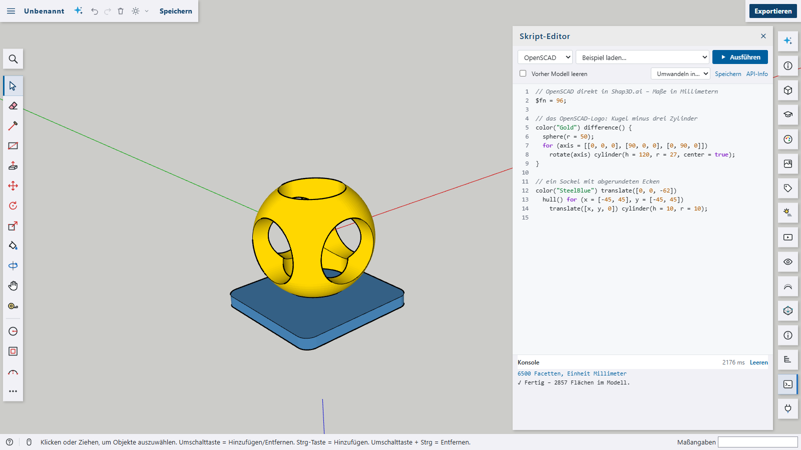

With the plugin switched on, _OpenSCAD_ also shows up when you right-click an object and choose _Als Code öffnen ▸_ – next to the built-in formats JavaScript, JSON and OBJ:

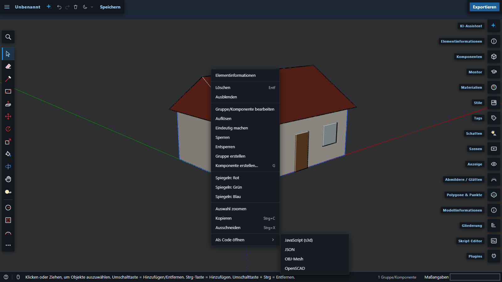

## The IFC plugin

The package in [`plugins/ifc/`](../../plugins/ifc) opens **IFC** files (BIM: Revit, ArchiCAD, Allplan, SketchUp …) and exports the model as **IFC4**. It reads them with [web-ifc](https://github.com/ThatOpen/engine_web-ifc) as WebAssembly – no server or converter, so it also works in the desktop app and a static deployment. web-ifc (MPL-2.0, about 7.5 MB) ships in the package, not in the app, and is only loaded on the first IFC import.

```bash
cd plugins/ifc
npm ci
npm run build
```

Then _Plugins › Load plugin folder…_ and pick `plugins/ifc/dist`.

- **Import** of IFC 2x3, IFC 4 and IFC 4.3: project › site › building › storey and aggregated elements become nested groups, each IFC class becomes a tag (spaces, zones and openings start hidden), and the IFC class, GlobalId, attributes, property sets and quantities (in metres) are kept on the group.
- **Export as IFC4** (_Export › IFC4_): spatial structure from classified groups (or a default storey), elements in their IFC class, triangulated geometry with materials and colours, property sets and quantities; GlobalIds of imported elements are written back.
- **IFC properties** panel (right-click › _IFC properties…_): shows the IFC data of a group and sets its class.
- **Limits:** triangles only (no parametric walls), no type objects, no georeferencing, 200,000 triangles per import.

Details in [its README](../../plugins/ifc/README.md).

## The LayOut plugin

The package in [`plugins/layout/`](../../plugins/layout) adds sheets for plans **next to the 3D model** – a workspace _Sheets_ that the switch _Model | Sheets_ in the top bar opens. It needs no dependencies of its own and is built like the others:

```bash
cd plugins/layout
npm run build
```

Then _Plugins › Load plugin folder…_ and pick `plugins/layout/dist`.

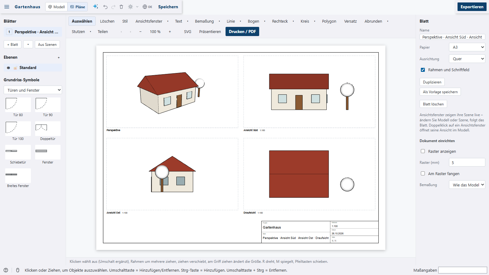

- **Sheets** in A4 to A1, Letter and Tabloid with frame and title block.
- **Viewports** show scenes of the model **live** – change the model and the sheet follows – at a drawing scale (1:1 … 1:1000) and as hybrid, raster or vector drawing. _From scenes_ puts up to four scenes on a new sheet with fitting scales.
- **The tools of a layout program**: text, labels, dimensions and angle dimensions (on a scaled viewport they measure the model), lines, freehand, arcs, pies, rectangles (rounded, lozenge, bulged), circles, ellipses, polygons, images, offset, fillet, chamfer, trim, extend, split, join, groups, style transfer – with line styles, fills and patterns.
- **Floor plan symbols** in real size – doors, windows, stairs, furniture, kitchen and bath, people, trees, cars – that take the scale of the viewport they are dropped on.
- **Sections per viewport** with filled cut surfaces, own face style and tags per viewport, titles with the live scale, layers, sheet templates and a document setup (grid, snapping, dimension units).
- **Presentation** of the sheets full screen, **SVG export** of a sheet and **printing** all sheets in their paper sizes (to PDF through the print dialog). The sheets are saved in the `.shap3d.json`.

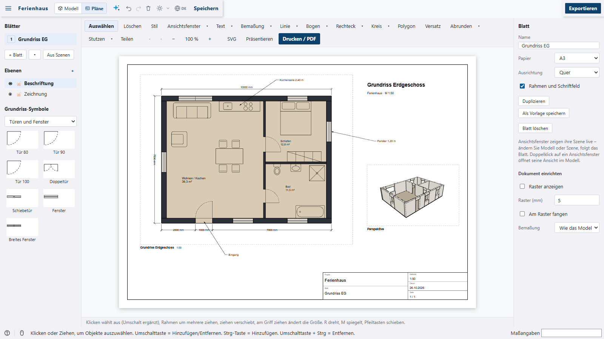

It builds on three parts of the plugin API made for it: workspaces, views rendered on demand (image and vector lines) and data on the model. Its `.vue` components use the app's Vue – see [its README](../../plugins/layout/README.md).

## The room planner plugin

The package in [`plugins/roomplanner/`](../../plugins/roomplanner) furnishes a room like a furniture store's planner – a panel _Room planner_ and a tool in the 3D view. No dependencies of its own; built like the others:

```bash
cd plugins/roomplanner
npm run build
```

Then _Plugins › Load plugin folder…_ and pick `plugins/roomplanner/dist`.

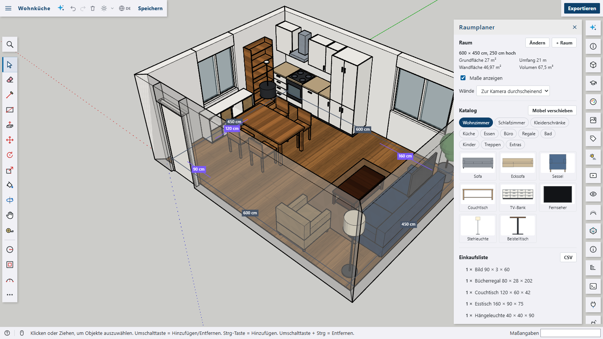

- **Rooms** side by side – rectangles, L-shapes or free floor plans with **slanted and round walls** – with doors and windows, **sloped ceilings** (shed, gable, hip roof) with **roof windows** and **maisonettes** (an upper floor with a square or round stairwell); floor and living area, perimeter, wall area and volume; the walls between the camera and the room open up (doll's house view).
- **Catalog** of parametric furniture with thumbnails: living room, bedroom, a modular **wardrobe system** (sections, heights, depths, hinged or sliding doors, interior), **kitchen** (a whole kitchen run, base, wall and tall cabinets, island), dining, office, shelves (bookcase, cube shelf …), bathroom, kids, **stairs** (straight, quarter-turn, spiral – floor to floor) and extras.
- **Placing and moving with snapping**: back to the nearest wall and flush against it, sides snapping to walls and neighbours, R turns by 90°, collisions shown in red.
- **Measures** on the floor: room size, openings and the distances of a piece to walls and neighbours.
- A **shopping list** with CSV, and the script functions `s3d.room(…)` and `s3d.furniture(…)` for rooms from code.

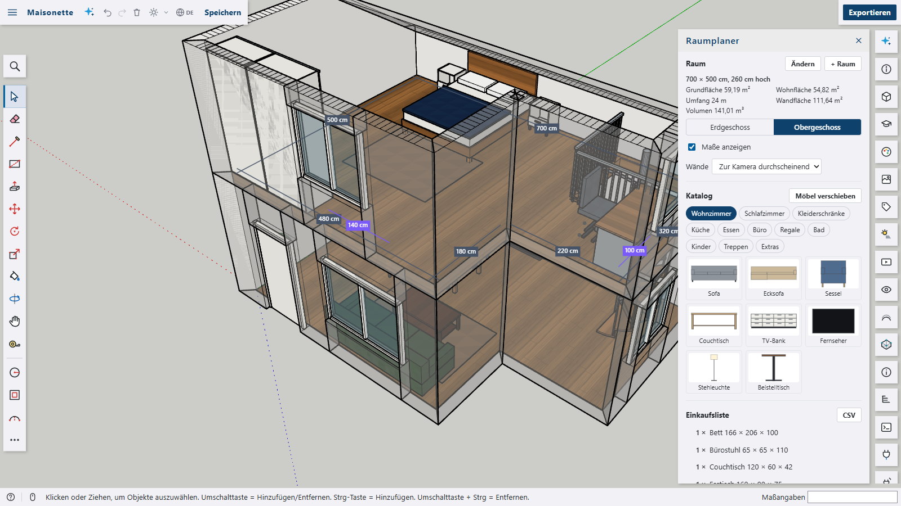

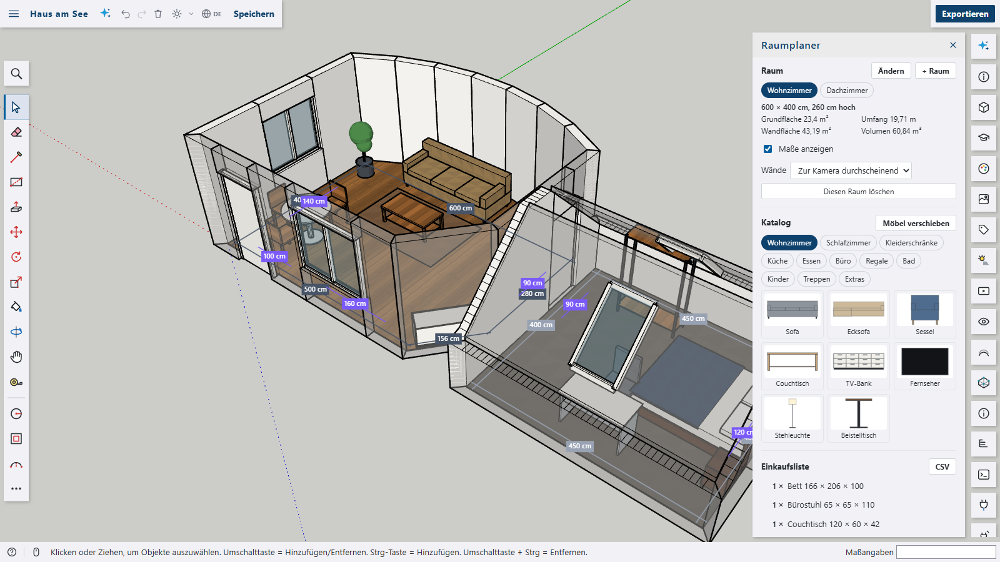

The pieces are ordinary components of the model, built with the script API (`s3d.box`, `s3d.cylinder` …) – the app's own tools work on them too. Details in [its README](../../plugins/roomplanner/README.md).

## The shader materials plugin

The package in [`plugins/shaders/`](../../plugins/shaders) draws materials with GLSL shaders instead of pictures – wood, marble, granite, terrazzo, rust and patina, brick walls, checker and exposed concrete. No dependencies of its own; built like the others:

```bash
cd plugins/shaders
npm run build
```

Then _Plugins › Load plugin folder…_ and pick `plugins/shaders/dist`.

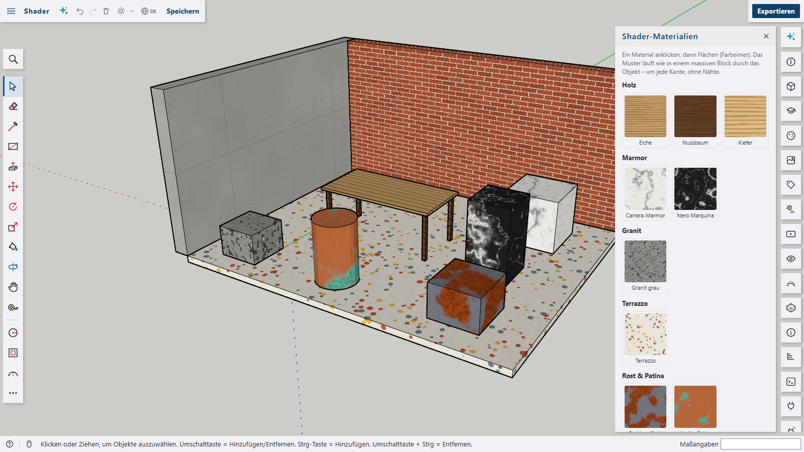

- The patterns are **solid** – computed from the point in the object's own coordinates – so they run round every edge without seams and move with the object.
- The shaders appear with the textures in the **Materials panel** (_Texture › Shaders (plugins)_); their parameters (colours, ring count, vein sharpness, brick size …) are sliders and colour pickers there.
- A panel with **ready-made materials** (oak, walnut, Carrara, Nero Marquina, terrazzo, rusty steel, copper patina, clinker, exposed concrete …), and `s3d.shaderMaterial('oak')` or `s3d.material(name, colour, { shader: 'shaders.wood', params })` in scripts.

It uses `context.materials.registerShader` – the way to add shaders of your own is in [its README](../../plugins/shaders/README.md). Without the plugin, materials with a shader show their colour; export formats keep the colour too.

## The noise plugin

The package in [`plugins/noise/`](../../plugins/noise) brings procedural generation from seeded noise – simplex noise (fBm, ridged, billow) and cellular (Voronoi) noise – to the app. No dependencies of its own; built like the others:

```bash
cd plugins/noise
npm run build
```

Then _Plugins › Load plugin folder…_ and pick `plugins/noise/dist`.

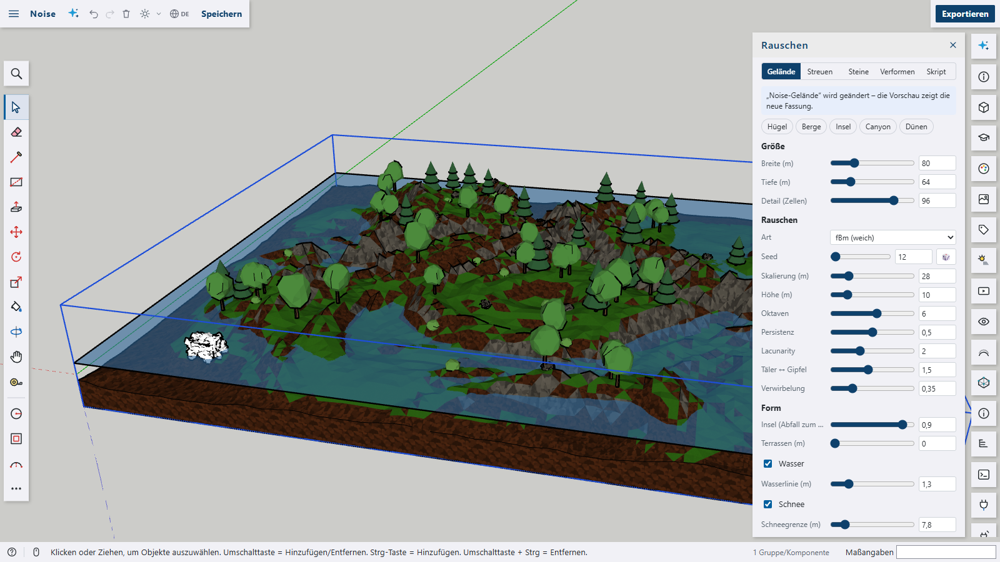

- **Noise terrains** with a live preview: seed, scale, height, octaves, persistence, lacunarity, warp, island falloff, terraces, water and snow, five presets. They store their height grid in the terrain plugin's format, so the **Terrain tool sculpts them further**.
- **Trees** grown from seeds (oak, birch, pine, palm) and **erosion** for terrains (raindrops dig gullies and fill valleys), **rivers** dug through the valleys and **roads** that find the gentlest way, with bridges.
- **Scattering** trees, bushes, rocks or the model's own components – on a terrain, on selected faces or **along selected edges** (an avenue) – gathered by a noise mask.
- **Stones** from cellular noise: flagstones, cobbles, slabs and dry walls as real stones with joints and chamfers, on selected faces or an area.
- **Facades** with windows, shutters, balconies and shops on walls or whole groups, and **cities** of streets, blocks and buildings whose heights follow a density map – with pitched roofs, perimeter blocks round courtyards, parks, street trees and road markings – on flat ground or on a terrain, where the blocks become terraces on retaining walls – and **villages** on the gentle slopes, connected by roads.
- **Deforming** groups: twist, taper, bend and roughen with 3D noise – boxes become towers, columns or boulders; three material shaders (_Noise_, _Cells_, _Facade_).
- `s3d.noise`, `s3d.fbm`, `s3d.cellNoise`, `s3d.noiseTerrain`, `s3d.scatter`, `s3d.tree`, `s3d.erode`, `s3d.river`, `s3d.road`, `s3d.villages`, `s3d.paving`, `s3d.facade`, `s3d.city` and `s3d.noiseDeform` for scripts.

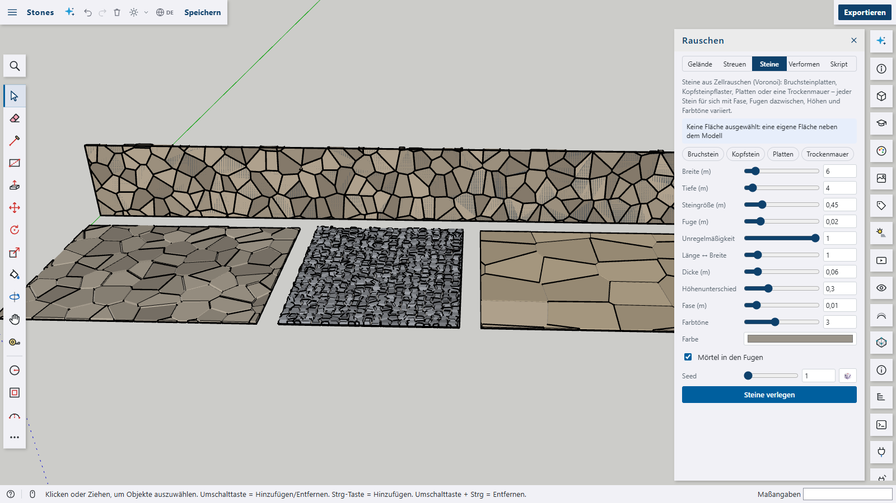

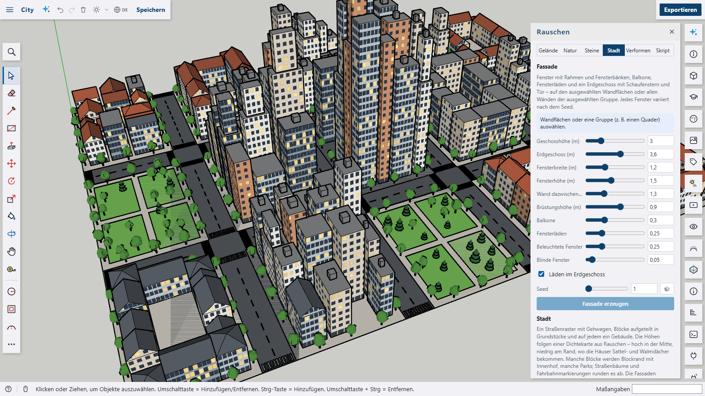

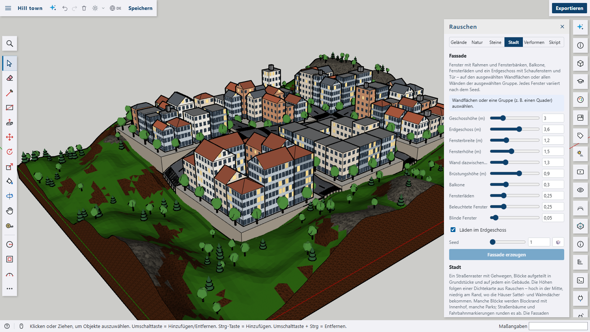

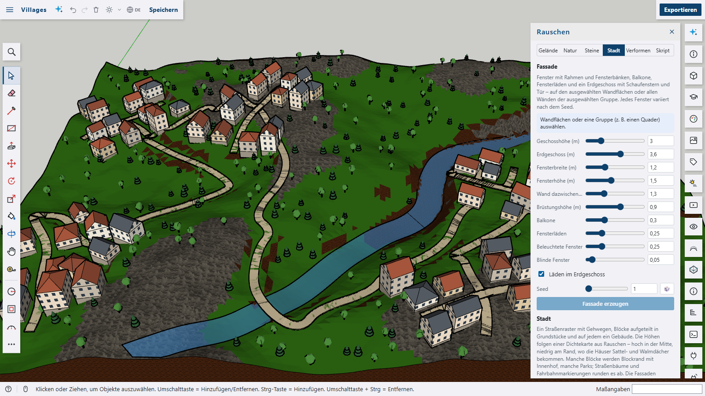

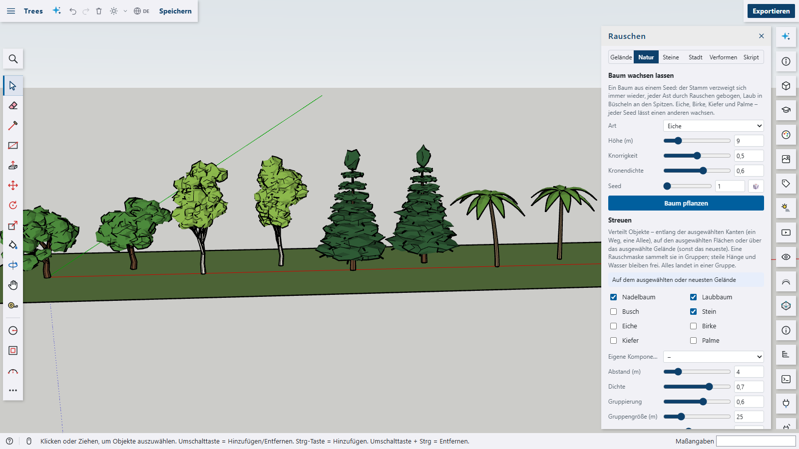

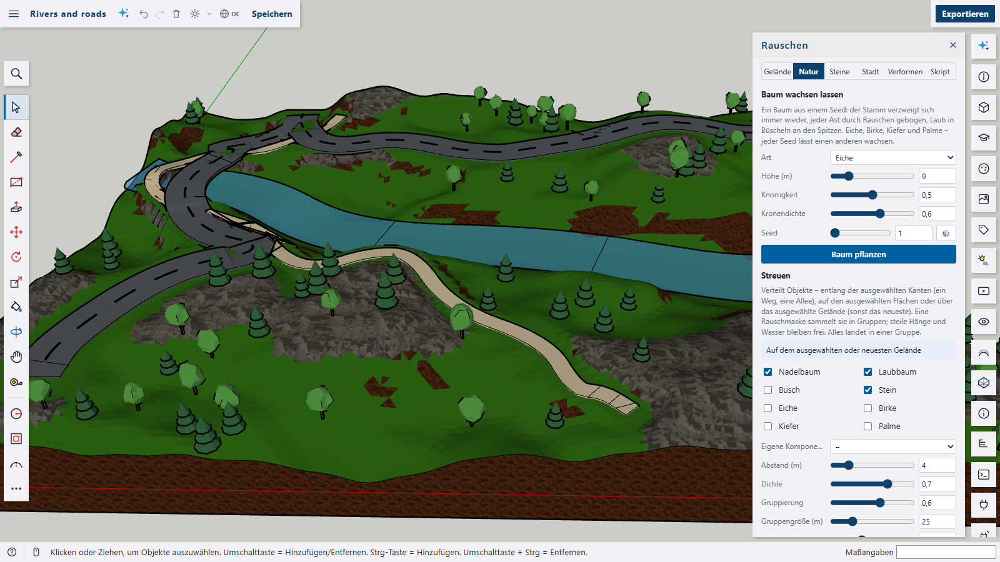

More pictures (erosion, scattering, facades, deforming) and all options in [its README](../../plugins/noise/README.md).

## The level editor plugin

The package in [`plugins/level/`](../../plugins/level) puts game objects into the model and exports them for game engines. It needs no other plugin – a terrain from the noise plugin is just geometry the objects stand on. Built like the others:

```bash
cd plugins/level
npm run build
```

Then _Plugins › Load plugin folder…_ and pick `plugins/level/dist`.

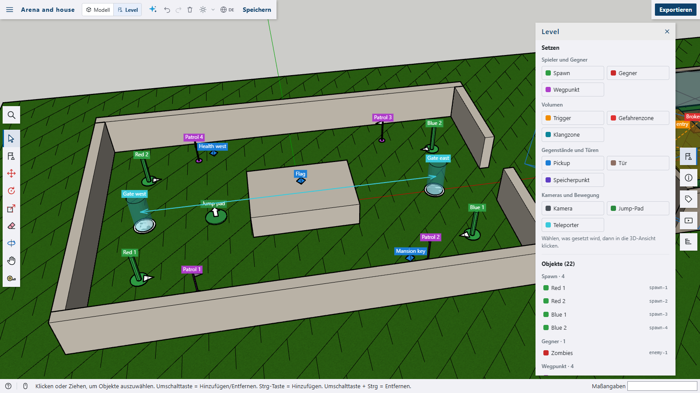

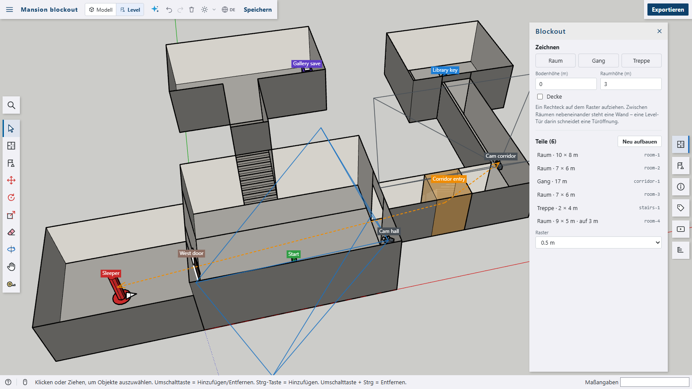

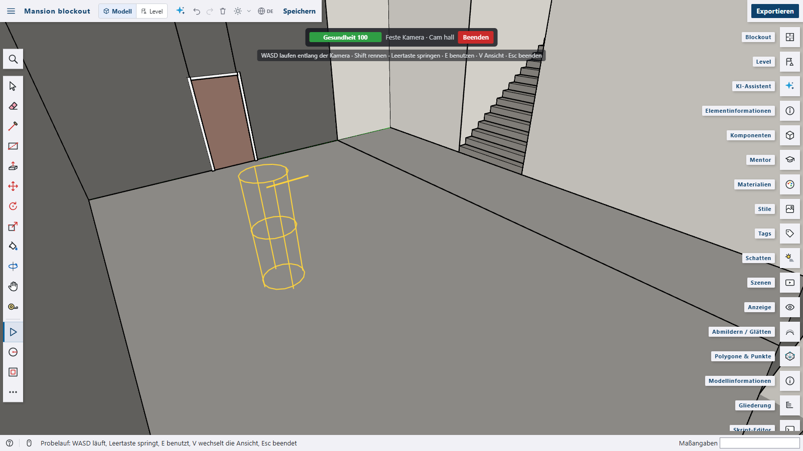

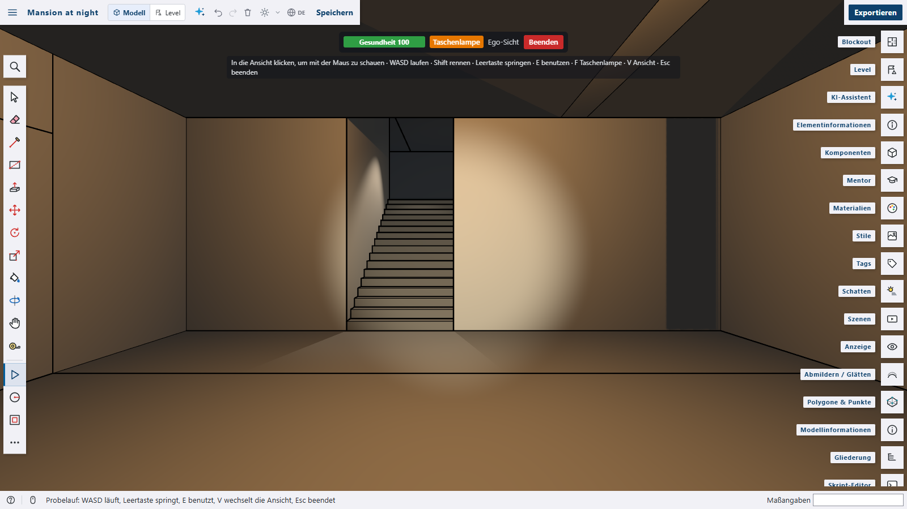

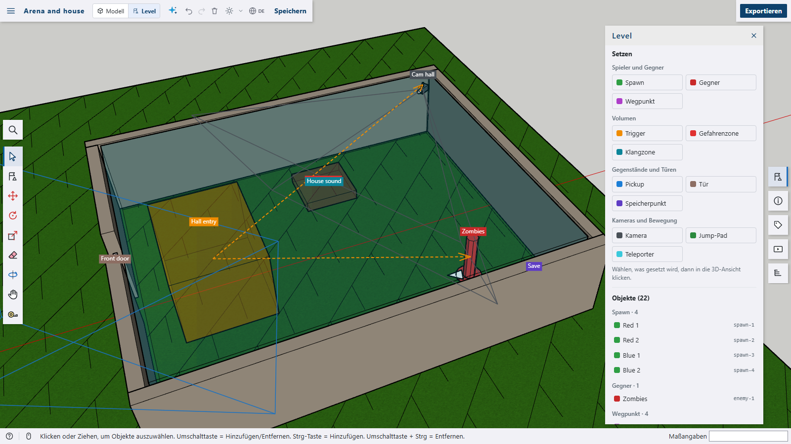

- **Blockout**: rooms, corridors and stairs drawn on a grid (key K) and built with floors, walls and ceilings – corridors open into rooms, level doors cut doorways.
- **Level objects** for an arena shooter or a survival horror house: spawn points, enemies, waypoints, triggers, hazards, sound zones, pickups, doors with lock and key, save points, fixed cameras, jump pads and teleporters – components of the model, each placed object with its own id and properties (plugin data on the instance).
- **Actions** of triggers and pickups: open or unlock a door, let enemies come, switch the fixed camera, teleport, play a sound, show a message – drawn as dashed links, the cameras' views too.
- **Placing** with the _Place level object_ tool (J) on any surface, R turns; the **Level panel** edits name, id, properties and actions and lists all objects with **checks** (a locked door whose key nothing gives, links to nothing, no first camera …).
- **Generated floor plans** from a seed – rooms, corridors with loops and, when wanted, start, lights, enemies, health, save point and goal.
- **Engine templates** for Godot 4, Unity and Unreal: a script that builds the level's game objects in the engine next to the model's GLB.
- **Light and atmosphere**: lamps and spots that triggers switch, daylight down to a dark night, fog – shown while editing and in the test run, where the player has a torch.
- A **test run** (P): walk through the level with collision – first person, from behind or through the fixed cameras – while triggers, doors and keys, pickups, teleporters, jump pads and hazards work.
- A **level mode** (_Model | Level_ in the top bar) with only the level tools and panels.
- **Export**: the model as glTF and a **level file** (JSON) with id, kind, glTF node, position, rotation, scale, properties and actions of every object in glTF's space.
- The data format `level.object` and `s3d.levelObject`, `s3d.levelObjects` and `s3d.levelFile` for scripts.

More in [its README](../../plugins/level/README.md).
