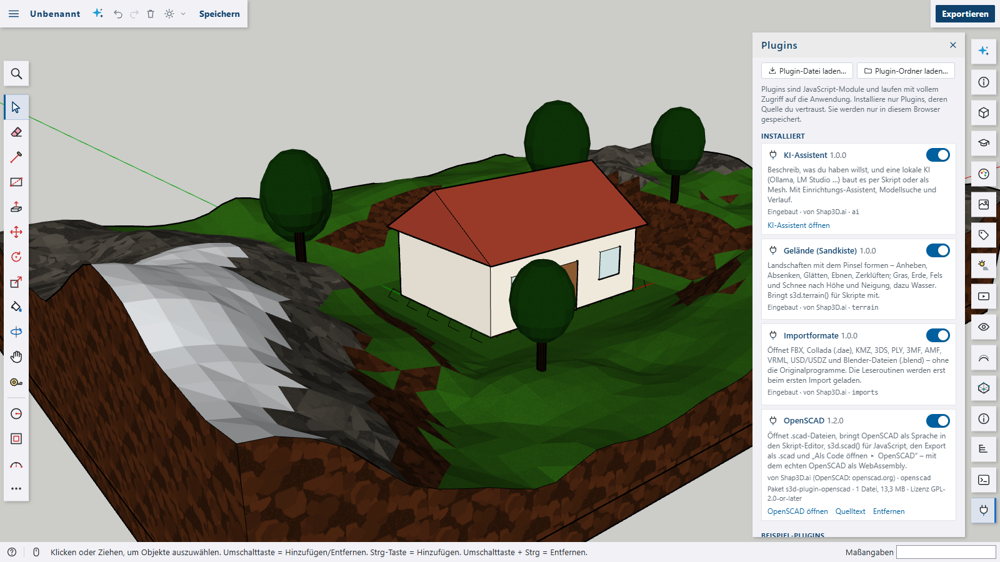
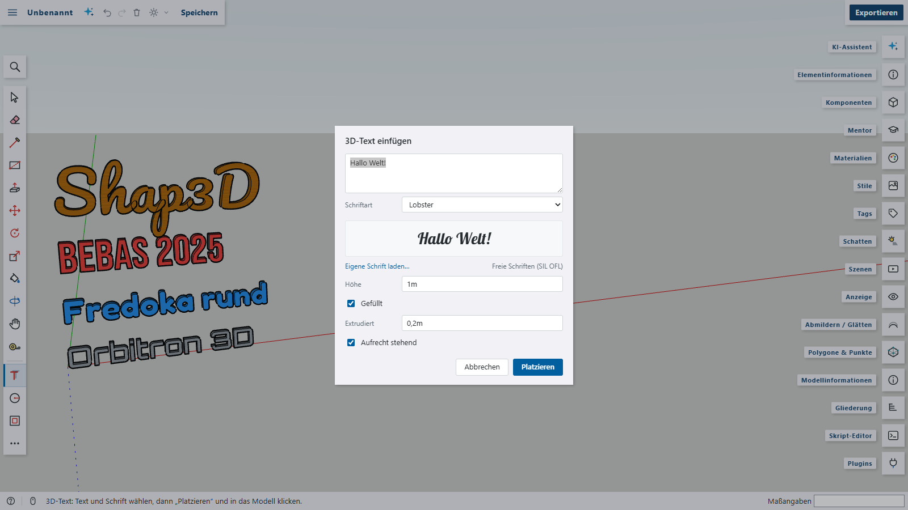

# Writing plugins

A plugin is a plain JavaScript **ES module** whose default export describes the plugin and has an `activate(context)` function. No build step and no server are needed. You load the `.js` file in the **Plugins** panel (_Plugin-Datei laden…_); it is stored in your browser and started again with every app start. Everything a plugin registers through `context` is removed automatically when it is switched off or removed.



> Plugins run with full access to the app (like a browser extension). Only install plugins whose source you trust – the plugin manager can download the source of every installed plugin.

```js
// hello-plugin.js
export default {
  id: 'hello', // unique: a–z, 0–9 and -
  name: 'Hallo Welt',
  version: '1.0.0',
  description: 'Shows how a plugin works.',

  activate(context) {
    // a command – appears in the Plugins menu and in the command palette
    context.commands.register({
      id: 'greet',
      label: 'Hallo sagen',
      run: (editor) => context.ui.toast(`Das Modell hat ${editor.model.root.faces.size} Flächen`),
    });

    // a new script command: s3d.pillar(height) in the script editor
    context.script.extend('pillar', (api, height = 2) => api.cylinder([0, 0, 0], 0.2, height), {
      signature: 's3d.pillar(höhe)',
      description: 'Eine Säule am Ursprung.',
    });
  },
};
```

## The `context` API

| Area             | Call                                                                                                                                                                                                            | What it does                                                                                                                                                                                                                                                                                                                                                                                                                                                                                                                                                                                                                                                                                    |
| ---------------- | --------------------------------------------------------------------------------------------------------------------------------------------------------------------------------------------------------------- | ----------------------------------------------------------------------------------------------------------------------------------------------------------------------------------------------------------------------------------------------------------------------------------------------------------------------------------------------------------------------------------------------------------------------------------------------------------------------------------------------------------------------------------------------------------------------------------------------------------------------------------------------------------------------------------------------- |
| Commands         | `commands.register({ id, label, run, group?, icon?, shortcut?, keywords?, checked?, enabled? })`                                                                                                                | Adds a command to the main menu (_Plugins_, or another `group`) and to the command palette. With `checked` it becomes a switch; `shortcut` is only shown as a hint.                                                                                                                                                                                                                                                                                                                                                                                                                                                                                                                             |
| Tools            | `tools.register({ id, name, icon?, key?, create: editor => tool })`                                                                                                                                             | Adds an interactive tool to the expanded toolset and the palette. Subclass `context.classes.PointTool` for snapping (`this.pick(pointer, from)`) or `context.classes.Tool` for anything else. `key` is a single-key shortcut, used only when no other tool has it.                                                                                                                                                                                                                                                                                                                                                                                                                              |
| Panels           | `panels.register({ id, label, icon?, width?, tile?, flush?, mount(element) })` or `{ …, component }`, `panels.open(id)`, `panels.close(id?)`                                                                    | A side panel. `mount` fills a plain DOM element (return a clean-up function if needed); `component` takes a Vue component – `context.vue` exposes `h`, `ref`, `computed`, `defineComponent` … to write one without a bundler. Without `tile`, plugin panels open from the Plugins menu, the palette and the plugin manager; `tile: 'first'` or `'last'` gives them a tile in the right-hand bar. `flush: true` drops the padding and scrolling for components that lay themselves out.                                                                                                                                                                                                          |
| Script API       | `script.extend(name, (api, ...args) => …, { signature?, description?, example? })`, `script.run(code)`                                                                                                          | Adds `s3d.<name>(…)` to the scripting API and lists it in the API reference (_Hilfen_ tab). `script.run` runs a script as one undo step.                                                                                                                                                                                                                                                                                                                                                                                                                                                                                                                                                        |
| Script languages | `script.registerLanguage({ id, label, run(code, editor), examples?, help?, highlight? })`, `script.openInEditor(language, code)`                                                                                | A new language in the script editor's language selector, with its own examples and help. `run` may be async and returns `{ ok, logs, error?, durationMs }`. `script.beforeRun(code => …)` is awaited before a JavaScript script runs – to prepare what a script extension needs.                                                                                                                                                                                                                                                                                                                                                                                                                |
| Code completion  | `script.registerCompletions(language, ({ code, offset, word }) => candidates)`, `script.completeValues(option, () => values)`                                                                                   | `registerCompletions` adds suggestions to a script language – your own or another plugin's: strings or `{ label, insert?, kind?, detail?, signature?, description?, example? }`, which the editor filters and ranks by the word before the cursor. Like everything else it is gone when the plugin is switched off. `completeValues` adds suggestions for an option value – `{ font: '…' }` in JavaScript and `"font": "…"` in JSON. `values` is asked every time the list opens and returns strings or `{ label, detail?, description?, color? }`. Option keys and the methods themselves come from the `signature` of `script.extend`, e.g. `s3d.text3d(text, { at, size, font })`.           |
| Meshes           | `meshes.add({ vertices, faces, faceMaterials? }, { name?, scale?, smooth?, materials? })`, `meshes.build(entities, mesh, options?)`                                                                             | Turns a polygon mesh into real faces – as a new group (one undo step) or inside a script extension (`api.ents`). `scale` converts the mesh units to metres; `faceMaterials` gives each face a material, `materials` defines missing ones (`{ name: { color, opacity } }`) in the same undo step.                                                                                                                                                                                                                                                                                                                                                                                                |
| Materials        | `materials.ensure(name, { color, opacity?, shader?, params?, size? })`                                                                                                                                          | Creates a material if the model doesn't have it yet – optionally drawn with a shader.                                                                                                                                                                                                                                                                                                                                                                                                                                                                                                                                                                                                           |
|                  | `materials.registerShader({ id, label, glsl, params?, size? })`, `materials.preview(material)`                                                                                                                  | A surface shader for materials: `glsl` defines `vec3 s3dSurface(vec3 p, vec3 n, vec3 base)` – the point in the object's own coordinates (1 = one tile), the normal and the material colour, all linear – and returns the colour there; each parameter `{ name, label, type: 'number' \| 'color', default, min?, max?, step? }` is a uniform `u_<name>`. The shader is listed with the textures in the Materials panel, its parameters become sliders and colour pickers. Light, shadows and clipping stay with the app; without the plugin the material shows its colour. Returns the full id (`<plugin>.<id>`) that materials store. `preview` gives a material's picture as a CSS background. |
| Package files    | `assets.url(path)`, `assets.blob(path)`, `assets.list()`                                                                                                                                                        | Files that came with a plugin package (see below), e.g. a WebAssembly build: `await import(context.assets.url('engine.js'))`.                                                                                                                                                                                                                                                                                                                                                                                                                                                                                                                                                                   |
| Files            | `files.registerImporter({ extensions, label, import(file, editor) })` or `{ extensions, label, loadScene(file) }`                                                                                               | Opens new file types through _Importieren…_ and drag & drop. With `loadScene` the plugin only returns `{ object, upY, scale }` (a three.js scene) and the app does the rest like for its own formats.                                                                                                                                                                                                                                                                                                                                                                                                                                                                                           |
|                  | `files.registerExporter({ id, label, fileName(editor), mimeType?, export(editor) })`                                                                                                                            | Adds _Exportieren: …_ to the export menu; `export` returns a string or a `Blob`.                                                                                                                                                                                                                                                                                                                                                                                                                                                                                                                                                                                                                |
| Code formats     | `code.registerFormat({ id, label, generate(scene), evaluate?(code, sandbox, options) })`                                                                                                                        | Adds the format to _Als Code öffnen ▸_ and _Umwandeln in…_. `generate` gets a `CodeScene` (points in metres, Z up; faces with holes, materials and triangles; nested groups) and returns code. `evaluate` builds code into `sandbox.entities`, a throw-away model, so it can be converted into the other formats. Use the id of a script language so the code runs in the editor.                                                                                                                                                                                                                                                                                                               |
| Drawing          | `overlay.draw((overlay, editor) => …)`                                                                                                                                                                          | Draws on the 2D overlay above the 3D view on every redraw (`overlay.line`, `overlay.text`, `overlay.context` for the raw canvas).                                                                                                                                                                                                                                                                                                                                                                                                                                                                                                                                                               |
| Icons            | `icons.register(name, svgContent)`                                                                                                                                                                              | An icon for commands, tools and panels (inner SVG markup for a 24 × 24 view box).                                                                                                                                                                                                                                                                                                                                                                                                                                                                                                                                                                                                               |
| Events           | `events.onToolChange(listener)`, `events.onNewModel(listener)`, `events.onDataChange(({ key, target }) => …)`                                                                                                   | React to tool changes and new models. `onDataChange` hears every change of plugin data made through `data` (any plugin's – `key` is whose, `target` the definition, instance or `null` for the model), at the end of the undo step it was made in and still inside it: what the listener changes is undone with it. Undo, redo and opening a model announce nothing.                                                                                                                                                                                                                                                                                                                            |
| Storage          | `storage.get(key, fallback)`, `storage.set(key, value)`                                                                                                                                                         | JSON settings, kept per plugin in the browser.                                                                                                                                                                                                                                                                                                                                                                                                                                                                                                                                                                                                                                                  |
|                  | `storage.files.list()`, `.get(path)`, `.put(path, blob)`, `.remove(path)`, `.clear()`                                                                                                                           | Files the plugin keeps for the user (IndexedDB), e.g. libraries or fonts – removed together with the plugin.                                                                                                                                                                                                                                                                                                                                                                                                                                                                                                                                                                                    |
| UI               | `ui.toast(text)`, `ui.prompt(title, value?)`, `ui.confirm(title)`                                                                                                                                               | Messages and simple dialogs.                                                                                                                                                                                                                                                                                                                                                                                                                                                                                                                                                                                                                                                                    |
|                  | `ui.addContextMenuEntry({ label, when?(editor), run(editor) })`                                                                                                                                                 | An entry in the viewport's context menu, shown when `when` is true.                                                                                                                                                                                                                                                                                                                                                                                                                                                                                                                                                                                                                             |
|                  | `ui.addWindow(component)`                                                                                                                                                                                       | A floating window (Vue component, rendered once; it decides itself when to show).                                                                                                                                                                                                                                                                                                                                                                                                                                                                                                                                                                                                               |
|                  | `ui.addTopBarButton({ icon, title, active?(), badge?(), position?, run(editor, event) })`                                                                                                                       | A button in the top bar next to the model name (`position: 'theme'`: right of the light/dark switch), highlighted while `active()` is true; `badge()` shows a short text next to the icon. `event` lets it open a popover at its position.                                                                                                                                                                                                                                                                                                                                                                                                                                                      |
| Languages        | `i18n.t(key, params?)`, `i18n.addMessages(language, messages)`, `i18n.addLanguage({ code, name, dir? }, messages?)`, `i18n.language()`, `i18n.languages()`, `i18n.setLanguage(code)`, `i18n.onChange(listener)` | Texts by key with `{placeholders}` and fallback (current language → English → key). `addMessages` adds texts for a language (nested or flat), `addLanguage` a whole language that can be chosen. See [Texts and languages in plugins](#texts-and-languages-in-plugins).                                                                                                                                                                                                                                                                                                                                                                                                                         |
| Workspaces       | `workspaces.register({ id, label, icon?, component })`, `workspaces.open(id \| null)`, `workspaces.active()`                                                                                                    | A workspace of its own next to the 3D model: the top bar gets a switch _Model \| …_, and while it is active the component fills the window below the top bar instead of the viewport, the tools and the panels. Only Ctrl+Z/Y/S and the command palette stay global keys then.                                                                                                                                                                                                                                                                                                                                                                                                                  |
| Modes            | `modes.register({ id, label, icon?, tools, panels?, enter?(editor), leave?(editor) })`, `modes.open(id \| null)`, `modes.active()`                                                                              | A mode of the 3D model, in the same switch: the view stays, but the toolbar shows only the mode's tools (the first is chosen on entering) and the right-hand bar only its panels – e.g. a level editor's tools for game objects. Tools and panels by full id (`select`, `terrain.sandbox`) or the plugin's short id; register them before the mode. Switching the plugin off ends its mode.                                                                                                                                                                                                                                                                                                     |
| Views            | `render.image({ camera, width, height, style?, hiddenTags?, orthoHeight? })`, `render.lines(…)`                                                                                                                 | A view of the model rendered on demand without changing the viewport – as a PNG, or as lines (visible edges and silhouettes, hidden parts removed) for vector output. `orthoHeight` (metres from top to bottom) gives a parallel projection at a drawing scale.                                                                                                                                                                                                                                                                                                                                                                                                                                 |
| Lighting         | `lighting.set([{ kind, position, direction?, color?, intensity?, range?, angle?, penumbra?, shadow? }])`, `lighting.atmosphere({ fog?: { color, near, far }, daylight?, background? } \| null)`                 | Lights and atmosphere in the 3D view – a level's lamps, a torch, fog, a dark night. While any are set, faces are drawn lit so the lights fall on them. The same number and kinds of lights are updated in place, so a torch can follow the camera every frame. `shadow: true` lets a light cast shadows – the first four that ask (a point light renders its shadow six times); things closer than half a metre to the light cast none, so its own lamp does not darken the room. They belong to the view, not to the model, and go when the plugin stops.                                                                                                                                      |
| Display          | `display.place(instance, matrix \| null)`                                                                                                                                                                       | Draws an instance at another place (a matrix in its parent's space, like `instance.matrix`) without changing the model, its undo history or what is saved – e.g. enemies walking in a test run. `null` puts it back; all go back when the plugin stops.                                                                                                                                                                                                                                                                                                                                                                                                                                         |
| Model data       | `data.get(target)`, `data.set(target, value)`, `data.getModel()`, `data.setModel(value)`                                                                                                                        | JSON the plugin keeps on a group/component definition (all its copies), on one instance (copied with it) or on the model itself – saved with the model and kept while the plugin is off (the terrain plugin stores its height grid here, the LayOut plugin its sheets).                                                                                                                                                                                                                                                                                                                                                                                                                         |
| Data formats     | `data.formats.register({ id, key, version, label?, validate? })`, `data.formats.get(id)`, `data.read(format, target)`, `data.write(format, target, value)`                                                      | Data under another plugin's key, read and written without that plugin running: the plugin it belongs to declares the format, and so does every plugin that uses it – declarations of one id must agree on key and version. `read` gives nothing for data that fails the check, `write` refuses it. The terrain plugin declares its height grid as `terrain.grid` (version 1).                                                                                                                                                                                                                                                                                                                   |
| Model            | `editor`, `THREE`, `newId()`                                                                                                                                                                                    | The full editor (model, selection, viewer; `editor.commit(label, change)` makes one undo step) and three.js.                                                                                                                                                                                                                                                                                                                                                                                                                                                                                                                                                                                    |

`script.extend` also takes `category`, `title` and `returns` to place the command in the API reference (e.g. under _Körper_).

Every `register…` call returns a function that removes the registration early. `onDispose(fn)` adds your own clean-up, and an optional `deactivate()` on the plugin runs when it is switched off. If `activate` throws, everything it registered so far is removed and the error is shown in the plugin manager.

The three bundled examples in [`src/plugins/examples/`](../../src/plugins/examples) can be installed from the plugin manager and cover all extension points:

- **Würfelraster** (`grid-generator.js`) – a command with an input dialog, a DOM panel and the script command `s3d.boxGrid()`.
- **Koordinaten & Hilfspunkte** (`cursor-coordinates.js`) – an overlay with the coordinates of the snapped point, a toggle command and the tool _Hilfspunkt_ (key <kbd>J</kbd>) built on `PointTool`.
- **Stückliste & Punktimport** (`parts-list.js`) – a CSV parts-list exporter and an importer for `.xyz`/`.pts` point lists.

## Texts and languages in plugins

A plugin brings its own texts – the app only registers them, it never keeps texts of plugins. Give the plugin a `messages` object with English (the source language and fallback – required) and as many other languages as you like; they are registered as soon as the plugin is loaded, so even its `name` and `description` in the plugin manager can be translated:

```js
export default {
  id: 'hello',
  name: 'hello.name', // labels may be message keys …
  description: 'hello.description',
  messages: {
    en: {
      hello: { name: 'Hello world', description: 'Shows how a plugin works.', greet: 'Say hello', faces: '{count} face | {count} faces' },
    },
    de: {
      hello: {
        name: 'Hallo Welt',
        description: 'Zeigt, wie ein Plugin funktioniert.',
        greet: 'Hallo sagen',
        faces: '{count} Fläche | {count} Flächen',
      },
    },
  },
  activate(context) {
    const { t } = context.i18n;
    context.commands.register({
      id: 'greet',
      label: 'hello.greet', // … they follow the language
      run: (editor) => context.ui.toast(t('hello.faces', { count: editor.model.root.faces.size })),
    });
  },
};
```

- **Keys** are `area.key`; prefix them with your plugin id so they never collide. Labels, names and titles given to commands, tools, panels, top-bar buttons, context-menu entries and exporters may be keys (or getters) – they change with the language. Plain text is shown as it is.
- **Placeholders** `{name}` are filled from the parameters; numbers are formatted for the language. `"one | many"` (or `"zero | one | many"`) picks the form by `{count}`.
- `context.i18n.addMessages(language, messages)` adds texts at run time (e.g. a language pack a plugin downloads); everything is removed again when the plugin is switched off.
- In the translation editor every plugin is an area of its own (named after the plugin, with the icon of its panel or tool), so translators find its texts.

## Built-in plugins

Some features of the app are written as plugins themselves, in [`src/plugins/builtin/`](../../src/plugins/builtin), against the same API. They are part of the app, loaded as their own chunk on demand, on by default and can be switched off (not removed) in the plugin manager:

- **KI-Assistent** (`src/plugins/builtin/ai/`) – the chat panel with its tile, the ✦ button in the top bar, the setup wizard, the model search, the chat history and the palette switches _KI: Schnellmodus_ and _KI: Code automatisch ausführen_. Switched off, an answer that is being written and running model downloads stop; settings and history stay.
- **Importformate** (`src/plugins/builtin/imports/`) – FBX, Collada, KMZ, 3DS, PLY, 3MF, AMF, VRML, USD/USDZ and Blender. It only registers the file types (`files.registerImporter` with `loadScene`); the three.js loaders and the Blender reader are a separate chunk loaded on the first import. The app turns the scene into faces, guesses units and places it.
- **Gelände (Sandkiste)** (`src/plugins/builtin/terrain/`) – the terrain tool, its floating window, the _Gelände bearbeiten / aus Fläche_ context-menu entries, the command and `s3d.terrain()`. Terrains in a model stay intact while it is off; they just can't be sculpted until it is on again.
- **3D-Text** (`src/plugins/builtin/text3d/`) – 3D letters and numbers: the _3D-Text_ tool opens a dialog with a live preview in the chosen font; the text becomes a component you place with a click (flat or upright, filled, extruded or as an outline, several lines). Besides Helvetiker and Optimer it brings 13 free fonts under the SIL Open Font License – Roboto, Playfair Display, Bebas Neue, Fredoka, Black Ops One (stencil), Pacifico, Lobster, Caveat, Orbitron, Press Start 2P (pixel), JetBrains Mono – and _Eigene Schrift laden…_ adds your own TTF, OTF or WOFF file (kept in the browser). Fonts and the font reader ([opentype.js](https://opentype.js.org)) load only when used. Scripts use it as `s3d.text3d('Hallo', { font: 'bebas', size: 0.5, depth: 0.1 })`; the fonts a script names are loaded before it runs.

- **Remote-API** (`src/plugins/builtin/remote/`, dev server only) – the REST API, Swagger UI and MCP server: `server/` is the Vite plugin that takes the requests, the rest answers them against the editor; its panel shows the connection, an activity log and the MCP set-up (see [Remote control](remote-api.md)).
- **Sprachen** (`src/plugins/builtin/i18n/`) – German, French, Spanish and Arabic for the app (`languages/*.json`), the language switch in the top bar, a _Language: …_ command per language and the translation editor (see [Languages and translations](languages.md)). Switched off, only English is left.

Each built-in plugin keeps its own texts in `i18n/en.json` (source) and `i18n/de.json` in its folder – the core never holds texts of plugins. Each one also has its own version and a `CHANGELOG.md` in its folder; the app's changes are in [CHANGELOG.md](../../CHANGELOG.md).



## Plugin packages

A plugin that needs more than one file – a WebAssembly engine, fonts, data – is a **package folder with its own `package.json`**. It is installed with **Plugin-Ordner laden…** in the plugin manager:

```json
{
  "name": "s3d-plugin-example",
  "version": "1.0.0",
  "license": "MIT",
  "shap3d": { "main": "plugin.js" }
}
```

`shap3d.main` (or `main`) names the plugin module. Every other file in the folder (without `node_modules`) is stored in the browser (IndexedDB) and reachable through `context.assets` by its path relative to the `package.json`. The plugin manager shows the package name, size and license.

A **bundle** brings several plugins in one folder – e.g. a level editor with the noise plugin. Its `package.json` lists the folders of the packages instead of a module:

```json
{
  "name": "s3d-bundle-level-editor",
  "version": "1.0.0",
  "shap3d": { "bundle": ["level", "noise"] }
}
```

Each listed folder is a package of its own (with `shap3d.id`, so _Aktualisieren_ finds it again). They are installed side by side: each can be switched off, removed and updated on its own, none needs another, and a plugin installed already in a newer version keeps it. The plugin manager shows _from bundle …_ next to them.

In Chromium-based browsers (Chrome, Edge) the app remembers the folder a package came from. After rebuilding the package (e.g. `npm run build`), **Aktualisieren** next to the plugin – or **Alle aktualisieren** – reads the folder again and installs the new version; the browser asks once for read access. If access is already granted, opening the plugin manager shows a hint like _Neue Version 1.3.0 im Ordner_. Firefox and Safari have no folder handles, so there the folder is simply chosen again with **Plugin-Ordner laden…**.

Such packages are separate programs with their own dependencies and license – they are not part of the app.

Type definitions for the whole API are in [`src/plugins/types.ts`](../../src/plugins/types.ts); reference them with `/** @type {import('./types').S3dPlugin} */` for autocompletion in your editor.

The plugin packages that live in this repository – OpenSCAD, IFC, LayOut, room planner and shader materials – are described under [Plugin packages](plugin-packages.md).
