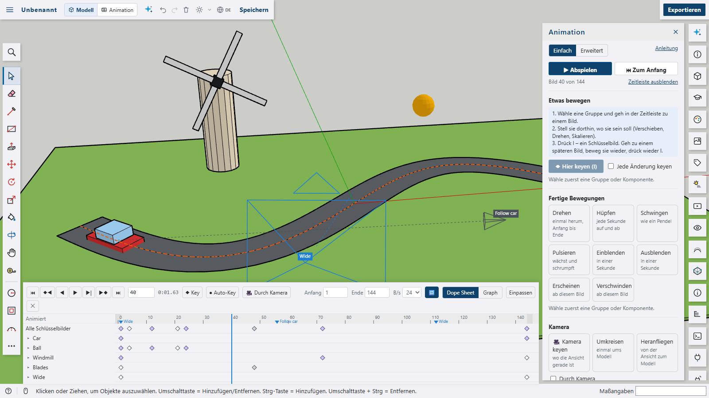
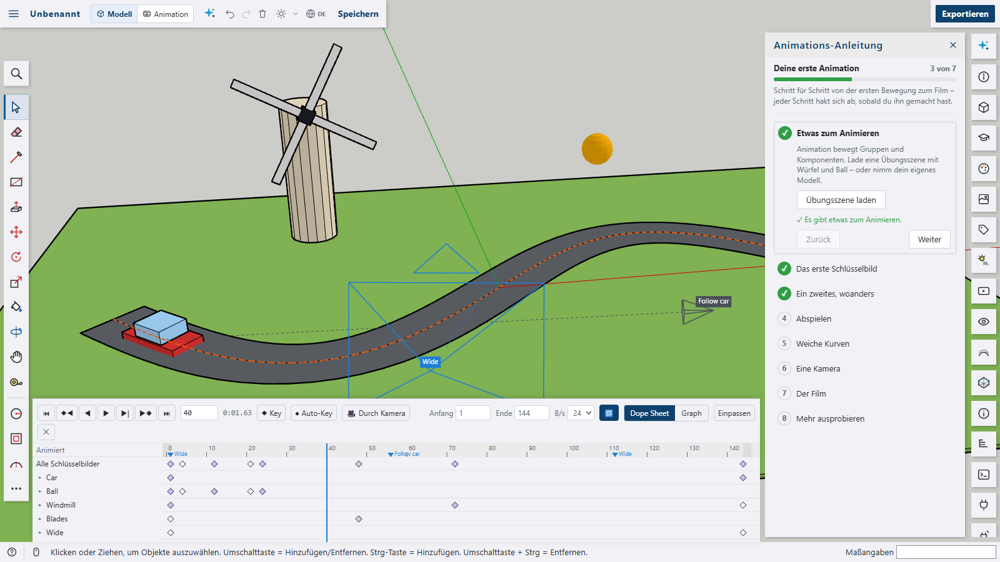
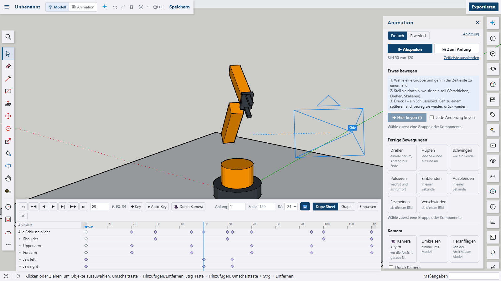
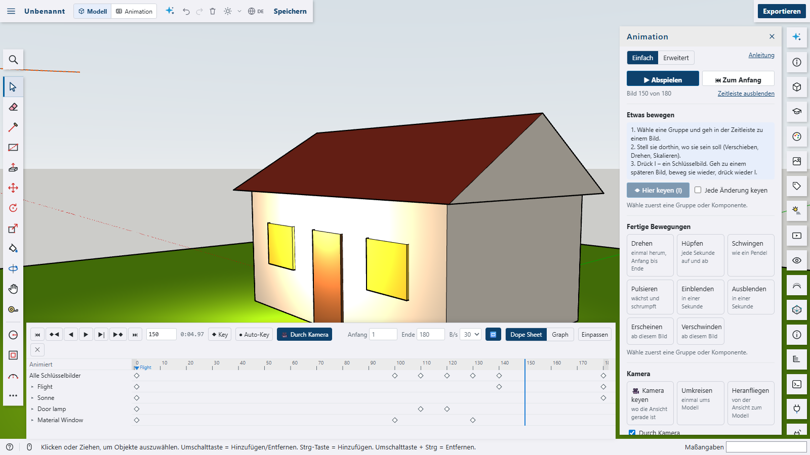
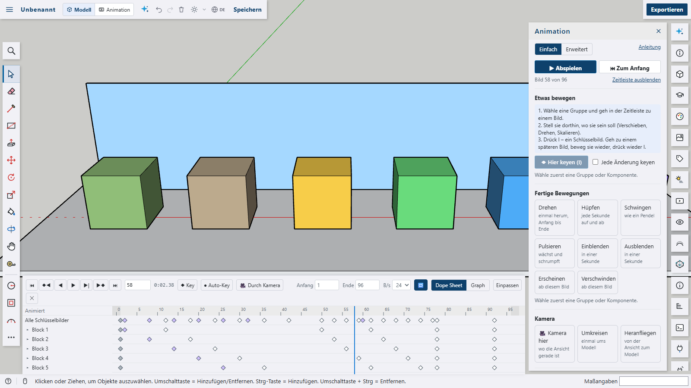

# Animation for Shap3D.ai

Films of the model, made the way Blender makes them: **keyframes** on groups and components – where they are, how they are turned and scaled, whether they are visible, their colour and opacity – on **material colours**, **cameras** (position, target, lens), **lights** and the **sun**. A **timeline** under the 3D view plays and scrubs; its **dope sheet** moves and deletes keys, its **graph editor** shapes the curves between them (constant, linear, Bézier with handles, easings, bounce, elastic). Groups **follow paths** and **look at** other groups, parts inside groups move with their parents, **shots** cut between cameras – and the film is **rendered** as a video (MP4 or WebM) or as PNG images, at a fixed frame rate however slow the computer is. The model is not changed: the 3D view shows the animation on top of it.











The plugin is a package of its own with its own `package.json` and is **not** part of the app. It only uses the plugin API – a mode, two panels, two windows (the timeline and the render progress), the viewport overlay, `display.place`, `display.look` and `display.material` for what the view shows, `lighting.set` and `lighting.sun` for lights and the sun, `events.onUndoStep` for keys from the app's tools, plugin data on instances and on the model, two data formats, the script API and its examples – and needs no other plugin and no library.

## Features

- **Simple and advanced**: the Animation panel opens in its **simple view** – Play, three steps to a first movement (a frame, a place, the I key), _Key every change_, **ready-made movements** (spin, bounce, swing, pulse, fade in and out, appear, disappear, follow a path), a camera where the view is or one that flies around the model or towards it, and the film. _Advanced_ shows every value: the scene's frame rate and range, the selected group's channels with a key diamond each, its pivot, path and look-at, cameras and shots, the sun, lights, material colours.
- **Keys**: **I** keys the selected groups where they are shown (their place, turn and scale) – with nothing selected, the camera of the shot from the view. **Auto key** (_Key every change_) makes every move, turn or scale with the app's tools a key at the frame shown, in the same undo step. Without it, a moved group stays where it was put until the frame changes, so it can be keyed with I.
- **The timeline** (`animation` mode, or the command _Animation timeline_): play and pause, frame by frame and key to key, start and end, frames a second, play again from the start; the ruler scrubs (Ctrl + wheel zooms, Shift + wheel scrolls in time). Shots are marked on the ruler.
- **Dope sheet**: a row per animated thing (and its channels when opened), a diamond per key – click to pick, Shift adds, drag to move by whole frames, right-click for the curve, handles, repeating (cycle) or deleting; Delete, Space, arrows, Home and End while the strip has the focus.
- **Graph editor**: the curves of the chosen channels (or of the selected groups) – drag keys in time and value, drag the handles of smooth keys (the other side turns along), _Normalise_ to see channels of different sizes together.
- **Curves**: constant, linear, Bézier (auto-clamped handles like Blender's, or free ones), ease in, ease out, ease in and out, back (overshoots), bounce and elastic; any channel may repeat its keys.
- **Paths**: a group follows the line another group's edges make (a line, an arc, a curve – a group of edges only), turned along it with a chosen front axis; cameras fly along paths too.
- **Look-at**: a group turns its front towards another group; a camera looks at a group wherever it goes.
- **Parents**: the group hierarchy is the parent-child chain – a group inside an animated group moves with it and adds its own animation (a robot arm, wheels of a car, blades of a windmill). Each group turns about its pivot: the middle of its box, the middle of its bottom, its origin – or any point set by a script.
- **Cameras and shots**: cameras made from the view, keyed by position, target and lens (35 mm film); shots switch between them at frames – a film with cuts. _Through camera_ shows the 3D view through the shot's camera.
- **The sun and lights**: the sun's hour moves its light (and its shadows when shadows are on), the daylight dims it; lamps and spots with keyed position, target, brightness and colour, optionally casting shadows.
- **Colour and visibility**: a group's own colour, opacity and visibility over time; a material's colour (and opacity) over time.
- **Rendering**: _Film_ in the panel – HD, Full HD, square, upright or the size of the view, as a video (MP4 where the browser can, else WebM) or as PNG images in a ZIP. Every frame is set and drawn one after another, through the shot's camera, without the axes and the selection, optionally with what is drawn over the view (labels, other plugins); the video is then recorded from those images at exactly the frame rate.
- **Getting started**: the **animation mode** (_Model | Animation_ in the top bar) shows the timeline, the tools that move things and only the panels it needs; the first time it opens the **animation guide** – eight steps from a practice scene to the first film, each with buttons that do it.
- **Scripts**: `s3d.animate`, `s3d.animateKeys`, `s3d.animatePath`, `s3d.animateLookAt`, `s3d.animateCamera`, `s3d.animateShot`, `s3d.animateSun`, `s3d.animateLight`, `s3d.animateMaterial`, `s3d.animateScene`, `s3d.animatePlay`, `s3d.animateRender` and `s3d.animateClear`; the data formats `animation.object` and `animation.scene`.
- Texts in English, German, French, Spanish and Arabic.

```js
const box = s3d.box([0, 0, 0], 1, 1, 1, { name: 'Box' });
s3d.animate(box, { frame: 1, at: [0.5, 0.5, 0.5] });
s3d.animate(box, { frame: 48, at: [5, 0.5, 0.5], rotate: [0, 0, 180], interp: 'ease-in-out' });
s3d.animateCamera({ name: 'Wide', frame: 1, position: [-6, -10, 5], target: [2.5, 0, 0.5], lens: 35 });
s3d.animatePlay({ frame: 1, play: true, lookThrough: true });
```

## Demos

The demos in [`docs/`](docs) are the scripts the screenshots are made with – and the examples in the script editor:

| Demo                                      | Shows                                                                                              |
| ----------------------------------------- | -------------------------------------------------------------------------------------------------- |
| [`demo.js`](docs/demo.js)                 | A little film: a car on a road (path), a bouncing ball (cycle), a windmill (parents), the sun, two cameras with shots |
| [`demo-robot.js`](docs/demo-robot.js)     | A robot arm: groups inside groups, each joint turning about its own pivot                          |
| [`demo-camera.js`](docs/demo-camera.js)   | A camera flying along a curve, looking at a house, zooming in; sunset, a lamp, glowing windows     |
| [`demo-colors.js`](docs/demo-colors.js)   | Blocks appearing with an overshoot, a colour wave, fading out; a material's opacity                 |

## Build and install

```bash
cd plugins/animation
npm run build
```

Then in Shap3D.ai: _Plugins › Load plugin folder…_ and pick `plugins/animation/dist` (`plugin.js` and the README). The package has no dependencies of its own – the build tools come from the repository root.

Checks: `npm run typecheck`, `npm run lint`, `npm run format:check`, `npm run i18n` (texts in all languages). Screenshots: start the dev server in the repository root (`npm run dev`), build the package, then `npm run screenshots` (`--url`, `--only <name>`).

## How it works

- **Data** (`data.ts`): on each animated instance its tracks (one per channel: `x`, `rx`, `sx`, `visible`, `r`, `opacity`, `path` …), pivot, path and look-at; on the model the scene – frame rate, range, cameras, shots, the sun's tracks, lights and material tracks. A track is a sorted list of keys (frame, value, curve, handles). Saved with the model, every change is an undo step.
- **Curves** (`curves.ts`): a key's value to the next one – held, straight, an easing, or a cubic Bézier through the handles (solved for the frame by halving); auto handles are as steep as the line between the neighbours and flat at peaks, clamped so they do not overshoot. Cycles repeat the keyed part.
- **The pose** (`pose.ts`): for a frame, every animated group's matrix in its parent – the place channels (the pivot's position, an XYZ turn in degrees, the scale) over the model's own values, then a path (the pivot onto the line, the front along it) and a look-at; parents first, so children follow them. The camera of the shot at the frame, the sun, lights and material colours.
- **The view** (`apply.ts`): each animated group's matrix in its parent with `display.place` (the app puts a group inside a moved group where its parent is shown), its colour, opacity and visibility with `display.look`, material colours with `display.material`, the sun with `lighting.sun`, lamps with `lighting.set` – only what changed since the last frame is handed over. The app keeps them over every new build of the view; nothing of the model changes.
- **Tools and keys** (`player.ts`, `keying.ts`): at the end of every undo step (`events.onUndoStep`, still inside it) the plugin compares the animated groups' matrices with the ones before – a tool's move, turn or scale goes onto the place shown at the frame (as keys with auto-keying); while the tool drags, the group is shown moved from where the animation has it.
- **Rendering** (`render.ts`): every frame is set and drawn at the chosen size (pixel ratio 1) through the shot's camera and kept as an image; for a video the images are played into `MediaRecorder` at exactly the frame rate (`captureStream(0)` and `requestFrame()`), for PNG images they go into a ZIP (`zip.ts`, stored).

## Limits

- A material's opacity builds the view again for each change (its faces may go into another mesh) – fast enough for small and middle-sized models; its colour does not. Faces with textures keep their texture.
- The sun's hour changes the light's direction; its shadows only show with the model's shadows on. The sky does not darken with the daylight.
- Needs the app with `display.look`, `display.material`, `lighting.sun` and `events.onUndoStep` (0.10.0 or newer – `shap3d.minAppVersion`).
- Turns are XYZ Euler angles (as Blender's default); a camera has no roll.
- Recording a video plays the rendered images in real time once more (a 10 s film takes 10 s after the frames are drawn).

Third-party software: none – the plugin brings no library.
