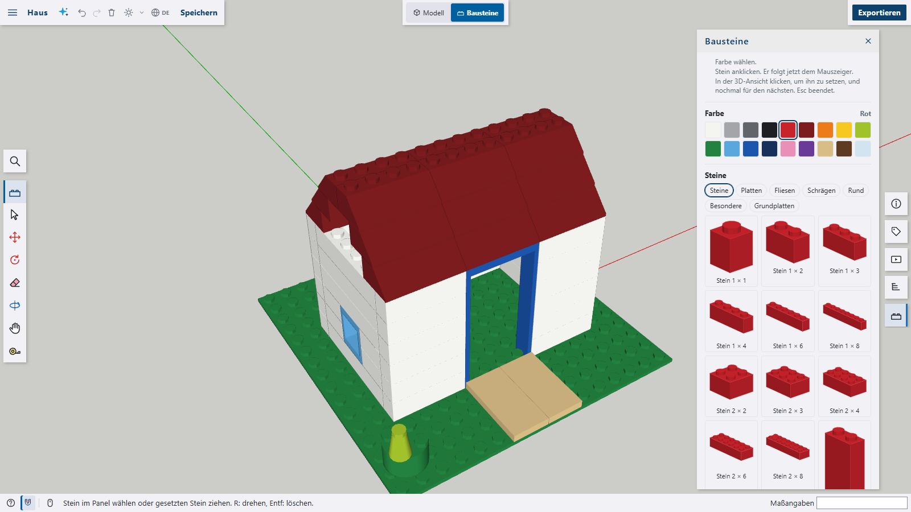

# Brick designer for Shap3D.ai

Build with clamp bricks: pick a brick and a colour, click to place it on the stud grid, stack, turn and delete, and get a parts list. A basic set works without a network; more parts load from the free LDraw library.



The plugin is a package of its own with its own `package.json` and is **not** part of the app. It only uses the plugin API: a mode, a panel, a tool, the overlay, meshes and data on components. It is not connected to any brick manufacturer and has no logos: studs are plain.

## Installing

```bash
cd plugins/bricks
npm run build
```

Then _Plugins › Load plugin folder…_ and pick `plugins/bricks/dist`. The switch in the top bar then offers _Bricks_.

## Using it

1. Choose a colour.
2. Click a brick. It follows your pointer.
3. Click in the 3D view to place it, and again for the next one. Esc stops.

| Key | What it does |
| --- | --- |
| R, Shift+R | a quarter turn |
| Page Up, Page Down | one plate higher or lower than where the brick would rest (to fill a gap under an overhang) |
| Delete | removes the selected bricks |
| Esc | stops placing |

Drag a placed brick to move it. A colour clicked while bricks are selected paints them. The camera, the app's Undo and the app's own tools work as usual: bricks are ordinary components of the model. A component is shared by all bricks of one part, the colour is the material of each instance, so large models stay light.

The mode shows bricks without lines along their edges, because the lines would cover the colours of a large model. Switching back to _Model_ brings them back; the model and its saved style do not change.

Sizes are real ones: 8 mm from stud to stud, a brick 9.6 mm high, a plate 3.2 mm. A brick comes to rest on the highest thing under it, and a brick pointing at the side of another goes into the cell next to it.

## Finished models

The panel's section _Finished models_ offers:

- **Own models** (house, car, tree, lighthouse, bridge, rocket): built from the plugin's bricks, no network needed.
- **Whole sets online**: 38 models from LDraw's collection by theme, up to about 4200 parts, every part in its real place. They are fan-made models of sets that were once sold, stated with author and licence. Only models whose file names a licence are listed, and none of a licensed film, car or game brand.
- **Your own file**: _Open model file…_ reads any `.ldr` or `.mpd`. The [LDraw model repository](https://library.ldraw.org/omr) has many more; download one there and open it here.

A model follows the pointer and is placed by a click like a brick. It moves, turns and is deleted as one piece, and the parts list counts its bricks one by one. Each brick has one colour, so a part made of two colours (a printed tile, say) shows only its main colour. A large set takes a while to load: all its parts are fetched and made in workers, with _Cancel_ on the way.

## Where the bricks come from

| Source | What it gives | Key | Tested |
| --- | --- | --- | --- |
| The plugin itself | the catalog, made with [`src/shapes.ts`](src/shapes.ts); works offline | none | yes |
| [LDraw](https://www.ldraw.org/) parts library | any part's shape by its number; about 100 common parts can be searched by name | none | yes, through the copy named below |
| LDraw's model collection | whole sets with every part in its place | none | yes, through the copies named below |
| [Rebrickable](https://rebrickable.com/api/) | searching all parts by name; the shape still comes from LDraw | your own | **no**, nobody ran it with a real key; the panel says so |

- **LDraw from a copy.** `library.ldraw.org` sends no CORS header, so a web page cannot read it. The plugin reads [erik-larsen/ldraw](https://github.com/erik-larsen/ldraw), a copy of October 2026 made for web pages, through jsDelivr at a pinned commit, and from that copy's own site if jsDelivr fails. It belongs to one person; if it goes away, the catalog and all parts loaded before still work. To point to another copy, change `LIBRARIES` in [`src/online.ts`](src/online.ts). [kulits/ldraw-parts](https://github.com/kulits/ldraw-parts) is synced daily and would serve as well.
- **Sets from copies too.** The list in [`src/ldrawModels.ts`](src/ldrawModels.ts) reads pinned commits of [gkjohnson/ldraw-parts-library](https://github.com/gkjohnson/ldraw-parts-library) and the three.js examples. The model repository itself has no CORS header and no API, so its files are opened by hand.
- **Licence.** Current LDraw parts are CC BY 4.0, older files and these set models CC BY 2.0 (LDraw calls it CCAL 2.0). The panel names the library, and the parts list names author and licence of each loaded part. Keep them when you publish a picture or a list.
- **Your key.** The Rebrickable key stays in this browser and goes only to Rebrickable, in a header. Its rate limit is about one request per second, so the plugin only asks when you press the button. Nothing else is sent.
- **Limits.** A part may have at most 1500 files, 64 MB and 80000 faces. Files from outside are only read as numbers and checked paths. Names of protected brands in a source's titles are left out.
- **Set lists without places.** Rebrickable and Brickset know the parts of a set, but not where each one goes, so they cannot give a built model. Rebrickable's CSV downloads have no CORS header either. Neither is used for sets.
- **BrickLink** is not used: going by third-party descriptions (its own pages were down for maintenance when this was written), requests are signed with OAuth 1 using a secret that is bound to a registered IP address, which does not fit a browser.

## Scripts

```js
s3d.brick('brick-2x4', { at: [0, 0], rotation: 90, color: 'red' });
```

`at` counts in studs from the origin and snaps to the grid. Without `level` (in plates above the ground) the brick rests on what is below. A part from the library is `'ldraw:3001'` once it is loaded in the panel.

## Checks

```bash
npm run typecheck && npm run lint && npm run format:check && npm run i18n && npm test && npm run build
```
