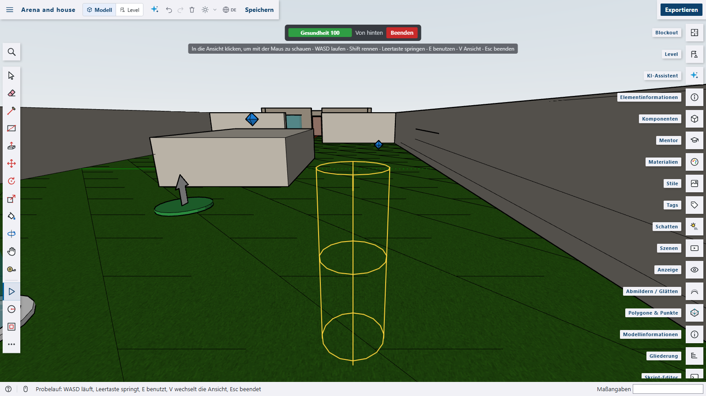
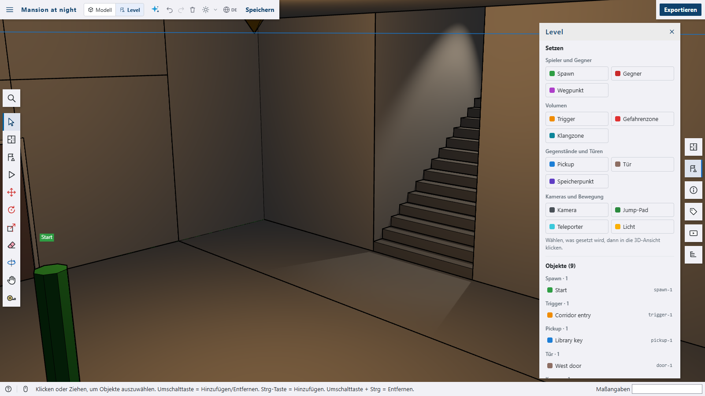
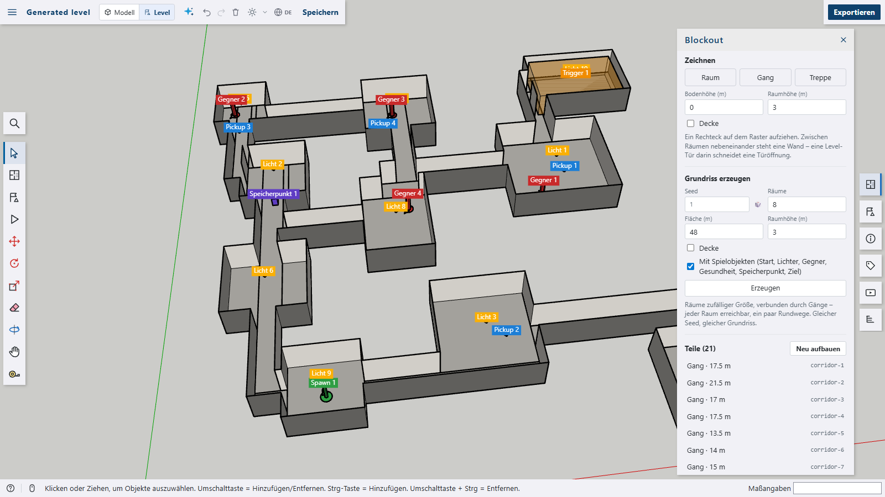
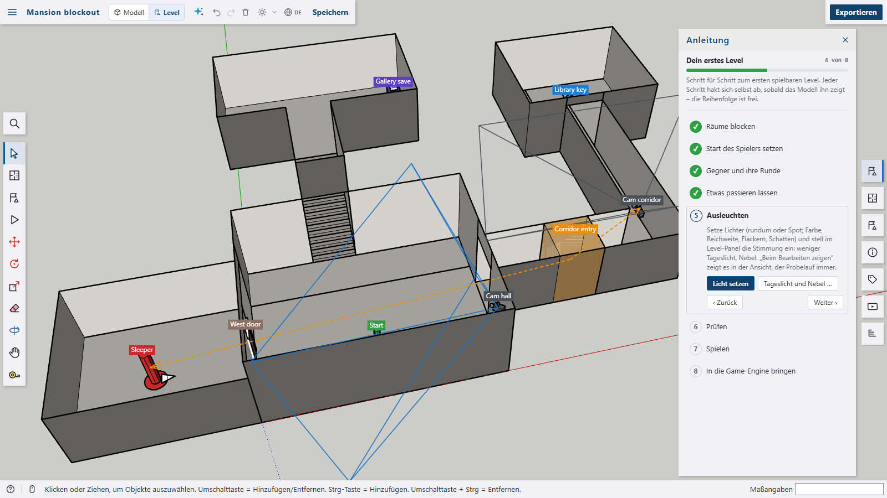
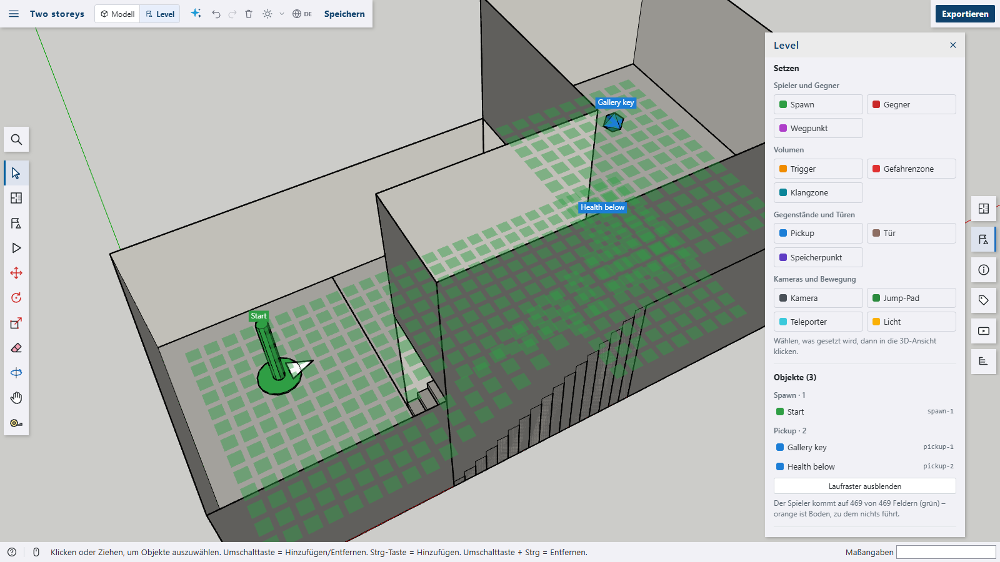
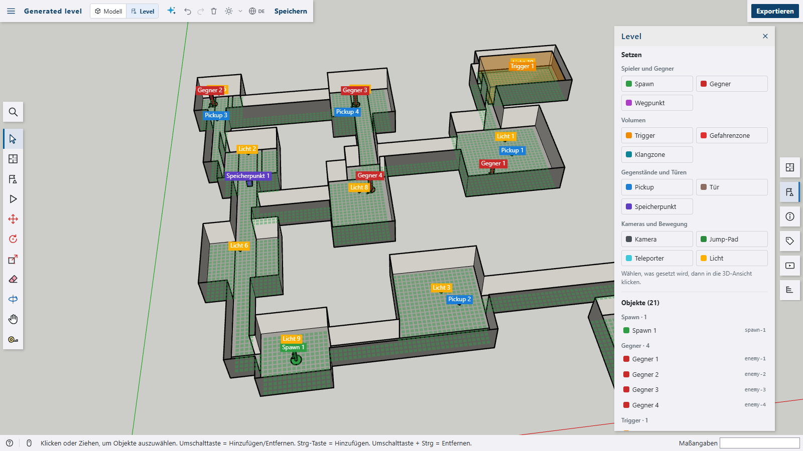

# Level editor for Shap3D.ai

Levels for a game engine – for an arena shooter as well as a survival horror house: **block out** rooms, corridors and stairs on a grid – or **generate** a floor plan from a seed – place spawn points, enemies, triggers, hazards, sound zones, pickups, doors with keys, save points, fixed cameras, jump pads and teleporters, give them their properties, let triggers and pickups set off actions (open a door, switch the camera, let enemies come …), see what is missing, light it, **play it** in a test run, work in a level mode of its own and export the level as glTF plus a level file (JSON) and **templates for Godot, Unity and Unreal**.










The plugin is a package of its own with its own `package.json` and is **not** part of the app. It only uses the plugin API – panels, tools, a mode, the viewport overlay, a data format, data on components and instances, the script API and an exporter – and needs no other plugin: a terrain from the noise plugin or the Terrain tool is just geometry the objects stand on. Level objects are ordinary components of the model, so the app's own tools (Move, Rotate, Scale, Eraser, Outliner …) work on them too.

## Features

- **Guide** (the first time the level mode opens, or the command _Level guide_): eight steps to a first playable level – blockout, start, enemies and their round, triggers and doors, light, checks, test run, export. Each step says what to do, has buttons that start it (the right tool with the right kind, a panel, the check) and ticks itself off once the model shows it is done, its parts listed with their own ticks (e.g. a trigger placed · an action on it); buttons add a message to the trigger or open the enemy's path and the trigger's actions; a bar shows how far the level is. The guide, the Level and the Blockout panel live in the level mode only – it opens with the switch _Model | Level_ in the top bar, the commands, or by taking a level tool (J, K).

  

- **Blockout** (_Blockout_ panel or the _Draw blockout_ tool, key **K**) – rooms, corridors and stairs on a grid of 0.5 m (or 0.25, 1, 2 m), built into one group with floors, walls and – where wanted – ceilings:
  - _Room_: drag a rectangle (or click two corners) at the chosen floor height; its room height and an optional ceiling come from the panel.
  - _Corridor_: click its start and its end – it bends once when they are not in line (along x first, **Shift** along y first); its width from the panel. Where a corridor runs into a room, the room opens; along a room's side the wall stays.
  - _Stairs_: drag its rectangle the way it goes up – steps of about 18 cm from its floor up by _Climbs_, to a room on a higher floor.
  - **Floors above each other**: a room at a higher floor height may lie over another (a gallery over a hall, a flat over a shop) – both keep their floors and walls, the lower one's ceiling is the upper one's floor; stairs inside the lower room lead up into it. Only pieces that overlap in height replace each other.

    

  - Rooms side by side get **one wall** between them. A **level door** placed in a wall – it snaps onto the wall's line and turns with it – **cuts a doorway** (leaf size, with the lintel above).
  - The panel lists the pieces: each opens to change its position, size, floor and room height, ceiling, a corridor's ends, width and bend, a stairs' climb and direction – or to remove it; _Build again_ after doors were moved or removed. Every change is one undo step.
  - **Generate a floor plan** (Blockout panel, `s3d.levelGenerate()`): rooms of random size spread over an area without touching, linked by corridors – every room reached, a few loops – from a seed (🎲 for another): rooms, area, room height, ceilings. _With game objects_ also places the player's start in the room nearest the corner, a light in every room, enemies and health on the way, a save point half way and a trigger in the furthest room that ends the level. It replaces the blockout (and then the level's objects) after asking; one undo step.
  - The pieces are kept in the model's level data (`{ cell, pieces }`); the geometry comes from [`packages/procgen`](../../packages/procgen/README.md) (`blockout.ts`, with tests). One grid holds one floor per spot – rooms cannot lie above each other yet.
- **Level objects** – each kind is a component of the model with a small, recognisable shape; every placed object is an instance with its own **id** (`spawn-1`, `door-2` …) and **properties**:
  - _Players and enemies_
    - _Spawn_: a disc with an arrow the way the player faces and a post as high as a person – `team`
    - _Enemy_: the same in red – `type`, `count`, `when` (at the start or when an action calls), `path` (the waypoints it patrols)
    - _Waypoint_: a post with a flag the way it faces – `path`, `order`, `wait` (seconds)
  - _Volumes_ – see-through boxes, scaled with the Scale tool to the space they cover (the panel shows the size)
    - _Trigger_: goes off `on` entering, leaving or use, `once` – and sets off its **actions**
    - _Hazard_: `damage` per second, or `kill` at once (lava, a pit, broken glass)
    - _Sound zone_: `sound`, `volume`, `reverb` (none, room, hall, cave) – the ambience of a place
  - _Items and doors_
    - _Pickup_: a diamond above the ground – `item` (a weapon, ammo, health, a key …), `amount`, `respawn` (seconds) – and **actions** when it is picked up
    - _Door_: frame and leaf, 1 × 2.1 m – `opens` (swinging, sliding, upwards), `startsOpen`, `locked`, `key` (the item that opens it)
    - _Save point_: a desk with a box on it – `label`
  - _Cameras and movement_
    - _Camera_: a fixed camera hung 2.6 m above the clicked surface, looking the way it faces – `pitch`, `fov`, `start` (the first one); its view is drawn in the 3D view
    - _Jump pad_: `height` and `distance` of the jump
    - _Teleporter_: `target`, the teleporter it sends to (chosen from a list)
- **Actions** of triggers and pickups, each with its target chosen from the objects that fit: open, close, unlock or lock a door, switch an object on or off, let enemies come, switch to a fixed camera, send the player to a teleporter, play a sound, show a message. Links from a trigger or pickup to its targets and from a teleporter to its destination are drawn as dashed arrows. Changing an object's id changes what points at it.
- **Placing** (_Level_ panel or the _Place level object_ tool, key **J**): choose a kind, it follows the pointer on the surface under it (terrain, floors, platforms – not other level objects) or on the ground, a click places it. **Shift+click** places more, **R** turns by 45° (Shift+R back), **Esc** stops. Without a chosen kind a click selects a level object.
- **Level panel**: the kinds to place by group; the selected object's name (its node in the glTF), id, properties and actions – each change one undo step; the list of all objects by kind (a click selects).
- **Light and atmosphere** (_Light and atmosphere_ in the Level panel, `s3d.levelAtmosphere()`):
  - _Light_ objects (group _Cameras and movement_): all around or a spot (its cone and its tilt), colour, brightness, reach, on at the start, flickering, casting shadows (the first four lights that do, the torch first – shadows cost time every frame) – placed 2.4 m above the clicked surface. Triggers and pickups switch them with _Switch on_ and _Switch off_.
  - The level's mood: **daylight** from 100 % down to 0 % (a night, a house without windows – then only its lights and the player's torch light it), **fog** with its colour, where it begins and from where nothing is seen any more.
  - _Show while editing_ shows lights and atmosphere in the 3D view; the test run always does. The level file carries the atmosphere, the lights are objects in it.
- **Test run** (_Play level_ in the Level panel, the _Test run_ tool, key **P**, or the commands _Level test run_, _… in first person_, _… from behind_): walk through the level as the player.
  - **Walking** with collision against everything visible in the model (blockout, terrain, own geometry): WASD, Shift runs, Space jumps, F switches the torch (on by itself where the daylight is low), steps up to 45 cm (stairs) are climbed, gravity, falling out of the level starts again at the spawn point.
  - **Views** (V changes them): first person – a click in the view locks the mouse for looking, Esc frees it –, from behind (the camera comes closer where a wall stands behind the player), and through the **fixed cameras** in the style of a survival horror game: the first camera at the start, switched by triggers; the keys walk along the camera's view and the player (drawn in yellow) turns the way it walks.
  - **The level's logic**: triggers go off on entering, leaving or use (E) – once or every time – and set off their actions; doors open with E, locked ones with their key from the inventory (or stay shut: _Locked – it needs …_), closed doors block; pickups are collected on touch (and come back after `respawn`), with their actions; teleporters and jump pads move the player; **enemies walk**: they patrol the waypoints of their `path` in order (waiting `wait` seconds where a waypoint says), see the player ahead of them (±70°, up to 12 m, close by from any side – never through walls), follow faster, give up after 4 seconds out of sight and go back to their round; every one of a `count` walks on its own (the extra ones drawn as red figures); hazards and enemies cost health, at 0 the player starts again at the spawn point; **sounds play**: a sound zone loops its sound while the player is inside (fading in and out, at its `volume`, with the echo of a room, hall or cave), _Play sound_ plays one once (with the echo of the zone the player is in) – the files come from _Sounds_ in the Level panel (kept with the plugin; a file `door-creak.ogg` plays for the name `door-creak`), a name without a file plays a stand-in made up from its name; save points answer E.
  - **Display** at the top: health, what the player carries, the view and camera, messages, the controls – and _Stop_ (or Esc). Editing markers (spawn points, volumes, cameras, waypoints, names and links) are hidden while it runs.
  - The model is not changed: what is shown comes back, and the camera returns to where it was.
- **Checks** – what a game engine would trip over, listed under the objects (a click selects the object): no spawn point, the same name or id twice, actions or teleporters pointing at nothing (or at the wrong kind), a locked door whose key no pickup gives and no action unlocks, fixed cameras without a first one, enemies waiting for an action that never comes. The level file lists them too.
- **What can be reached** (_Check what can be reached_ under the checks, command _Check what can be reached_, `s3d.levelNav()`): a walking grid of 0.4 m cells over the model's floors – on several floors above each other, with room to stand (1.8 m headroom, away from walls), linked where the step is at most 0.45 m and no wall stands between; teleporters and jump pads link to where they send the player. From the player's spawn points it shows in green what the player gets to, in orange floor nothing leads to, and lists pickups, doors, save points, triggers, teleporters and jump pads that cannot be reached, and spawn points with no floor to walk on. While shown it follows changes of the model. The export always checks it.

  

- **Level mode** in the switch of the top bar (_Model | Level_): the 3D view stays, the toolbar shows only Select, Draw blockout, Place, Test run, Move, Rotate, Scale, Eraser, Orbit, Pan and Tape Measure, the right-hand bar only the Level and Blockout panels, Entity Info, Outliner, Tags and Scenes. Names stand above the objects while the mode is on (and above the selected ones always).
- **Export** for game engines: _Model (GLB)_ is the app's glTF export, _Level file (JSON)_ (also under _File › Export as_) writes the objects with id, kind, name, `node` (the name of its node in the glTF), position, rotation (quaternion) and scale in glTF's space (metres, Y up), its size, properties and actions – and for a fixed camera `look`, the way it looks. Copies made with the app's tools carry their original's id – the export gives them ids of their own first.
- **Engine templates** (Level panel, _File › Export as_, `s3d.levelTemplate()`): a script that builds the level's game objects in the engine's editor – next to the model's GLB, which brings the geometry (the objects' names are its nodes). The level's data is in the script.
  - **Godot 4** – `<level>_level.gd`, an EditorScript (_File › Run_ in the script editor): Marker3D for spawn points, enemies, waypoints and doors, Area3D with a box for volumes, pickups and save points, OmniLight3D / SpotLight3D, Camera3D (the first one current), a WorldEnvironment with ambient light and fog; metadata `level_id`, `kind`, `props`, `actions`. glTF's space (Y up) as it is.
  - **Unity** – `Shap3dLevelObject.cs` (into _Assets_, the name has to stay): a component with id, kind, props and actions (JSON) and the menu _Tools › Shap3D › Import level_: trigger box colliders, lights, cameras, render settings with fog – one undo step. Places as glTFast imports glTF (X mirrored).
  - **Unreal** – `<level>_level.py` (_Tools › Execute Python Script_, Python Editor Script Plugin): PlayerStart, TargetPoint, TriggerBox scaled to the volume, point and spot lights, camera actors, exponential height fog, in a folder of the level – one transaction; tags `level:<id>`, `kind:<kind>`, `prop:<name>=<value>`, `action:<do>:<target>:<value>`. The model's own space (Z up) in Unreal's centimetres (Y mirrored).
  - Checked here: the Python template parses and reads its data back, the GDScript data survives its escapes, the C# template compiles against stand-ins for Unity's classes. Not yet run in the engines themselves.
- **Data format** `level.object` (version 1, key `level`): on the kind's component `{ kind }`, on each placed object `{ id, props, actions? }` – other plugins can read and write level objects through it without this plugin running.
- **Scripts**: `s3d.levelBlock(kind, { x, y, width, depth, from, to, bend, floor, height, ceiling, rise, direction })` adds a room, corridor or stairs and returns its id, `s3d.levelBlockEdit(id, changes | null)` changes or removes one, `s3d.levelBlockout({ cell })` builds the blockout again; `s3d.levelObject(kind, { at: [x, y, z], rotation, size: [w, d, h], props, actions, name })` places an object and returns its instance id, `s3d.levelObjects()` lists them, `s3d.levelFile()` returns the level file as an object.

```js
s3d.levelBlock('room', { x: 0, y: 0, width: 10, depth: 8, height: 4 });
s3d.levelBlock('corridor', { from: [10, 4], to: [18, 13], width: 2 });
s3d.levelBlock('stairs', { x: 3, y: 8, width: 2, depth: 4, rise: 3, direction: '+y' });
s3d.levelObject('spawn', { at: [-9, -4, 0], props: { team: 'red' }, name: 'Red 1' });
s3d.levelObject('door', { at: [20.2, 0, 0], props: { locked: true, key: 'mansion-key' }, name: 'Front door' });
s3d.levelObject('trigger', {
  at: [23, 0, 0],
  size: [3, 4, 2.6],
  actions: [
    { do: 'camera', target: 'camera-2' },
    { do: 'spawn', target: 'enemy-1' },
    { do: 'sound', value: 'door-slam' },
  ],
});
console.log(JSON.stringify(s3d.levelFile().objects));
```

## The level file

```json
{
  "format": "shap3d-level",
  "version": 1,
  "name": "Arena",
  "units": "m",
  "up": "y",
  "objects": [
    {
      "id": "trigger-1",
      "kind": "trigger",
      "name": "Hall entry",
      "node": "Hall entry",
      "position": [23, 0, 0],
      "rotation": [-0.707107, 0, 0, 0.707107],
      "scale": [1.5, 2, 1.3],
      "size": [3, 4, 2.6],
      "props": { "on": "enter", "once": true },
      "actions": [
        { "do": "camera", "target": "camera-2" },
        { "do": "spawn", "target": "enemy-1" },
        { "do": "sound", "value": "door-slam" }
      ]
    }
  ],
  "nav": {
    "cell": 0.4,
    "points": [
      [1.2, 0, -1.2],
      [1.6, 0, -1.2]
    ],
    "links": [[0, 1]]
  },
  "warnings": []
}
```

Position, rotation and scale are the object's place in the glTF's space – the app's glTF export turns Z up into Y up, so the rotation contains that turn and the scale stays along the object's own axes (width, depth, height). `actions` refer to other objects by their ids. `model` holds the same place in the model's own space (metres, Z up) with the angle it faces around Z (`yaw`) and its tilt (`pitch`, cameras and spots) – what Z-up engines read. `nav` is the walking grid as far as the player gets from the spawn points: the cells' centres in glTF's space and the links between them (indices, each pair once; teleporters and jump pads one way) – for an engine's own AI or to compare with its nav mesh. `warnings` lists what the checks found, unreachable objects included.

## Building and installing

```bash
cd plugins/level
npm run build
```

Then _Plugins › Load plugin folder…_ in Shap3D.ai and pick `plugins/level/dist`. `npm run typecheck`, `npm run lint`, `npm run format:check` and `npm run i18n` check the package; `npm run screenshots` renders `docs/level.png` and `docs/level-house.png` from `docs/demo.js` and `docs/level-blockout.png`, `docs/level-guide.png` and `docs/level-play.png` from `docs/demo-blockout.js`, `docs/level-play-arena.png` from `docs/demo.js`, `docs/level-night.png` and `docs/level-night-play.png` from `docs/demo-night.js`, `docs/level-generated.png` and `docs/level-nav.png` from `docs/demo-generate.js`, `docs/level-storeys.png` from `docs/demo-storeys.js`, `docs/demo-enemies.js` for the walking enemies (dev server running, package built).

## Layout

```
src/
  index.ts             registers the panels, tools, mode, overlay, data format, script functions and the exporter
  blockout.ts          the blockout: its pieces in the model's data, building its group, doorways from doors
  blocktool.ts         the block tool
  S3dBlockoutPanel.vue the Blockout panel
  kinds.ts             the kinds of level objects (shape, colour, size, properties) and the actions
  objects.ts           level objects in the model: the components, placing, ids, changes, selection
  tool.ts              the place tool
  checks.ts            what a game engine would trip over
  nav.ts               the walking grid: where the player gets to from the spawn points
  sounds.ts            the test run's sounds: the user's files, stand-ins, zone loops with echo
  drawing.ts           names, links and camera views in the viewport
  exporter.ts          the level file
  templates.ts         the engine templates (Godot, Unity, Unreal)
  generate.ts          a level from a seed: the floor plan as blockout, the game objects
  lights.ts            light and atmosphere: the level's mood, its light objects in the view
  world.ts             what the test run collides with: the model's faces in a grid, door leaves
  play.ts              the test run: walking, views, the level's logic
  S3dPlayHud.vue       the test run's display
  S3dLevelPanel.vue    the Level panel
  S3dLevelGuide.vue    the guide through a first level
  state.ts, names.ts   what panel and tool share
  runtime.ts           what the plugin takes from the app at run time
  styles.ts            the panel's styles
  i18n/                texts in English, German, French, Spanish and Arabic
docs/                  demo and screenshot
```

## Not yet

Running the templates in the engines – see the [level editor architecture](../../docs/level-editor-architektur.md).

## License

Apache-2.0, like Shap3D.ai.
