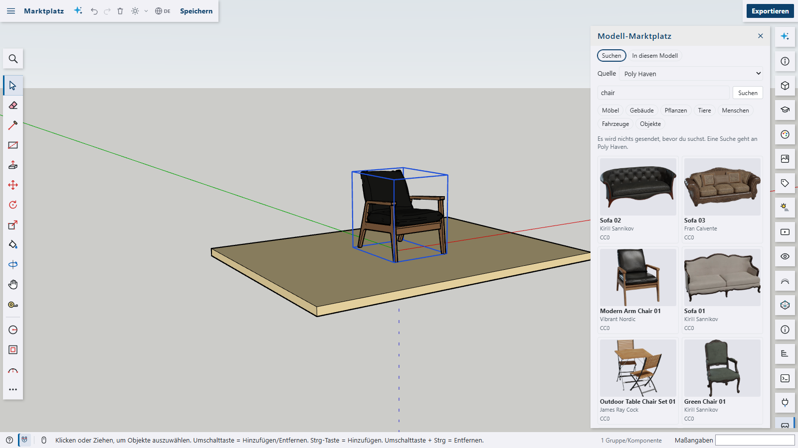

# Model marketplace for Shap3D.ai

Search public 3D sources from inside the app, see a preview, the author and the licence, and load a model into the current model. The plugin is a package of its own and is **not** part of the app. It only uses the plugin API.



## Sources

| Source            | Key                                    | Loads                | Licence                                  | Tested in the browser                                                  |
| ----------------- | -------------------------------------- | -------------------- | ---------------------------------------- | ---------------------------------------------------------------------- |
| Poly Haven        | none                                   | glTF with its parts  | CC0                                      | search to model in the scene                                           |
| Wikimedia Commons | none                                   | STL                  | per file                                 | search to model in the scene                                           |
| OpenStreetMap     | none                                   | footprints as blocks | ODbL (credit, share-alike)               | search to model in the scene; Overpass is shared and can be slow or full |
| Sketchfab         | your API token, for loading only       | GLB, or glTF in zip  | per model (many CC, some non-commercial) | search and details; **loading not tested**                             |
| Thingiverse       | your App Token, for everything         | biggest STL or OBJ   | per thing                                | the service allows calls from a page; **nothing with a real token**    |
| MyMiniFactory     | your API key, for search               | nothing: opens the page | per object                            | **not tested**, field names and header unconfirmed                     |

Sources marked as not tested say so in the panel: nobody could try them with a real key yet.

- **Keys**: you enter them in the panel. They stay in this browser (`localStorage`, readable by anything that runs in the app, like AI keys) and only go to that source, in a header, never in an address.
- **Requests**: nothing is sent until you search or click. A search goes to the source you chose; its pictures load from it.
- **Poly Haven** asks to be told about integrations in tools and to be named; **Sketchfab** asks apps to name it and to show author and licence. The panel does this. Nominatim (place search) has a [usage policy](https://operations.osmfoundation.org/policies/nominatim/): one request per search, no search-as-you-type.

## Loading

1. The bytes are fetched in a worker, with a progress bar and _Cancel_. Limit: 256 MB, counted as they arrive and again while unpacking.
2. A glTF with its `.bin` and pictures, or a zip with them, becomes one `.glb` in the worker, so the import needs nothing from outside. An address inside a file is not followed: such a file is refused. Paths in a zip stay inside it. Draco, meshopt and Basis compression are refused with a message, since the app's loader has no decoders for them.
3. The result goes through the app's own import (`context.files.importFile`): faces in a worker, on the ground at the origin, one undo step.  **A textured material becomes one colour**, the mean of its picture where the model uses it: faces have no texture coordinates, so the picture itself does not arrive.
4. **STL has no unit.** One from Commons or Thingiverse with a largest side over 10 is taken for millimetres, and you are told.
5. **OpenStreetMap**: search a place, and the buildings within 150 m become simple blocks, with `height` or `building:levels` where the map has them. Holes and multi-part buildings (OSM relations) are skipped.

## Credits

Author, licence, source and address stay on the imported group (`context.data`), also in the saved `.shap3d.json`. _In this model_ lists them and copies them as text. Exports to other formats do not carry them, so copy them when you pass the work on. The licence hints in the panel are a reminder, not legal advice: read the licence.

## Add a source

A source is one file in `src/sources/` that fills `ModelSource` from `src/source.ts` (`search`, optional `details`, `download`), listed in `src/sources/index.ts`. Do not add sources without an API that allows this: no scraping.

## Build and check

```bash
cd plugins/marketplace
npm run build
```

Then _Plugins › Load plugin folder…_ and pick `plugins/marketplace/dist`. Checks: `npm run typecheck`, `lint`, `format:check`, `i18n`, `test`.
