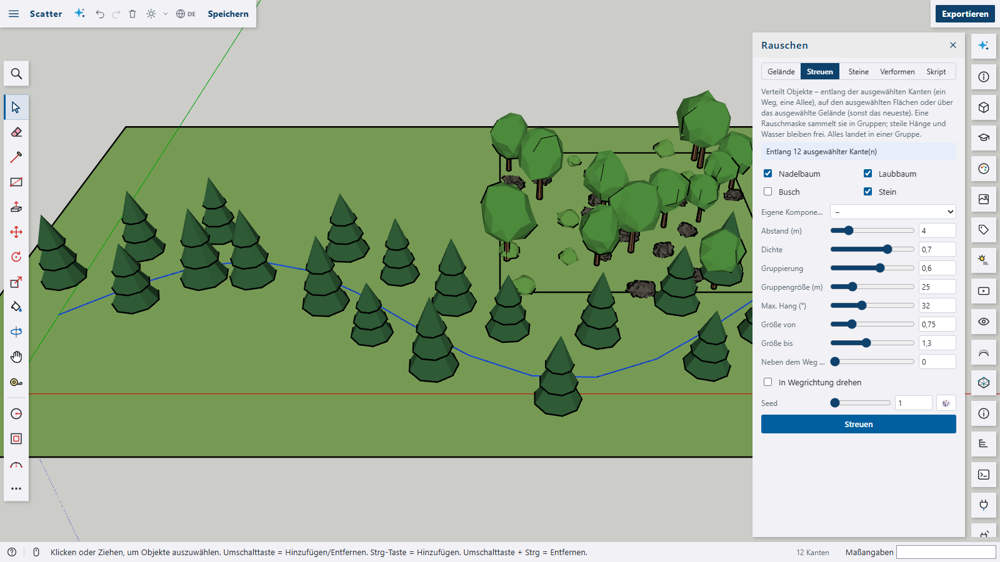
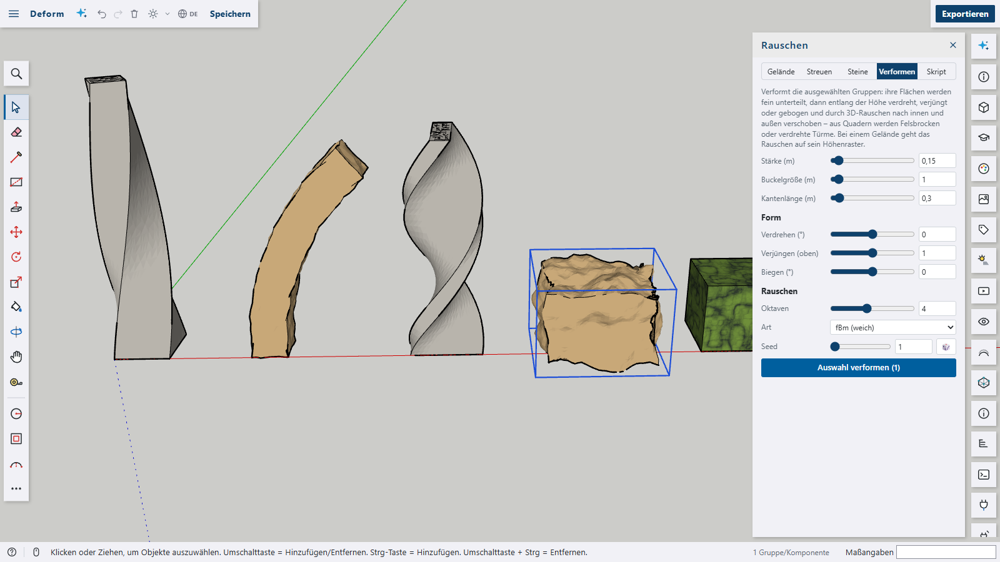

# Noise for Shap3D.ai

Procedural generation from seeded noise – simplex noise (the improved successor of Perlin noise) and cellular (Voronoi) noise: terrains with hills, mountains, islands, canyons and dunes with a live preview, trees, bushes and rocks scattered over terrains, faces or along paths, flagstones, cobbles and dry walls as real stones, groups twisted, bent and roughened into boulders, two material shaders, and `s3d.noise()` / `s3d.cellNoise()` for scripts.







The plugin is a package of its own with its own `package.json` and is **not** part of the app. It only uses the plugin API: a panel, script extensions, a material shader, context menu entries, the viewport's helpers for the preview and data on groups and components.

## Features

- **Noise terrain** (tab _Terrain_): width, depth and detail (cells along the longer side, up to 120), and the noise itself:
  - **Kind**: _fBm_ (soft, rolling), _Ridged_ (a ridged multifractal – sharp crests, smooth valleys) or _Billow_ (round bumps, dunes)
  - **Seed** (🎲 for a random one), **scale** (metres per hill), **height**, **octaves**, **persistence**, **lacunarity**
  - **Valleys ↔ peaks** (an exponent: wide valleys and sharp peaks above 1), **warp** (noise bent by noise – meandering valleys, folded ridges)
  - **Island**: the ground falls into the sea towards the edges; **terraces** with adjustable edges; **water** level and **snow** line; a closed block with earth walls
  - Five presets: _Hills_, _Mountains_, _Island_, _Canyon_, _Dunes_
  - A **live preview** in the 3D view; _Create terrain_ adds it as one undo step. Grass, earth, rock and snow follow height and slope like in the built-in terrain plugin.
  - The terrain keeps its settings: select it and the panel shows them – _Apply changes_ rebuilds it in place (the preview shows the new version first), _As new terrain_ adds another one.
- **Works with the Terrain tool**: a noise terrain stores its height grid in the format of the built-in terrain plugin (`pluginData.terrain`), so _Terrain_ (sandbox) opens it and sculpts it by hand. Changing it in the Noise panel again starts from the noise settings (hand sculpting is lost then).
- **Scatter** (tab _Scatter_): conifers, broadleaf trees, bushes and rocks (low-poly components, several variants each, crowns and rocks bent by noise) or a component of the model. Where depends on the selection:
  - **selected edges** – along a path: one object every _spacing_ metres, optionally _beside the path_ on alternating sides (an avenue) and _facing along the path_
  - **selected faces** – on them, in any direction; optionally _standing on the face_ (along its normal – walls, roofs)
  - otherwise the **selected terrain** or the newest one; steep slopes and water stay free
  - A noise mask gathers them in clumps (woods, scree); spacing, density, clumping, clump size, maximum slope, random size and turn. All of it goes into one group.
- **Stones** (tab _Stones_ or the context menu on faces): cellular (Voronoi) noise laid as real stones – each a prism with a chamfered top, joints between them, heights and shades varied, optionally mortar in the joints. On the selected faces (floors and walls alike; a convex face cuts the border stones to fit) or on an area of its own. Stone size, joint, irregularity, length ↔ width, thickness, height variation, chamfer, number of shades, colour. Presets _Flagstones_, _Cobbles_, _Slabs_ and _Dry wall_.
- **Deform** (tab _Deform_ or the context menu): the selected groups are refined (every edge shorter than a length, without cracks), then **twisted**, **tapered** and **bent** along their height and moved in and out by 3D noise – boxes become twisted towers, bent columns or boulders. Groups inside groups are deformed too; a component changes in every place it is used. On a terrain the noise goes onto its height grid, so it stays a terrain.
- **Material shaders** in the Materials panel (_Texture › Shaders (plugins)_), solid in the object's coordinates (no seams):
  - _Noise_ – two colours mixed by fractal noise (kind, octaves, persistence, warp, contrast, balance): moss, stains, clouds
  - _Cells_ – a Voronoi pattern with joints and a shade per cell (joint colour and width, irregularity, shade variation): crazy paving, dried mud
- **Scripts**:
  - `s3d.noise(x, y, z?, seed?)` – simplex noise −1 … 1 (2D or 3D)
  - `s3d.fbm(x, y, { z, seed, octaves, persistence, lacunarity, mode })` – fractal noise (`'fbm'`, `'ridged'`, `'billow'`)
  - `s3d.noiseTerrain({ at, width, depth, detail, seed, scale, height, octaves, persistence, lacunarity, mode, warp, exponent, terraces, terraceSharpness, falloff, water, snow, rock, skirt, name })` – returns the group
  - `s3d.scatter({ on, area, objects, spacing, density, clumping, clumpSize, seed, maxSlope, minHeight, maxHeight, sizeMin, sizeMax, limit })` – returns the group with the objects
  - `s3d.cellNoise(x, y, seed?, jitter?)` – cellular noise: `{ f1, f2, id, site }` (distance to the nearest and second nearest site, a number per cell, the site)
  - `s3d.paving({ on, area, z, size, gap, jitter, stretch, thickness, variation, bevel, shades, color, material, joint, seed })` – stones on the selected faces or an area; returns the group
  - `s3d.noiseDeform({ target, amount, scale, detail, octaves, persistence, mode, seed, twist, taper, bend })` – returns how many groups changed
  - `s3d.scatter({ …, offset, alongPath, align })` – the path and face options
  - `s3d.material('…', '#6f8f3a', { shader: 'noise.noise', params: { color2: '#2f3a2c', mode: 1 } })` and `{ shader: 'noise.cells', params: { joint: 0.08 } }`
  - The tab _Script_ opens an example in the script editor; the demos in [`docs/`](docs) build the screenshot scenes.
- **Languages**: English, German, French, Spanish and Arabic; the plugin follows the app's language.

The same seed always gives the same landscape – terrains, scattering and roughening are reproducible from their settings.

## Limits

- Terrains are regular height grids (no overhangs or caves) of at most 120 × 120 cells, like the Terrain tool's.
- Scattered objects are placed once: changing the terrain later leaves them where they are – scatter again.
- Deforming turns faces into triangles and keeps their front material; back materials and textures' positions are not kept. Twist, taper and bend work along z of the group.
- Stones on a concave face keep only the stones that lie wholly inside it (no cutting); holes in a face are not left out.
- Scattering along a path treats every selected edge on its own.
- Writing the height grid into `pluginData.terrain` relies on the built-in terrain plugin's data format – the plugin API has no call to write another plugin's data.

What changed in which version: [CHANGELOG.md](CHANGELOG.md).

## Building and installing

```bash
cd plugins/noise
npm run build
```

`npm run build` is a plain `vite build` (library mode, [`vite.config.ts`](vite.config.ts)); Vite, the Vue compiler and TypeScript come from the repository root, so run `npm ci` there first. The package has no dependencies of its own. `npm run typecheck` checks the TypeScript against the app's plugin types, `npm run lint` and `npm run format` lint and format `src/`, `npm run i18n` checks the texts.

Then in Shap3D.ai: _Plugins › Load plugin folder…_ and pick the folder `plugins/noise/dist`. The panel _Noise_ opens from the tile in the right-hand bar or the command palette (_Noise terrain…_).

**Screenshots**: `npm run screenshots` renders `docs/noise.png`, `docs/noise-scatter.png`, `docs/noise-stones.png` and `docs/noise-deform.png` from the demos in `docs/` ([`docs/screenshots.mjs`](docs/screenshots.mjs) – Windows and Linux/macOS) with the dev server running; `--url` picks another dev server, `--only stones` one picture.

## Structure

```
plugins/noise/
  package.json            a package of its own – no dependencies
  vite.config.ts          builds dist/: plugin.js from src/ (Vue routed to the app's Vue), README and package.json
  src/
    index.ts              the plugin (panel, commands, context menu, shader, s3d functions)
    noise.ts              seeded simplex noise 2D/3D, fBm, ridged, billow, warp, terraces, height fields, cellular noise
    terrain.ts            noise terrains as height grids in the terrain plugin's format, their mesh and surfaces
    actions.ts            what s3d.noiseTerrain, s3d.scatter, s3d.paving and s3d.noiseDeform do
    paving.ts             stones from Voronoi cells: cells with joints, cut to an outline, chamfered prisms
    mesh.ts               triangle meshes: refining without cracks, displacing, twist/taper/bend, icospheres and cones
    objects.ts            the trees, bushes and rocks to scatter
    preview.ts            the live preview in the 3D view
    shader.ts             the noise and cells material shaders (GLSL)
    presets.ts            the ready-made landscapes; example.ts the script example
    S3dNoisePanel.vue     the panel; S3dNoiseSlider.vue a slider with a number field
    styles.ts, tabs.ts, runtime.ts
    i18n/*.json           the texts: en (source), de, fr, es, ar
  docs/                   screenshots, their demos and screenshots.mjs
  dist/                   the installable plugin folder (not checked in)
```

## License

Apache-2.0, like the app.
