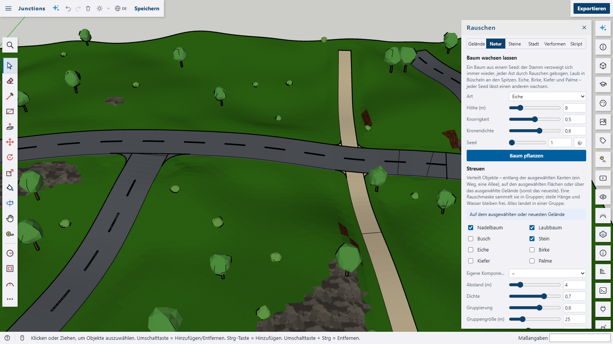
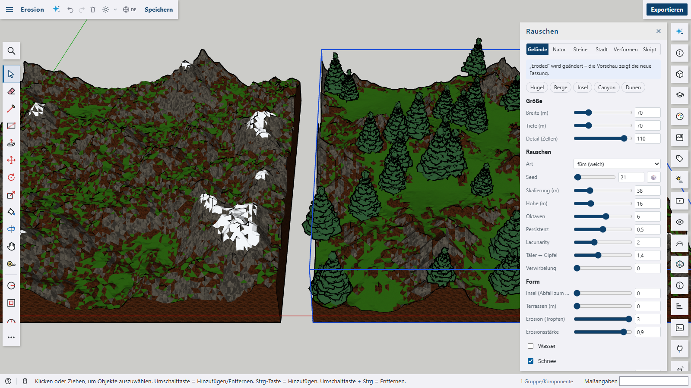
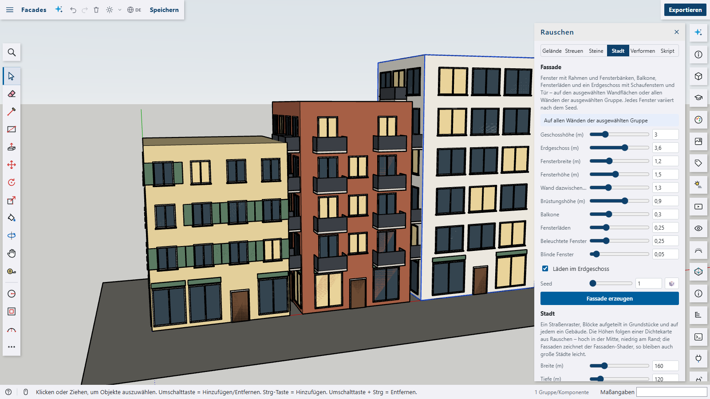

# Noise for Shap3D.ai

Procedural generation from seeded noise – simplex noise (the improved successor of Perlin noise) and cellular (Voronoi) noise: terrains with hills, mountains, islands, canyons and dunes with a live preview and hydraulic erosion, rivers dug through their valleys and roads that find the gentlest way over them, trees grown from seeds (oak, birch, pine, palm), bushes and rocks scattered over terrains, faces or along paths, flagstones, cobbles and dry walls as real stones, facades with windows and balconies, whole cities whose heights follow a density map – with pitched roofs, perimeter blocks round courtyards, parks, street trees and road markings, also on a terrain as a hill town of terraces – villages on the gentle slopes connected by roads, groups twisted, bent and roughened into boulders, three material shaders, and `s3d.noise()` / `s3d.cellNoise()` for scripts.










The plugin is a package of its own with its own `package.json` and is **not** part of the app. It only uses the plugin API: a panel, script extensions, a material shader, context menu entries, the viewport's helpers for the preview and data on groups and components.

## Features

- **Noise terrain** (tab _Terrain_): width, depth and detail (cells along the longer side, up to 120), and the noise itself:
  - **Kind**: _fBm_ (soft, rolling), _Ridged_ (a ridged multifractal – sharp crests, smooth valleys) or _Billow_ (round bumps, dunes)
  - **Seed** (🎲 for a random one), **scale** (metres per hill), **height**, **octaves**, **persistence**, **lacunarity**
  - **Valleys ↔ peaks** (an exponent: wide valleys and sharp peaks above 1), **warp** (noise bent by noise – meandering valleys, folded ridges)
  - **Island**: the ground falls into the sea towards the edges; **terraces** with adjustable edges; **water** level and **snow** line; a closed block with earth walls
  - Five presets: _Hills_, _Mountains_, _Island_, _Canyon_, _Dunes_
  - A **live preview** in the 3D view; _Create terrain_ adds it as one undo step. Grass, earth, rock and snow follow height and slope like in the built-in terrain plugin.
  - The terrain keeps its settings: select it and the panel shows them – _Apply changes_ rebuilds it in place (the preview shows the new version first), _As new terrain_ adds another one.
- **Rivers** (tab _Nature_, `s3d.river`): the cheapest way through the valleys of a terrain – from high on its border to the lowest spot of it, or between two points – meandering by noise. The bed is dug into the terrain's height grid so that it only falls downstream, gets wider towards the mouth and has gently sloping banks; a water ribbon fills it. Width, depth, meanders, seed.
- **Roads and paths** (tab _Nature_, `s3d.road`): between two points the road finds the gentlest way below the steepest grade you allow – searched with steps a little longer than the road is wide, so no bend gets tighter than it can take, then rounded into wide curves. Along several selected edges (or `along` points) it follows them; one selected edge: it finds its way between the edge's ends. The terrain is cut and filled to an evenly graded bed with banks; deeper hollows are bridged by the road deck, rivers always (1.2 m above the water, ramps up to it), and found routes keep away from rivers and cross them briefly. Where a road meets a road built before, they make a junction: a road running into another one ends at its edge – the end cut along that edge, its height ramped to the other road's and tilted with it on a slope – one crossing another is split into a piece on each side, and one starting or ending at another road's end goes on from it, leaving it straight before it bends; the corners are rounded off, the centre line stops short of the junction. Asphalt (with a dashed centre line) or a gravel path; width, steepest grade.
- **Building steps** (tab _Terrain_ with a terrain selected, `s3d.terrainSteps`, `s3d.editTerrainStep`, `s3d.rebuildTerrain`): everything built on a terrain – erosion, rivers, roads, a city, villages, scattering – is kept as a step of its recipe, with its options in the terrain's own coordinates. Switch a step off, give it another seed or remove it, and the terrain is built again: the heights from the start (a noise terrain's settings, or the heights a Terrain-tool terrain had before its first step), everything the steps made removed, then every step that is on, in order – one undo step. Changing a noise terrain's settings (_Apply changes_) builds its steps again on the new heights instead of losing them. Sculpting with the Terrain tool becomes a step of its own (_Sculpted_) as soon as it is applied – in the same undo step – so building again keeps it. The height grid is read and written through the app's data format `terrain.grid`, so this works without the terrain plugin running. A step that no longer fits (no place left for the villages) is skipped and named.
- **Erosion**: raindrops run downhill, dig gullies where they speed up and drop their sediment where they slow down; a thermal pass lets too steep slopes slide. A slider in the terrain tab (drops per grid point and strength, shown in the preview and kept with the settings), `s3d.erode()` and the context menu _Erode terrain_ for any terrain – also ones from the Terrain tool.
- **Works with the Terrain tool**: a noise terrain stores its height grid in the format of the built-in terrain plugin (`pluginData.terrain`), so _Terrain_ (sandbox) opens it and sculpts it by hand. Changing it in the Noise panel again starts from the noise settings (hand sculpting is lost then).
- **Trees** (tab _Nature_, `s3d.tree`): grown from a seed – the trunk forks again and again (shorter and thinner each time, turned round its parent), every branch bent by 3D noise, leaves as noise-bent clusters at the tips. _Oak_ (broad, gnarled), _birch_ (white bark, a leader that keeps going up), _pine_ (a straight stem with whorls of drooping branches) and _palm_ (a leaning stem, a crown of arching fronds). Height, gnarl and crown density; the same settings grow the same tree and share its component.
- **Scatter** (tab _Nature_): conifers, broadleaf trees, bushes and rocks (low-poly components, several variants each, crowns and rocks bent by noise), oaks, birches, pines and palms from the tree generator, or a component of the model. Where depends on the selection:
  - **selected edges** – along a path: one object every _spacing_ metres, optionally _beside the path_ on alternating sides (an avenue) and _facing along the path_
  - **selected faces** – on them, in any direction; optionally _standing on the face_ (along its normal – walls, roofs)
  - otherwise the **selected terrain** or the newest one; steep slopes and water stay free
  - A noise mask gathers them in clumps (woods, scree); spacing, density, clumping, clump size, maximum slope, random size and turn. All of it goes into one group.
- **Stones** (tab _Stones_ or the context menu on faces): cellular (Voronoi) noise laid as real stones – each a prism with a chamfered top, joints between them, heights and shades varied, optionally mortar in the joints. On the selected faces (floors and walls alike; a convex face cuts the border stones to fit) or on an area of its own. Stone size, joint, irregularity, length ↔ width, thickness, height variation, chamfer, number of shades, colour. Presets _Flagstones_, _Cobbles_, _Slabs_ and _Dry wall_.
- **Facades** (tab _City_ or the context menu on faces): windows with frames and sills, a mullion in wide ones, open shutters, balconies with railings in vertical stacks, cornices between the storeys and a ground floor with shop windows and a door in the middle – laid as geometry in front of the selected wall faces or of all walls of the selected group (a box becomes a town house). Storey and ground floor height, window size, wall between, sill height, shares of balconies, shutters, lit windows and blind windows, shops; every window varies by the seed. Gable and odd walls only get windows that fit.
- **Cities** (tab _City_): a grid of streets with pavements, blocks split into plots of random size, a building on each – its height follows a density map of noise (high in the centre, low at the edges), tall ones step back on their upper floors, flat-roofed ones often have a box on the roof, low ones get gable or hip roofs (tiles or slate; the gables carry the facade on into the attic). Some blocks become a perimeter block – a ring of houses round a courtyard with hip-roofed corners and wings cut into houses of different heights and facades – others parks with four lawns, a cross of paths and trees, more often where the city is low. Street trees stand in rows on the pavements, the streets get dashed centre lines and zebra crossings. Every building is a group of its own; their facades are drawn by the _Facade_ shader (five styles), so cities of hundreds of buildings stay light. Size, block size, street width, plot size, gap, floors from/to, storey height, scale of the density map, how high the centre is, share of empty plots, pavement width, share of pitched roofs and up to how many floors, share of perimeter blocks and parks, distance of the street trees, road markings.
- **Villages** (tab _City_, `s3d.villages`): sites on gentle, dry ground of the selected (or newest) terrain, spread apart and away from cities, rivers and roads (where there are too few, a little steeper ground is allowed). Each gets a main street along the slope's contour, through the centre, and side streets branching off it up and down the slope, wandering a little, dug into the terrain like roads; houses stand beside them in one or two rows – turned along the street, 1–3 storeys, gable or hip roofs, a plinth down to their lowest corner, small windows from the _Facade_ shader. Roads connect the villages (the shortest network that reaches them all), going on from a street end and finding the gentlest way around the other villages – gravel, asphalt or none. Number of villages, houses each, road width, steepest site.
- **Cities on a terrain** (tab _City_ with a terrain selected, `s3d.city({ on })`): the city takes the terrain's size (or the size you give it, centred on it). Its slopes are eased (_Ease the slopes_, fading out beyond the city), every block becomes a level terrace at the mean height of its ground on retaining walls, the streets follow the ground between them – a surface that ends exactly at the blocks, with walls inside a block where the street runs above it. The terrain sinks a little under the whole city, so it never shows through; buildings, parks, trees and markings stand on their terrace or street. Works on noise terrains and on ones from the Terrain tool.
- **Deform** (tab _Deform_ or the context menu): the selected groups are refined (every edge shorter than a length, without cracks), then **twisted**, **tapered** and **bent** along their height and moved in and out by 3D noise – boxes become twisted towers, bent columns or boulders. Groups inside groups are deformed too; a component changes in every place it is used. On a terrain the noise goes onto its height grid, so it stays a terrain.
- **Material shaders** in the Materials panel (_Texture › Shaders (plugins)_), solid in the object's coordinates (no seams):
  - _Noise_ – two colours mixed by fractal noise (kind, octaves, persistence, warp, contrast, balance): moss, stains, clouds
  - _Cells_ – a Voronoi pattern with joints and a shade per cell (joint colour and width, irregularity, shade variation): crazy paving, dried mud
  - _Facade_ – windows in a grid of storeys (one tile = one storey) with a shop floor, lit or dark per window: window and lit colour, share of lit windows, spacing, width and height of the windows
- **Scripts**:
  - `s3d.noise(x, y, z?, seed?)` – simplex noise −1 … 1 (2D or 3D)
  - `s3d.fbm(x, y, { z, seed, octaves, persistence, lacunarity, mode })` – fractal noise (`'fbm'`, `'ridged'`, `'billow'`)
  - `s3d.noiseTerrain({ at, width, depth, detail, seed, scale, height, octaves, persistence, lacunarity, mode, warp, exponent, terraces, terraceSharpness, falloff, water, snow, rock, skirt, name })` – returns the group
  - `s3d.scatter({ on, area, objects, spacing, density, clumping, clumpSize, seed, maxSlope, minHeight, maxHeight, sizeMin, sizeMax, limit })` – returns the group with the objects
  - `s3d.cellNoise(x, y, seed?, jitter?)` – cellular noise: `{ f1, f2, id, site }` (distance to the nearest and second nearest site, a number per cell, the site)
  - `s3d.paving({ on, area, z, size, gap, jitter, stretch, thickness, variation, bevel, shades, color, material, joint, seed })` – stones on the selected faces or an area; returns the group
  - `s3d.facade({ on, floorHeight, groundFloor, shops, windowWidth, windowHeight, spacing, sill, margin, balconies, shutters, lit, gaps, seed })` – on the selected faces, a face or all walls of a group; returns the group
  - `s3d.city({ at, on, flatten, width, depth, block, street, plot, gap, minFloors, maxFloors, floorHeight, scale, centre, empty, sidewalk, roofs, pitchedFloors, courts, parks, treeSpacing, markings, ground, seed })` – returns the group
  - `s3d.tree({ at, species, height, gnarl, density, rotation, seed })` – returns the placed tree
  - `s3d.river({ target, from, to, width, depth, wiggle, seed })` – returns the water group
  - `s3d.road({ target, from, to, along, width, surface: 'asphalt' | 'gravel', maxGrade, markings, seed })` – returns the road group
  - `s3d.villages({ target, count, houses, roadWidth, maxSlope, roads: 'gravel' | 'asphalt' | 'none', seed })` – returns the group with the houses
  - `s3d.terrainSteps({ target })`, `s3d.editTerrainStep({ target, index, enabled, seed, remove })` and `s3d.rebuildTerrain({ target })` – the building steps
  - `s3d.erode({ target, amount, strength, seed })` and `s3d.noiseTerrain({ …, erosion, erosionStrength })` – erosion
  - `s3d.noiseDeform({ target, amount, scale, detail, octaves, persistence, mode, seed, twist, taper, bend })` – returns how many groups changed
  - `s3d.scatter({ …, offset, alongPath, align })` – the path and face options
  - `s3d.material('…', '#6f8f3a', { shader: 'noise.noise', params: { color2: '#2f3a2c', mode: 1 } })` and `{ shader: 'noise.cells', params: { joint: 0.08 } }`
  - The tab _Script_ opens an example in the script editor; the demos in [`docs/`](docs) build the screenshot scenes.
- **Languages**: English, German, French, Spanish and Arabic; the plugin follows the app's language.

The same seed always gives the same landscape – terrains, scattering and roughening are reproducible from their settings.

## Limits

- Terrains are regular height grids (no overhangs or caves) of at most 120 × 120 cells, like the Terrain tool's.
- Scattered objects are placed once: changing the terrain later leaves them where they are – scatter again.
- Deforming turns faces into triangles and keeps their front material; back materials and textures' positions are not kept. Twist, taper and bend work along z of the group.
- Stones on a concave face keep only the stones that lie wholly inside it (no cutting); holes in a face are not left out.
- Scattering along a path treats every selected edge on its own.
- Trees are low-poly on purpose (leaf clusters, no single leaves); a tree with a dense crown has a few thousand faces, so scatter reuses a handful of variants per species. Erosion works on the terrain's height grid (at most 120 × 120), so gullies are as fine as its cells – rivers and roads too: on a coarse grid their banks are coarse. Water, road surfaces, cities and villages are groups beside the terrain; building the steps again makes them anew, so changes made to them by hand are lost then. Steps are only kept from this version on, and only for what is built on a terrain (a city beside the model is no step). A Terrain-tool terrain keeps its heights from before the first step, and every terrain with steps the heights they gave last (to tell sculpting from them) – two copies of the height grid in the model. If the Terrain tool changes the grid's size, sculpting is not taken over and a Terrain-tool terrain cannot be built again. Objects scattered before stay where a road or city now runs; scattering afterwards leaves cities, villages, rivers and roads on the terrain free. A later road leaves the surface of earlier ones as it is; where two roads cross, one may lie a little above the other. Bridges are a deck without piers or railings.
- Facades are built in front of the wall – nothing is cut out of it – and on walls with a vertical face only. City buildings are boxes (with pitched roofs, setbacks or round a courtyard) on rectangular plots in a straight grid of streets; their windows are a shader, not geometry (export formats keep the facade colour).
- Writing the height grid into `pluginData.terrain` relies on the built-in terrain plugin's data format – the plugin API has no call to write another plugin's data.

What changed in which version: [CHANGELOG.md](CHANGELOG.md).

## Building and installing

```bash
cd plugins/noise
npm run build
```

`npm run build` is a plain `vite build` (library mode, [`vite.config.ts`](vite.config.ts)); Vite, the Vue compiler and TypeScript come from the repository root, so run `npm ci` there first. The package has no dependencies of its own; the generators come from [`packages/procgen`](../../packages/procgen/README.md) and are bundled in. `npm run typecheck` checks the TypeScript against the app's plugin types, `npm run lint` and `npm run format` lint and format `src/`, `npm run i18n` checks the texts.

Then in Shap3D.ai: _Plugins › Load plugin folder…_ and pick the folder `plugins/noise/dist`. The panel _Noise_ opens from the tile in the right-hand bar or the command palette (_Noise terrain…_).

**Screenshots**: `npm run screenshots` renders `docs/noise.png`, `docs/noise-scatter.png`, `docs/noise-stones.png`, `docs/noise-trees.png`, `docs/noise-villages.png`, `docs/noise-routes.png`, `docs/noise-junctions.png`, `docs/noise-erosion.png`, `docs/noise-facade.png`, `docs/noise-city.png`, `docs/noise-hillcity.png` and `docs/noise-deform.png` from the demos in `docs/` ([`docs/screenshots.mjs`](docs/screenshots.mjs) – Windows and Linux/macOS) with the dev server running; `--url` picks another dev server, `--only stones` one picture.

## Structure

```
plugins/noise/
  package.json            a package of its own – no dependencies
  vite.config.ts          builds dist/: plugin.js from src/ and the generators of packages/procgen (Vue routed to the app's Vue), README and package.json
  src/
    index.ts              the plugin (panel, commands, context menu, shader, s3d functions)
    actions.ts            what s3d.noiseTerrain, s3d.scatter, s3d.tree, s3d.erode, s3d.river, s3d.road, s3d.villages, s3d.paving, s3d.facade, s3d.city and s3d.noiseDeform do
    objects.ts            the trees, bushes and rocks to scatter, as components
    recipes.ts            building steps: recording a step, marking what it made, sculpting as a step
    rebuild.ts            building a terrain's steps again, editing them, new settings for a noise terrain with steps
    preview.ts            the live preview in the 3D view
    shader.ts             the noise, cells and facade material shaders (GLSL)
    presets.ts            the ready-made landscapes; example.ts the script example
    S3dNoisePanel.vue     the panel; S3dNoiseSlider.vue a slider with a number field
    styles.ts, tabs.ts, runtime.ts
    i18n/*.json           the texts: en (source), de, fr, es, ar
  docs/                   screenshots, their demos and screenshots.mjs
  dist/                   the installable plugin folder (not checked in)
```

The generators themselves – noise, terrains, erosion, rivers and roads, cities, villages, trees, stones, facades and meshes – live in [`packages/procgen`](../../packages/procgen/README.md), a library with its own tests. The plugin imports it as `@shap3d/procgen` (an alias in `vite.config.ts` and `tsconfig.json`) and bundles it into `plugin.js`; at runtime it needs nothing else.

## License

Apache-2.0, like the app.
