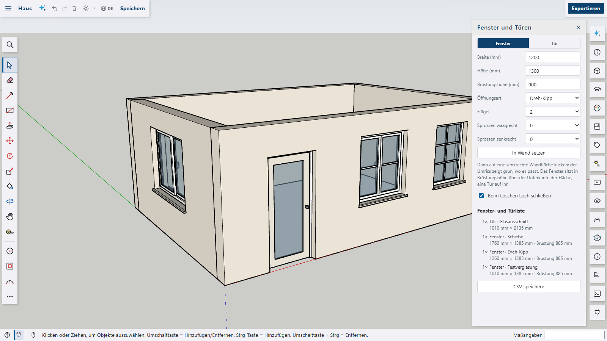

# Windows and doors for Shap3D.ai

Parametric windows and doors, set into any wall with a click: the opening is cut through the wall – its rectangle is drawn on the wall face and pushed onto the wall's back, as you would in SketchUp – and the window or door sits in it as a group of pieces. Windows have a frame, one to three sashes with glass, glazing bars across and upright, and sills inside and out; doors have a three-sided frame, a leaf and a handle on both faces. A schedule counts them and goes out as CSV.



## Use

1. _Plugins › Windows and doors…_: choose _Window_ or _Door_ and its sizes in mm – width, height and (windows) sill height. A window opens tilt and turn, casement or sliding, or is fixed glazing (panes in the frame, mullions between), with one to three sashes and glazing bars; a door has its hinges left or right and a solid or a glazed leaf.
2. _Set into wall_, then move over a vertical wall face: the outline follows the pointer, green where it fits, red where it would leave the face or overlap another opening. A window sits at its sill height above the bottom of the face, a door on it.
3. Click: the hole goes through the wall (the wall's thickness is found by itself; a single face just gets the hole) and the window or door is set into the middle of the wall. One undo step. Esc stops.
4. Select a window or door (inside its wall's group) to change any of its settings. Sashes, glazing bars and hinges build its pieces again; a new width, height or sill height closes the old hole (healed into the wall faces) and cuts the new one, centred where the old one was – when it does not fit, nothing changes.
5. Deleting a window or door: while _Close the hole when deleting_ is on (the default, saved with the model), the hole goes with it – whether it is deleted with the Delete key, the eraser or cut – in the same undo step. Switched off, the hole stays (a passage, or room for another opening). _Remove and close the hole_ on a selected one always closes it.
6. Walls built again – a wall of _Parts from lines_ given another thickness or side – keep their windows and doors: they move onto the new wall face (up to 50 cm away) and cut their holes with the new thickness.
7. Move a window or door along its wall with the Move tool (or the arrow keys), or copy it with Ctrl: the hole moves along, a copy cuts its own – in the same undo step. One that ends up off the wall face (or turned, or scaled) gets no hole there.
8. The _schedule_ lists all windows and doors in the model, equal ones counted together; _Save CSV_ or _File › Export as window and door schedule (CSV)_ writes it with sizes in mm.

The pieces get the materials _Window frame_, _Window glass_, _Window sill_, _Door leaf_ and _Door handle_ – change their colours in the Materials panel.

## Scripts

```js
const wall = s3d.box([0, 0, 0], 4, 0.3, 2.6);
s3d.opening(wall, { at: [2, 0, 1], kind: 'window', width: 1.2, height: 1.3, sill: 0.9, sashes: 2, barsAcross: 1, operation: 'tiltTurn' });
s3d.opening(wall, { at: [0.8, 0, 1], kind: 'door', width: 0.885, height: 2.01, hinge: 'left', glazed: true });
```

`at` is a point on the wall face (model coordinates); the opening is centred on it along the wall. Sizes in metres; it returns the new group's id. See `docs/demo.js`.

## Build

```sh
npm run build   # dist/: plugin.js, README and package.json – install via Plugins › Load plugin folder… › dist
npm test        # the pieces are closed and face out
```

## Limits and plans

- Vertical wall faces only; the opening is a rectangle. Arched and round windows, door leaves with panels, double doors, roller shutters and plan symbols for LayOut are planned.
- Turned or scaled windows get no hole; only moves keep it.
- Walls of "Parts from lines" keep their windows when built again; rooms of the room planner have their own doors and windows.
