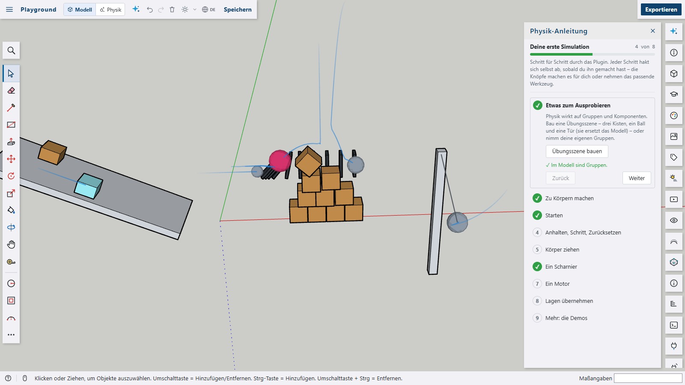
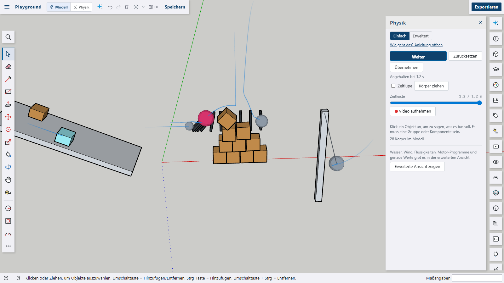
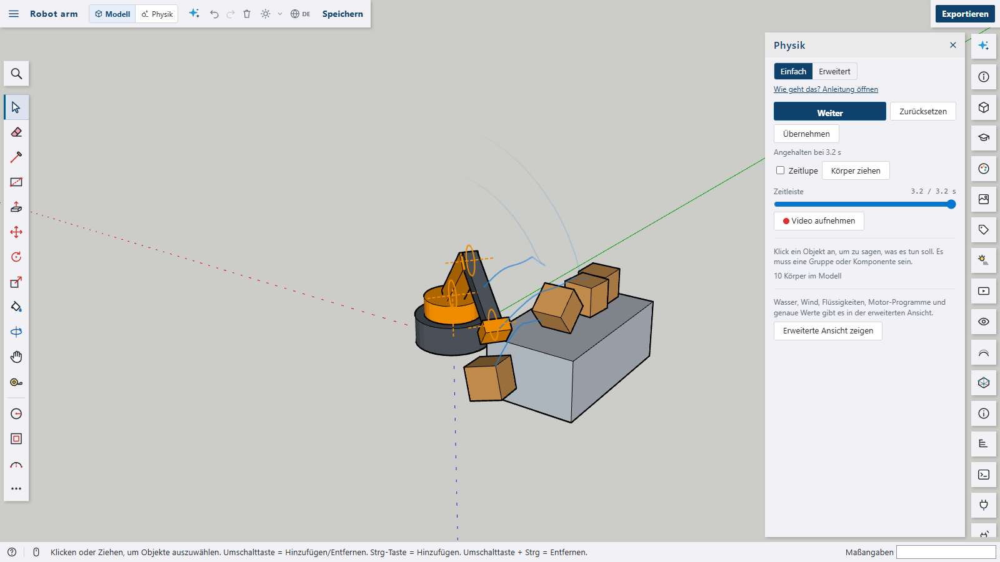
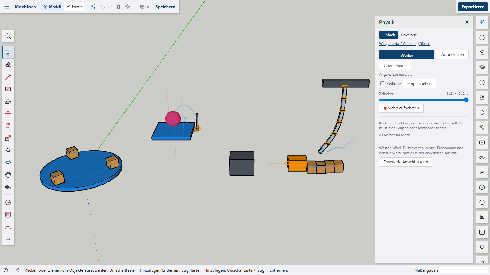
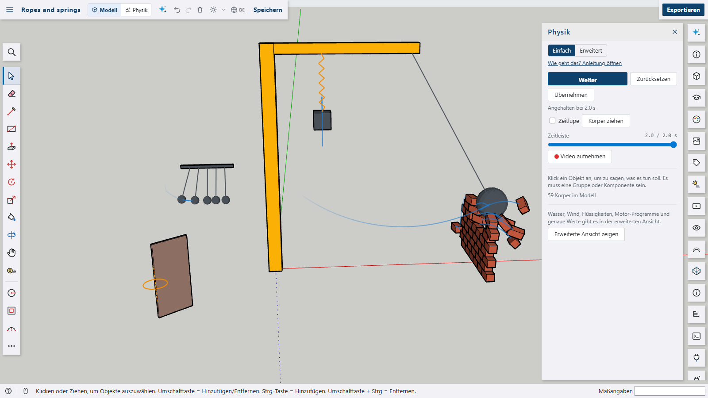
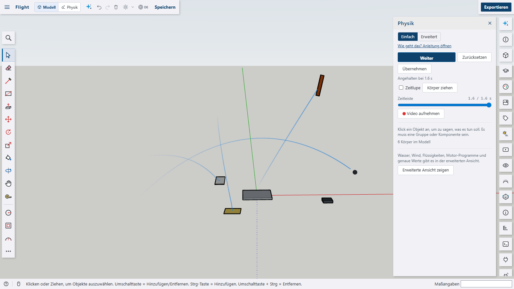
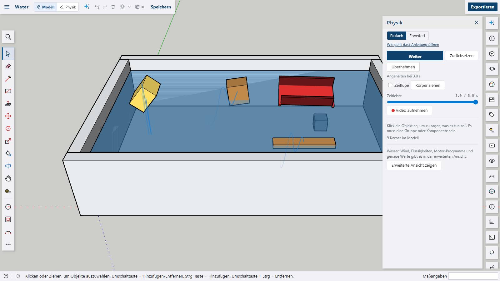
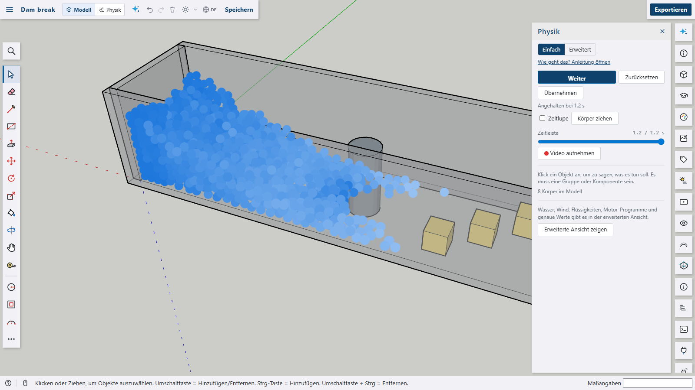
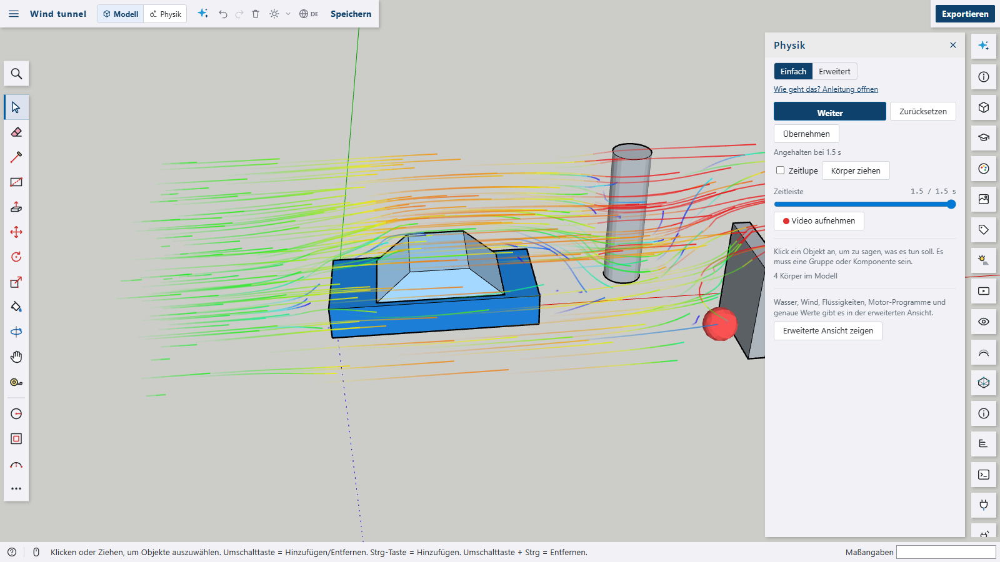

# Physics for Shap3D.ai

Physics on the model: groups and components become **rigid bodies** that fall, bounce, slide and collide – crates, balls, dominoes, a wall of bricks. **Joints** hold them together: hinges and sliders with limits and **motors** that follow a **program** (a robot arm sweeping a table), ball joints, fixed joints, **ropes** and **springs**. **Forces** push them: a constant force, **thrust** that turns with the body (a rocket, a drone), **lift** of a wing, **air drag** and **wind**. **Regions** add more: **water** that floats bodies by their density, a **liquid** of drops that flows around everything, and a **wind tunnel** that shows the air flowing around objects. Start, pause, step and reset – the model is not changed until the places are kept on purpose.



















The plugin is a package of its own with its own `package.json` and is **not** part of the app. It only uses the plugin API – a panel, two tools, the viewport overlay, `display.place` for the bodies' places, plugin data on instances and on the model, a data format, the script API and its examples – and needs no other plugin. The physics engine is [Rapier](https://rapier.rs) (Apache-2.0) as WebAssembly: it ships next to `plugin.js` as `rapier.js` and is only loaded when a simulation starts for the first time.

## Features

- **Simple and advanced**: the Physics panel opens in its **simple view** – Start, Reset, Keep and slow motion; for the selected objects _Falls_, _Stays put_ or _Ignore_, what they are made of (wood, steel, rubber that bounces, ice that slides …) and what holds them (a hinge like a door, a rope, a spring, glue – with a one-click motor for hinges). No numbers, no axes. _Advanced_ at the top of the panel shows every value: kinds, regions, forces, joints with limits, motors and programs, settings.
- **Timeline and video**: everything simulated is kept for two minutes – drag the timeline back to look at any moment again (with the trails up to it); going on from there simulates again from that moment (pulling with the tool and driving joints by hand are not repeated). _Record video_ saves the 3D view with everything drawn over it as MP4 (WebM where the browser has no MP4).
- **Push at the start** (simple view): up, away, left, right as seen from the camera, or spin – gently or strongly. In the advanced view: any start speed and turn.
- **Getting started**: switch to the **physics mode** (_Model | Physics_ in the top bar). The first time it opens the **physics guide**: eight steps from a practice scene to a hinge with a motor, each with buttons that do it or take the right tool, ticking themselves off as you go. Later it is the link at the top of the Physics panel or the command _Physics guide_.

- **Bodies** – select groups or components and make them bodies (Physics panel, the context menu or the commands _Make selection dynamic bodies_ / _static bodies_):
  - _Dynamic_: falls, bounces, slides and is pushed – by gravity, forces, joints and other bodies.
  - _Static_: stays where it is; the others collide with its exact faces.
  - _Moving (kinematic)_: moves and turns at its own speed – on and on, or back and forth with a period – and pushes what is in its way: a lift, a turntable, a piston, a conveyor.
  - _Ignored_: not part of the simulation.
  - Everything else that is visible – loose faces, plain groups – is the still world the bodies collide with, and a **ground** at height 0 catches what falls (it can be switched off).
- **Material** (wood, steel, stone, rubber, ice, plastic, foam or own values): density, friction and bounce – the friction of two surfaces is their mean, so ice slides down a ramp where wood sticks. A **mass** in kg overrides the density.
- **Shape**: _Automatic_ makes a dynamic body of convex hulls – one for its own faces and one for every plain group inside it, so a table of a top and four legs keeps its shape – and static and moving bodies of their exact faces. Or one convex hull (a boat whose inside counts in the water), a box, a sphere or a cylinder along the group's own axes.
- **Start speed and turn** of dynamic bodies, drawn as blue arrows.
- **Forces**: a constant **force** in model axes (red arrow), **thrust** in the body's own axes that turns with it (a rocket, a drone hovering on its rotors), **lift** of a wing (upwards along its own z, growing with the square of its speed along its own x) and **air drag** – its own value or, with _Air drag_ on, one from its size; **wind** blows everywhere.
- **Joints** – each body can have several, to another body, to the group it lies in or to the world:
  - _Hinge_ (around an axis) and _Slider_ (along an axis), with limits from where they start, and a **motor**: to a position or at a speed, with a strength. A **program** (`seconds:value, …`, repeated, eased between its points) drives it over time – a robot arm's moves. While it runs, the panel shows each hinge's angle or slider's way and a **slider to drive it by hand**.
  - _Ball joint_, _Fixed_ (two bodies as one), _Rope_ (a longest length, drawn as a line) and _Spring_ (rest length, stiffness, damping, drawn as a zigzag).
  - The **Joint tool** sets one up with two clicks – its anchor snaps to a corner or the middle of the face, and the simple view's door hinge always stands upright at the edge nearest the click: a face of the body (the anchor; a hinge or slider takes the face's normal as its axis), then the body it holds on to – the same body for the group it lies in, empty space for the world. Anchors and axes are kept in the instance's own coordinates, so they move with it.
- **Regions** – a group's box as a volume:
  - _Water_: up to its top. Bodies float by their density – their box is weighed in 27 cells, each pushed up by the share of it under water, so a boat rights itself – are slowed by the water and drift with its **current**.
  - _Liquid_: filled with drops at the start (up to 1500, their size can be set) that flow without friction around and over everything and push bodies; their **viscosity** goes from water to honey. Drawn as discs, lighter where they move fast.
  - _Wind tunnel_: the wind blows in along its strongest axis and the air flows around everything in the box – the model's faces and the bodies where they are now (stable fluids on a staggered grid, up to 64 cells along its length). **Smoke lines** show the flow, green as fast as the wind, blue where it is slower (0.4 × or less), red where it is faster (1.6 × or more); bodies in it are pushed by the air with their drag.
  - The groups of liquids and tunnels are hidden while it runs; water stays as it is drawn.
- **Simulation** (Physics panel or commands): _Start_, _Pause_ / _Go on_, _Step_ (pauses and goes 0.1 s further), _Reset_ and **Keep** – the bodies' places now are written into the model as one undo step (let things fall into place, then keep them). Gravity, wind, air drag and the speed (0.1× … 2×) change at once while it runs; a change of the model puts it back to the start. It steps at 120 Hz in real time; the model is **not changed** while it runs – `display.place` shows the bodies where they are.
- **Pull tool**: drag a body while the simulation runs – it follows the pointer on a spring (in the plane facing the camera); it starts the simulation when it is not running.
- **What the view shows** (each can be switched off): joints (hinge rings with their axis, slider rails, ropes, springs), forces and start speeds, the **trails** of bodies that moved, and the tunnel's flow.
- **Scripts**:
  - `s3d.physicsBody(group, { type, material, mass, density, friction, bounce, shape, velocity, spin, period, force, thrust, lift, drag, spacing, viscosity, resolution })` – a body or a region; `group` is a handle (`s3d.box(…)`), an instance, its id or its name.
  - `s3d.physicsJoint(group, { kind, to, at, axis, toAt, length, min, max, motor: { mode, value, strength }, program, stiffness, damping })` – points and axes in **model coordinates**; `to` is another group, `'parent'` or `'world'`.
  - `s3d.physicsSettings({ gravity, wind, air, ground, speed })`, `s3d.physicsStart({ at, pause })` (starts once the script is done, `at` seconds simulated at once), `s3d.physicsBodies()` and `s3d.physicsRemove(group)`.
  - Eight **examples** in the script editor under _Physics (plugin)_ – the demos below.
- The data format `physics.body` (plugin data `physics` on the instance), so other plugins can read and write bodies without this one; the settings are plugin data on the model.
- Texts in English, German, French, Spanish and Arabic.

```js
// a ball on a rope, let go to the side, and a door on a hinge pushed open
const ball = s3d.sphere([2, 0, 2], 0.3);
s3d.physicsBody(ball, { material: 'steel', shape: 'sphere' });
s3d.physicsJoint(ball, { kind: 'rope', to: 'world', at: [2, 0, 2], toAt: [0, 0, 3] });

const door = s3d.box([4, 0, 0], 1, 0.05, 2.1);
s3d.physicsBody(door, { material: 'wood', spin: [0, 0, 90] });
s3d.physicsJoint(door, { kind: 'hinge', to: 'world', at: [4, 0.025, 1], axis: [0, 0, 1], min: -100, max: 100 });

// an arm that lifts on a program: seconds → degrees from where it starts
const arm = s3d.box([6, -0.1, 0.5], 0.2, 0.2, 1.2);
s3d.physicsBody(arm, { material: 'steel' });
s3d.physicsJoint(arm, {
  kind: 'hinge',
  to: 'world',
  at: [6.1, 0, 0.5],
  axis: [0, 1, 0],
  program: [
    [0, 0],
    [2, 80],
    [4, 0],
  ],
});

s3d.physicsStart();
```

## Demos

The demos in [`docs/`](docs) are the scripts the screenshots are made with – and the examples in the script editor:

| Demo                                        | Shows                                                                                           |
| ------------------------------------------- | ----------------------------------------------------------------------------------------------- |
| [`demo.js`](docs/demo.js)                   | Playground: crates, rubber and steel balls, a ramp with ice and wood, dominoes, a pendulum      |
| [`demo-robot.js`](docs/demo-robot.js)       | A robot arm: four hinges with motors following programs, sweeping crates off a table            |
| [`demo-machines.js`](docs/demo-machines.js) | A turntable and a lift (kinematic), a piston on a slider, a chain on ball joints, a fixed joint |
| [`demo-crane.js`](docs/demo-crane.js)       | A wrecking ball on a rope, a spring, a door on a hinge, a cradle of balls                       |
| [`demo-flight.js`](docs/demo-flight.js)     | Thrust, lift, air drag and wind: a rocket, a glider, a drone, a cannon ball, a foam sheet       |
| [`demo-water.js`](docs/demo-water.js)       | A pool with a current: foam, wood, a plank, a steel cube and a boat                             |
| [`demo-liquid.js`](docs/demo-liquid.js)     | A dam break: liquid flowing around a pillar towards foam boxes                                  |
| [`demo-tunnel.js`](docs/demo-tunnel.js)     | A wind tunnel around a car, a pillar and a wall, and a beach ball blown away                    |

## Build and install

```bash
cd plugins/physics
npm install
npm run build
```

Then in Shap3D.ai: _Plugins › Load plugin folder…_ and pick `plugins/physics/dist` (`plugin.js`, `rapier.js`, the README and the licence notes).

Checks: `npm run typecheck`, `npm run lint`, `npm run format:check`, `npm run i18n` (texts in all languages). Screenshots: start the dev server in the repository root (`npm run dev`), build the package, then `npm run screenshots` (`--url`, `--only <name>`).

## How it works

- **The model as bodies** (`scene.ts`): every instance with physics data is a body or a region; its geometry is collected in model coordinates in parts – its own faces and every plain group inside it. Everything else that is visible is the static world (one triangle mesh).
- **The simulation** (`sim.ts`): a Rapier world stepped at 120 Hz. Every body starts turned like the world – its instance's own turn and scale are kept aside and put back when it is shown – so joints are given in model axes and hinge angles start at 0. Joints are Rapier's impulse joints with acceleration-based motors; the program is eased between its points. Forces, thrust, lift, drag and buoyancy are added before each step. After each frame each body's place is shown with `display.place` – in the coordinates of the group it lies in, so bodies inside moving bodies stay right.
- **Liquid** (`liquid.ts`): drops are small balls in the Rapier world without friction; neighbouring drops share their speed a little each step (viscosity).
- **Wind tunnel** (`flow.ts`): a staggered grid in the tunnel's box; solid cells come from the model's faces (surface and inside) and from the bodies where they are now. Each air step (40 a second) advects the air semi-Lagrangian and makes it free of divergence with a pressure solve (successive over-relaxation); the open side downstream has pressure 0.
- **What changes in the model**: only the plugin data written by the panel, the tools and the scripts (each one undo step) and the places written by _Keep_. A change of the model while it runs resets the simulation.

## Limits

- Dynamic bodies are convex hulls: a concave shape needs its parts as groups inside it (or a box, sphere or cylinder). Exact faces are only for static and moving bodies.
- The drops and the smoke are drawn over the view – they are not hidden by bodies in front of them.
- The wind tunnel blows along one axis of its box; the air does not take the speed of moving bodies, only their place.
- Joints count from where the bodies start: limits and programs are angles or ways from there.

Third-party software: see [THIRD-PARTY-NOTICES.md](THIRD-PARTY-NOTICES.md).
