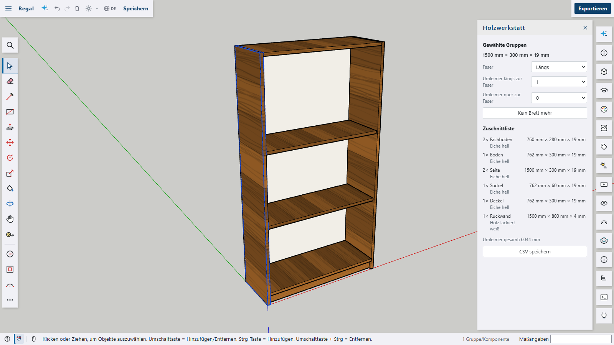
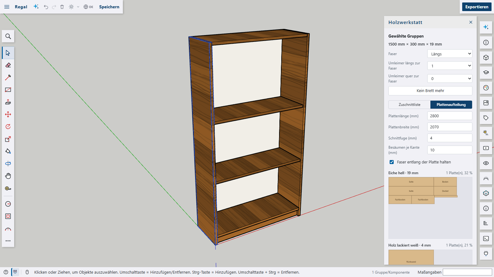

# Woodshop for Shap3D.ai

Woodworking: mark groups and components as boards – which way the grain runs and which edges get edge banding – and get the cut list of the whole model. Equal boards are counted in one line, sizes are taken in each board's own axes (a turned board keeps its sizes), length is the side along the grain, and the edge banding is added up. The cut list goes out as CSV for spreadsheets and cutting services, and nesting lays the boards of each material and thickness out on sheets.





## Use

1. Build the boards as groups or components (a box drawn and pushed, then _Make group_).
2. _Plugins › Woodshop…_: select one or more of them and click _Mark as board_. All copies of a component are boards then.
3. Set the grain (along the longest side or across it) and the banded edges along and across the grain (0–2 each).
4. The tab _Cut list_ lists every board in the model, also inside groups; hidden groups are left out. _Save CSV_ or _File › Export as cut list (CSV)_ writes it with sizes in mm.
5. The tab _Nesting_: sheet size, saw cut and edge trim in mm, and whether the grain stays along the sheet. The boards are laid out in strips across the sheet, so every cut goes straight through (as on a panel saw); each sheet is drawn with its pieces, and the panel says how many sheets each material needs and how much of them becomes boards. The settings are saved with the model.

The material of a line is the group's material, else the one most of its faces have.

## Scripts

```js
const side = s3d.box([0, 0, 0], 0.018, 0.4, 1.8).material('Eiche hell');
s3d.board(side, { grain: 'length', bandLong: 1, bandShort: 0 });
```

## Build

```sh
npm run build   # dist/: plugin.js, README and package.json – install via Plugins › Load plugin folder… › dist
npm test        # the checks of the cut list and the nesting
```

## Planned

Joints (mortise and tenon, dowels, finger joints, dovetails, pocket holes) as hole procedures (they need holes in the plugin API), nesting as SVG/DXF for CNC, shop drawings through LayOut, SVG and DXF.
